# KhetKundli · खेतकुंडली

**Every plot remembers. Every village sees together.**

KhetKundli gives every pomegranate plot in Phaltan taluka (Satara, Maharashtra) a living season record, its *kundli*, kept on the farmer's phone in Marathi. A taluka desk reads all the records together and shows what no single farmer can see: where bacterial blight is, where the wind will carry it in the next 72 hours, when each village will pick, how much groundwater stays in the ground, and whether a sale slip was fair.

Built by Team Outliers for the Phaltan Hackathon (agriculture track). The season runs on Phaltan's **recorded 2026 weather**, hour by hour, with a live forecast and a live wind field over the taluka; the 192 farmers and their plots are synthetic and labelled so on every screen.

**The project report** (problem and scale, gaps, approach, solution, technology, architecture, business model, feasibility, impact and the implementation plan) is in [docs/KhetKundli-Report.docx](docs/KhetKundli-Report.docx), with a [PDF copy](docs/KhetKundli-Report.pdf).

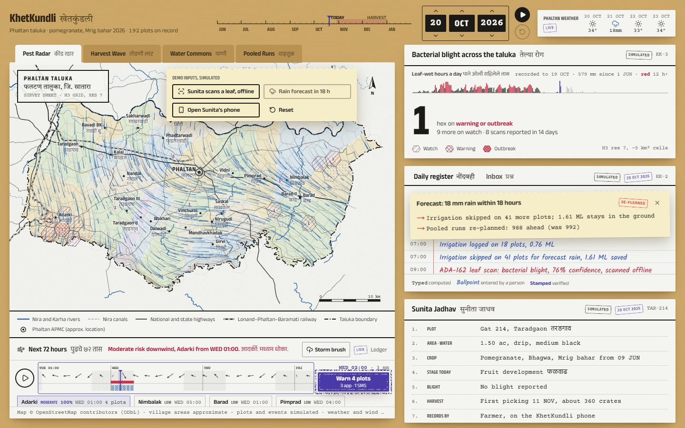

| Sunita's phone | A sale slip, checked on the phone | Asked in Marathi, answered from her record |
| :---: | :---: | :---: |
| 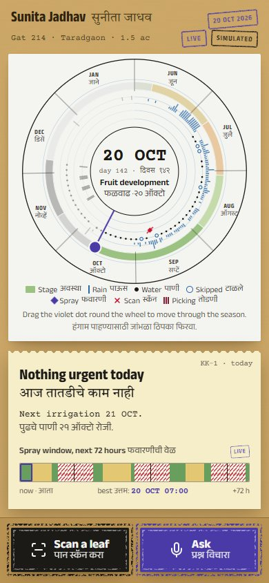 | 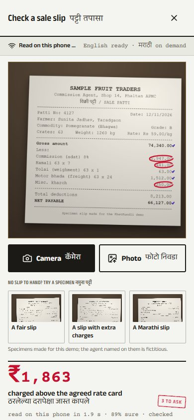 | 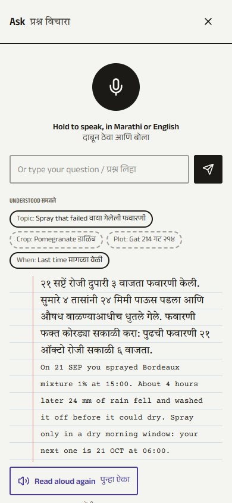 |

| Around her plot, cell by cell | A QR for each picking | What the buyer sees |
| :---: | :---: | :---: |
| 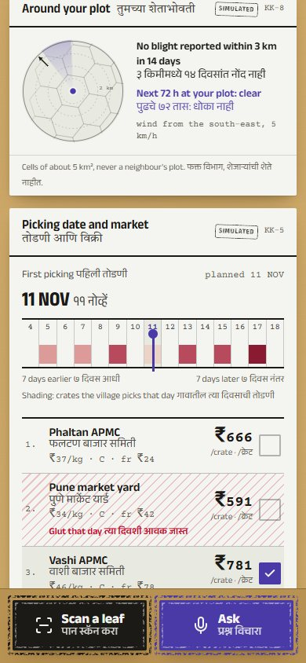 | 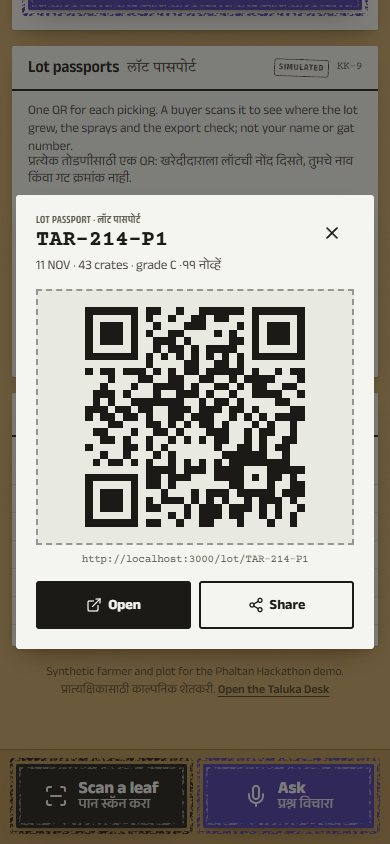 | 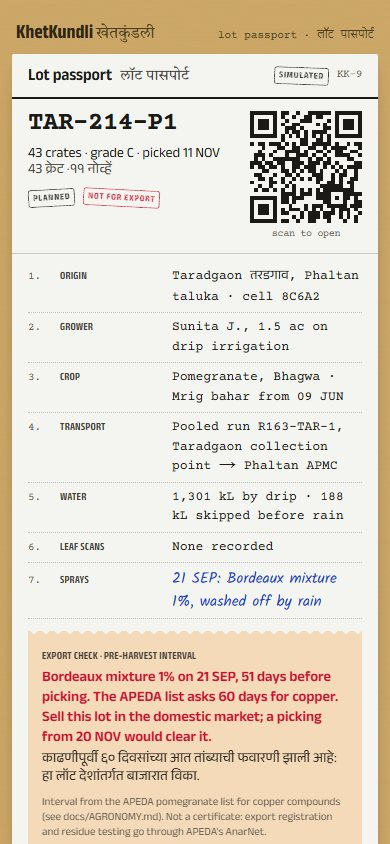 |

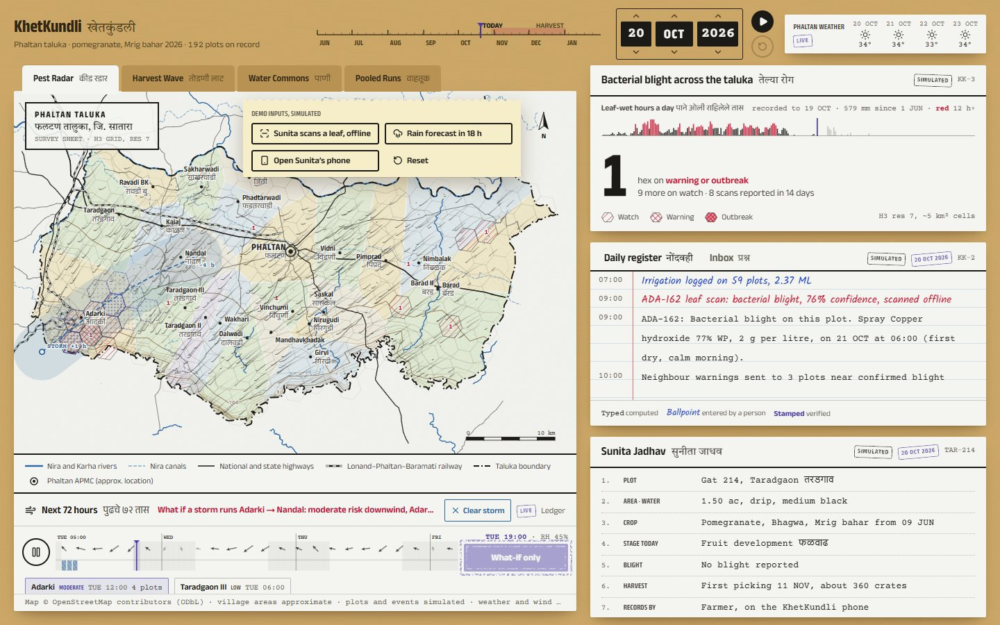

## What it does

| For | Feature | What is real |
| --- | --- | --- |
| Farmer | **Kundli wheel**: the whole season on one dial (stage, rain, water, sprays, scans, pickings); drag the dot to move through time | Rain ticks are Phaltan's recorded 2026 weather |
| Farmer | **Today slip**: the one thing to do today, and a 72-hour spray window from the hourly forecast | Live Open-Meteo forecast |
| Farmer | **Scan Lens**: photograph a leaf, get a diagnosis with no signal, see where the model looked | MobileNetV2 in the browser, ~80 ms; pomegranate result is scripted until trained |
| Farmer | **Ask**: Marathi or English voice question answered from her own record, read aloud; anything else goes to the officer | Web Speech API; answers built from the record, never invented |
| Farmer | **Sale slip check**: photograph the agent's patti; every number is read and checked against arithmetic and the agreed rate card | Tesseract OCR on the phone, ~1.2 s |
| Farmer | **Around your plot**: a radar of the cells within 4 km, with reported blight, the next 72 hours' exposure at her plot and the wind; never a neighbour's plot | Live forecast; reports simulated |
| Farmer | **Lot passports**: one QR per picking; the buyer's page shows origin cell, sprays, water, transport and an **export pre-harvest check** | Copper's 60-day interval from the APEDA list |
| Farmer | **Photo check** before a scan (sharp? lit?), live on the camera; **Listen** to the officer's reply aloud | On the phone |
| Farmer | **Works with no signal**: scans, questions and slips wait in the phone's outbox and go in order when signal returns; the header says *Synced*, *Sending* or *Offline · 2 to send* | IndexedDB outbox, hybrid logical clocks, an idempotent relay |
| Farmer | **Marathi slips**: labels and Devanagari digits read with the Marathi model; a misread is corrected only when the line proves itself ("63 x 5" must be 315), and totals are never guessed | Tesseract English + Marathi on the phone |
| Farmer | **Share my season**: the kundli wheel and the season so far as one image for WhatsApp | Drawn on the phone |
| Officer | **Pest Radar** with a **live wind field** and a **72-hour spread forecast**: where reported blight can travel, hour by hour, and who to warn | 9-point live wind grid; recorded weather for any past day |
| Officer | **Warn downwind**: one tap sends a preventive advisory to the plots in the plume, by app or SMS, and the season re-plans | Simulated outcome, shown as a ripple |
| Officer | **How sure is it**: the same forecast run on all 51 members of the ECMWF ensemble; chance of moderate exposure by cell, and the range of rain in the hour strip | Live Open-Meteo ensemble |
| Officer | **Storm brush**: draw a storm's path across the map and watch where it would carry blight, as a what-if | The model, with a moving rain cell and gust front |
| Officer | **Survey sheet in relief**: 25 m contour lines from real elevation; low-lying cells hold dew two hours longer in the forecast | Copernicus DEM via Open-Meteo |
| Everyone | **Forecast skill, measured**: a backtest over the recorded season scores the forecast against later reports, a distance-only baseline and an oracle | `npm run backtest`; results in [docs/MODELS.md](docs/MODELS.md) |
| Officer | **Harvest Wave**, **Water Commons**, **Pooled Runs**, daily register, inbox, plot records | Simulated network |
| Farmer, officer | **Reasoning agent, on this laptop**: a router trained here (Marathi and English), 12 tools over the plot record, weather and rules, Llama 3.1 8B planning and writing under a JSON schema, retrieval over our agronomy notes, and guards that block any dose, product, date or number not in the evidence; the officer drafts replies with it; an evening advisory pipeline batches warnings by village | Ollama on the laptop GPU; 14/14 routed, every answer guard-checked ([docs/AGENTS.md](docs/AGENTS.md)) |
| Everyone | **Season time machine**: one clock for every screen; replay the season on either device | Two devices stay in step over Wi-Fi |

## How it fits together

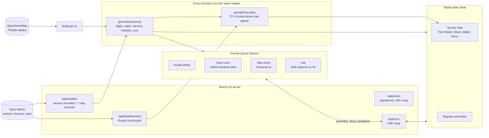

A scan, a demo rain, a picking date, an officer's advisory or a sale slip is an **override**. Every screen regenerates the season from the same seed, recorded weather and overrides, and `diffSeasons` writes what changed as a ripple:

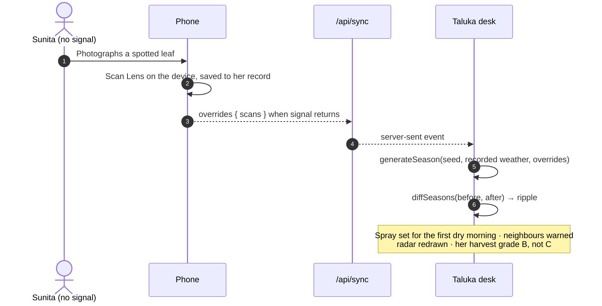

## Run it

```bash
cd web
npm install          # also fetches the leaf model, the OCR model, and the ONNX Runtime and Tesseract WebAssembly files
npm run dev          # http://localhost:3000 (pitch), /farmer and /desk
```

```bash
npm run smoke        # 21 end-to-end checks in Chrome (dev server running)
npm run test:slips   # reads the three specimen slips (English and Marathi) in Node and checks the parser
npm run backtest     # scores the spread forecast over the recorded season
npm run eval:agent   # the reasoning agent end to end on the local model (Ollama with llama3.1:8b and nomic-embed-text)
npm run report:figures && npm run report   # redraws the report's figures and rebuilds the Word report (Windows, needs Word for the contents and PDF)
```

For a real phone, run `npm run dev -- -H 0.0.0.0` and open `http://<laptop-ip>:3000/farmer` on the same Wi-Fi. For live mandi prices, copy `web/.env.example` to `web/.env.local` and add a data.gov.in key. The full demo script is in [docs/DEMO.md](docs/DEMO.md).

## Documentation

| Document | What it covers |
| --- | --- |
| [docs/PROBLEM.md](docs/PROBLEM.md) | Phaltan, pomegranate and the problems; the six problem statements and how one record answers them |
| [docs/ARCHITECTURE.md](docs/ARCHITECTURE.md) | System design, data model, the sync protocol, offline, performance and tests, with diagrams |
| [docs/MODELS.md](docs/MODELS.md) | The engine's models: blight, spread forecast, water, harvest, markets, runs, Scan Lens, slip check, voice |
| [docs/AGENTS.md](docs/AGENTS.md) | The reasoning backend: router training, tools, the local model, retrieval, guards, evaluation, API |
| [docs/DATA.md](docs/DATA.md) | Every data source, schemas, live versus recorded versus simulated, privacy |
| [docs/AGRONOMY.md](docs/AGRONOMY.md) | The spray table and its sources; why the antibiotic was removed; what still needs an agronomist |
| [docs/EXPERIENCE.md](docs/EXPERIENCE.md) | The "Living Record" design world, surfaces, motion, Marathi, accessibility |
| [docs/NEXT-STEPS.md](docs/NEXT-STEPS.md) | The plan for an excellent local prototype: what is real, simulated and missing; a local backend (database, jobs, delivery, agent log), models trained here, UI/UX, demo robustness; phases and the five things to do first |
| [docs/ROADMAP.md](docs/ROADMAP.md) | From the demo to a pilot to the taluka: features, technical designs, data, metrics, risks |
| [docs/DEMO.md](docs/DEMO.md) | The seven-minute demo, two-device setup and fallbacks |
| [docs/GLOSSARY.md](docs/GLOSSARY.md) | Bahar, telya, patti, adat, gat, H3 and the rest |
| [PRODUCT.md](PRODUCT.md), [DESIGN.md](DESIGN.md) | Product record and design system |
| [docs/KhetKundli-Report.docx](docs/KhetKundli-Report.docx) ([PDF](docs/KhetKundli-Report.pdf)) | The project report, 24 pages: the problem and its sourced scale, the gaps, the approach, the solution, technology and models, architecture, business model, feasibility, impact and the implementation plan, with 27 figures |

## Live, recorded, simulated

| Source | Status on screen |
| --- | --- |
| Phaltan weather, 1 June to yesterday (hourly, with leaf-wetness hours) | **Recorded**: Open-Meteo archive |
| Next 7 days of weather; 72-hour hourly forecast; 9-point wind grid | **Live**: Open-Meteo forecast |
| Taluka boundary, villages, roads, rivers, canals, rail | **Real**: OpenStreetMap |
| Elevation: contour lines on the survey sheet, low-lying cells | **Real**: Copernicus DEM via Open-Meteo |
| Tomato and capsicum leaf scans; sale slip reading | **Live** inference on the device |
| 192 farmers, plots, sprays, scans, pickings, sales; mandi prices without a key; the three specimen slips | **Simulated**, labelled synthetic |

## Roadmap at a glance

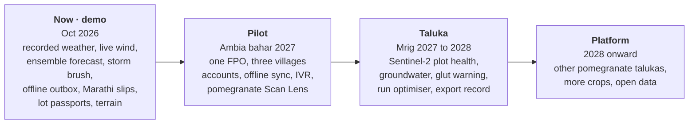

Details, technical designs and measures of success are in [docs/ROADMAP.md](docs/ROADMAP.md).

## Repository

```
web/                 Next.js 16 app (TypeScript, Tailwind v4, shadcn, Motion, React Bits, D3, h3-js)
  src/lib/sim/       season engine: weather, blight, water, harvest, markets, runs
  src/lib/spread.ts  72-hour spread forecast
  src/lib/patti.ts   sale slip parser and checks
  src/app/api/       weather, wind, prices, sync
  scripts/           geo build, smoke test, slip test, captures
ml/                  training pipeline for Scan Lens on field photos
data/raw/            OpenStreetMap extracts for Phaltan taluka (ODbL)
docs/                the documents above, and screenshots
```

Map data © OpenStreetMap contributors (ODbL). Weather data by Open-Meteo (CC BY 4.0). Sample leaf photos credited in `web/public/samples/samples.json`. OCR by Tesseract.js (Apache-2.0).
