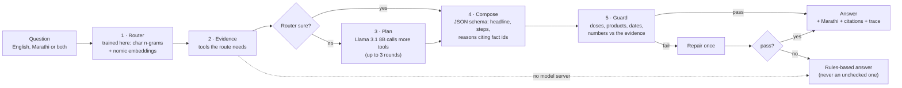

# Agents: the reasoning backend

KhetKundli's Ask, the officer's draft replies and the evening advisories run through one backend on this machine: a **router trained locally**, **tools** over the plot record, weather and the rules table, a **local language model** that plans and writes, **retrieval** over our own agronomy notes, and **deterministic guards** that every answer must pass. Nothing about a farmer leaves the laptop: the models run on its GPU through Ollama.



## The five stages

| Stage | What runs | Why |
| --- | --- | --- |
| **1 · Route** | `src/lib/agent/router.ts`: a character n-gram TF-IDF + logistic regression (runs anywhere) averaged with a logistic regression over local `nomic-embed-text` embeddings (when Ollama is up). Ten intents: spray failed, next spray, irrigation, harvest and market, blight risk, sale slip, transport, weather, export, other. Also detects Marathi, English or mixed | Fetch the right evidence before the model speaks; send out-of-scope questions to the officer |
| **2 · Evidence** | The route's tools run first (`PREFETCH` in `tools.ts`), from the same season engine the phone runs, on the recorded and forecast weather and the phone's overrides | The model reasons over exactly what the farmer sees |
| **3 · Plan** | Only when the router is unsure (under 75%): Llama 3.1 8B with native tool calling may request more tools, up to three rounds | Model time is spent on unclear questions, not routine ones |
| **4 · Compose** | Llama 3.1 8B under a JSON schema (Ollama structured outputs): a one-sentence headline, up to three steps with times, up to three reasons each citing fact ids, a confidence and an escalate flag | Answers that are formatted, short and checkable |
| **5 · Guard** | `guard.ts`, deterministic: no banned or unreviewed chemical (antibiotics, Streptocycline and others); every dose and product only from the spray table; every date and number found in the evidence. One repair round with the failures fed back; otherwise the rules-based answer | A model may phrase; it may not invent a dose, a date or an amount |

Marathi: where the intent has a reviewed Marathi template (spray failed, next spray, irrigation, harvest, blight), the farmer hears that; otherwise the model's translation is shown and marked *machine Marathi, to be checked*.

## Tools

| Tool | Returns |
| --- | --- |
| `plot_profile` | Gat, village, area, irrigation, soil, bahar date, stage today, expected harvest |
| `plot_record` | Record entries (sprays, scans, irrigation, advisories, pickings, sales) with ids and provenance |
| `weather` | Recorded days and the forecast: rain, chance, wind, temperature, wet-canopy hours, sprayable or not |
| `spray_window` | The spray already planned, and the first morning a spray will set |
| `spray_rule` | **The only source of products and doses**: the fixed table, its source and the 60-day export interval |
| `blight_status` | What the record shows, the Pest Radar level in the plot's cell, blight scans within 5 km in 14 days |
| `irrigation_plan` | The next irrigation or skip, litres, the crop coefficient and ET0 |
| `harvest_markets` | Expected pickings; prices at Phaltan, Pune and Vashi with freight and commission, and what the farmer keeps |
| `sale_slips` | Sales and checked slips, and the FPO's rate card |
| `transport` | Bookings on pooled runs, departure and fill |
| `export_check` | Copper sprays inside the 60-day pre-harvest interval and the first picking date that clears it |
| `search_knowledge` | Passages from our agronomy, model, problem, data and roadmap notes (retrieval below) |

Every tool returns short facts with ids (`wx-118`, `rule-preventive`, an event id), so the answer cites what it used and the guard can check it.

## What was trained or built on this machine

| Component | How | Result |
| --- | --- | --- |
| Router, character model | `ml/router/train.py`: 2,422 questions generated from 199 hand-written templates in English, Marathi and Marathi typed in Latin letters, with spelling noise; scikit-learn TF-IDF (`char_wb`, 2–4) + logistic regression; exported to JSON | 0.537 accuracy on questions from 35 templates never seen in training |
| Router, embedding model | Logistic regression on 768-d `nomic-embed-text` vectors computed by the local Ollama server | 0.651 on the same unseen templates |
| Router, ensemble (shipped) | Average of the two | **0.708** on unseen templates (`docs/data/router-eval.json`) |
| TypeScript port | `router.ts` re-implements scikit-learn's `char_wb` analyser and TF-IDF exactly | `npm run test:router`: max probability difference 1.2 × 10⁻⁵ on 25 fixtures |
| Knowledge base | `scripts/build-kb.mts`: 6 documents cut by heading into 70 passages, embedded with `nomic-embed-text`; search blends cosine similarity (0.75) with a keyword score (0.25) | `src/data/kb-index.json` |

The held-out split is by template, so the test phrasings are new to the model; it measures new phrasings of the same intents, not real farmers. During the pilot the router is retrained on real questions from the Ask log, relabelled by the officer.

**The language model is not fine-tuned.** Llama 3.1 8B (Q4_K_M, 4.9 GB) runs as released, on the laptop's RTX 4060 through Ollama. Its behaviour comes from the tools, the schema and the guards, which is the safer place to put it: a fine-tuned model can still invent a dose; a guarded one cannot get one past the checks. A LoRA fine-tune on real, officer-reviewed answers is on the roadmap for after the pilot has produced them.

## Evaluation

`npm run eval:agent` asks 14 questions (English, Marathi, Marathi in Latin letters, one out of scope, one asking for a banned antibiotic) about Sunita's plot on 19 October and records routing, guard results, content checks and latency (`docs/data/agent-eval.json`).

| 14 questions, Llama 3.1 8B on an RTX 4060 laptop GPU | Result |
| --- | --- |
| Routed to the right intent | **14 / 14** (English, Marathi, Marathi in Latin letters) |
| Answered by the model, guard passed | **12 / 14** |
| Answered by the rules fallback after the guard | 2 / 14: the weather question (the model added a chemical name; the guard removed the answer and the facts were given instead) and the request for Streptocycline (the banned antibiotic never reached the farmer) |
| Every delivered answer passed the guard | **14 / 14** |
| Content checks (the washed-off spray of 21 SEP, the next spray date, markets, the 60-day interval, the 6% card) | **6 / 6** |
| Out-of-scope question (a crop loan) sent to the officer | Yes |
| Latency, median / 90th percentile | **4.6 s / 9.3 s** (the first question after the model loads takes up to 21 s) |

Fourteen questions are a smoke test of the pipeline, not a measure of field quality; the pilot will score real questions the same way.

## API

| Route | Does |
| --- | --- |
| `POST /api/agent/ask` | `{ question, plot?, day, overrides?, audience? }` → server-sent events: one `step` per stage, then the `answer` (headline, steps, reasons with citations, Marathi, guard checks, trace, timings). `audience: "officer"` drafts a reply for the officer to edit |
| `POST /api/agent/advisories` | `{ day, overrides? }` → the evening advisory pipeline: plots in cells on warning, not already sprayed or sick; per plot the evidence, a 160-character SMS in English and Marathi from reviewed templates, the guard result, and app or SMS by phone type; grouped by village |
| `GET /api/agent/health` | Model server up or down, the model and embedding model, router accuracy, knowledge base size |

## Running it

```bash
ollama pull llama3.1:8b && ollama pull nomic-embed-text   # once
cd web
npm run train:router     # retrain the router (Python, scikit-learn, Ollama for embeddings)
npm run build:kb         # re-embed the knowledge base after editing docs
npm run test:router      # TypeScript router matches scikit-learn
npm run eval:agent       # end-to-end evaluation (dev server running)
```

`OLLAMA_URL`, `AGENT_MODEL` and `EMBED_MODEL` override the defaults (`http://localhost:11434`, `llama3.1:8b`, `nomic-embed-text`). With no model server the phone still answers from its own record, and the server falls back to the rules-based builder.

## Limits

- The router's training questions are generated, not collected; 0.71 on unseen templates is a floor to beat with real questions, not a field accuracy.
- Answers take 5 to 15 seconds on the laptop GPU (longer on the first question while the model loads). The phone shows the rules-based answer at once and the reasoned one when it arrives.
- The guard checks that every number and date appears in the evidence; it cannot tell whether the model drew the right conclusion from correct numbers. The officer's inbox and the escalate flag cover what the guard cannot.
- Prices are simulated until a data.gov.in key is set; the agent says so because its facts say so.
