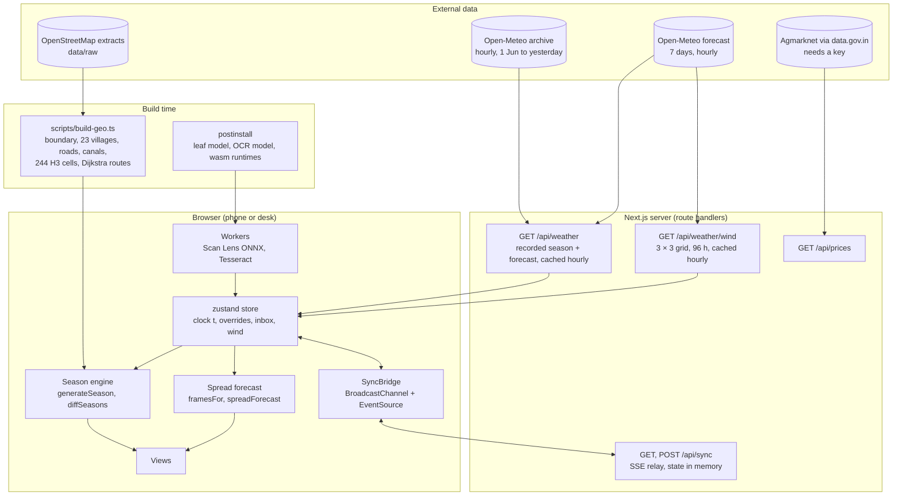
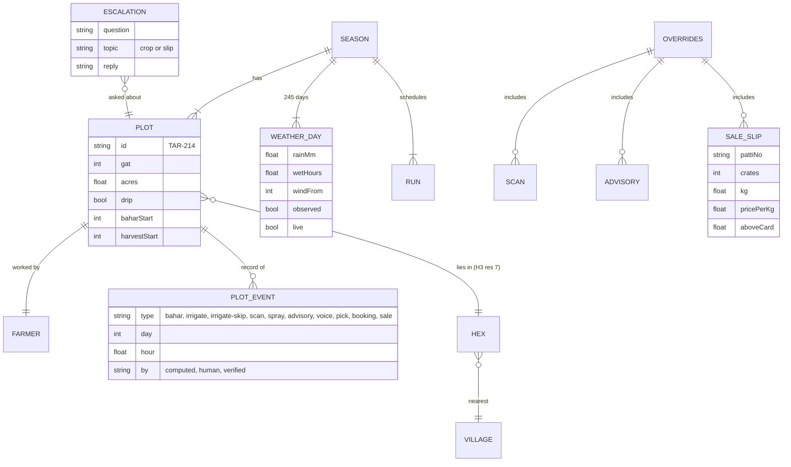
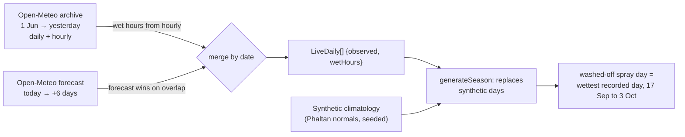
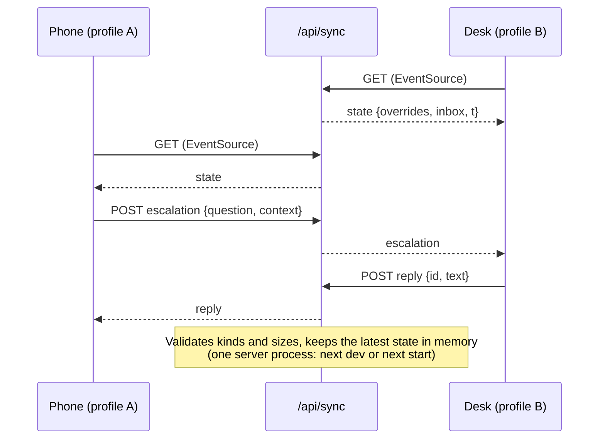

# Architecture

Status: 20 October 2026, third push. One Next.js 16 app; the season engine runs in every browser; a small server provides weather, wind, prices and a sync relay.

## System



## Principles in the code

- **One clock.** `t` is a float of season days (day 0 = 1 June 2026; the fraction is the hour). The date stamp, season track, kundli wheel, map, registers and forecast all read it. On load it rolls to the real date in IST.
- **Overrides, not mutations.** Anything that changes the season (a scan, demo rain, a picking date and market, an officer's advisory, a sale slip) is an entry in `Overrides`. The season is regenerated from `(seed, recorded weather, overrides)` and `diffSeasons(before, after, day)` writes the ripple. Same inputs, same season, on every device.
- **Causal isolation.** Randomness is drawn per `(plot, day, salt)` with a hash, not from a shared stream, so an injected event changes only what it causes. `scripts/simtest.ts` asserts that a scan far from the hero leaves other plots unchanged.
- **Provenance is visible.** Every event carries `by`: `computed` (typed), `human` (ballpoint) or `verified` (stamp), and the views draw it in that ink.
- **Doses from rules only.** `src/lib/sim/rules.ts` is the single spray table.

## Module map

| Area | Files | Notes |
| --- | --- | --- |
| Engine | `src/lib/sim/season.ts`, `rules.ts`, `weather.ts`, `calendar.ts`, `selectors.ts`, `rng.ts`, `types.ts` | ~150 ms for a 245-day season of 192 plots |
| Spread forecast | `src/lib/spread.ts` | 72 hourly frames, kernel per source cell per hour; ~5 ms |
| Geography | `src/lib/geo.ts`, `src/data/phaltan.json`, `components/desk/map-geometry.ts` | Mercator fit, Voronoi village areas, label placement |
| Store and sync | `src/lib/store.ts`, `sync.tsx`, `channel.ts`, `app/api/sync/route.ts` | |
| Phone | `components/farmer/*` | wheel, today slip, scan lens, ask, harvest date, passbook, slip check |
| Desk | `components/desk/*` | survey map, wind field, forecast panel, figure sheet, register, inbox, plot extract, ledger |
| Pitch | `components/pitch/*` | scroll-driven season story on the live engine |
| On-device ML | `public/workers/scan-lens.js`, `src/lib/scan.ts`, `src/lib/ocr.ts`, `src/lib/patti.ts` | |
| Voice | `src/lib/voice.ts`, `components/farmer/ask-sheet.tsx` | |

## Data model



The season is a pure function. Derived arrays are precomputed for the views: `eventsByDay`, `eventsByPlot`, `hexRisk[day][hex]`, `hexDetections`, `infected[day][plot]`, `harvestByWeek`, `prices[market][day]`, `runsByDay`, `waterSavedByDay`.

## Weather: recorded, forecast, simulated



If the archive fails, the forecast still loads; if both fail, the season is fully synthetic and every stamp says so. The hero's washed-off spray moves to the wettest recorded day in its window (21 September 2026, 24 mm), so the story agrees with the real weather.

## Sync protocol

Two transports carry one message stream: `BroadcastChannel("khetkundli")` between windows on one device, and `/api/sync` (POST in, server-sent events out) between devices on a network.

| Message | Sent when | Effect |
| --- | --- | --- |
| `hello` / `state` | A window opens | Peers (or the relay) answer with overrides, inbox and clock |
| `overrides` | Any local override | Receivers regenerate the season and show the ripple with the sender's label |
| `time` | The clock moves (throttled to 250 ms on the network) | Receivers follow the clock |
| `escalation` | A question the record cannot answer, or a slip dispute | Lands in the desk inbox |
| `reply` | The officer answers | Lands in the farmer's Ask sheet |
| `reset` | Reset on the desk | Clears overrides and inbox everywhere, including the relay |



Messages carry a `from` id so a window ignores its own echo. The relay is a demo transport: no authentication, state in one server process. The roadmap replaces it with accounts, an event store and a hosted realtime channel.

## Offline

The service worker (production builds) precaches the phone page, the leaf model, ONNX Runtime, the OCR worker and English model, and the sample images; it caches the OCR core on first use (the worker picks one of three builds by SIMD support). Static assets are cache-first; pages are network-first with cache fallback. Scan Lens and the slip check need no network once cached.

## Performance (measured on a laptop, Chrome)

| Operation | Time |
| --- | --- |
| `generateSeason` (192 plots, 245 days, recorded weather) | ~150 ms |
| `spreadForecast` (72 frames, up to 48 source cells) | ~5 ms |
| Scan Lens, MobileNetV2 fp32, one leaf | ~60–90 ms (plus a 7 × 7 occlusion map in batches) |
| Slip OCR, one 900 × 800 photo, English LSTM | ~1.2 s |
| Wind field | 460 particles at display refresh rate, canvas |

## Tests

| Command | What it proves |
| --- | --- |
| `npm run smoke` | 14 checks in real Chrome: two on-device scans, a voice answer citing the recorded washed-off spray, the Marathi answer, phone-to-desk ripple, recorded season loaded, live 9-point wind grid, demo rain entering the 72-hour forecast, escalation and reply across browser profiles, slip OCR finding ₹1,863, slip ripple and dispute in the inbox |
| `npm run test:slips` | Both specimen slips read in Node; gross, net, charge count and the amount above the card |
| `npx tsx --tsconfig tsconfig.json scripts/simtest.ts` | Engine statistics and causal isolation |
| `npx tsc --noEmit`, `npx eslint src`, `npm run build` | Types, lint, production build |

## Running

```bash
cd web
npm install
npm run dev                      # http://localhost:3000, /farmer, /desk
npm run dev -- -H 0.0.0.0        # for a phone on the same Wi-Fi (allowedDevOrigins covers private ranges)
npm run build && npm start       # production, with the service worker
node scripts/capture-docs.mjs    # regenerate docs/images
```

## Open items

- **Spray table.** `rules.ts` lists copper oxychloride with Streptocycline (streptomycin + tetracycline) for curative sprays. India notified a ban on streptomycin and tetracycline for crop use; confirm the current position with ICAR-NRCP Solapur and the CIB&RC lists, and replace the antibiotic in the table before any field use or public demo.
- 22 Marathi village names are best-effort transliterations (`mrVerified: false`).
- The leaf model's licence on Hugging Face is listed as "other"; confirm before distributing beyond the demo.
- Recorded weather is a reanalysis grid (several kilometres), not a station in the orchard; the wind grid has nine points over the taluka.
