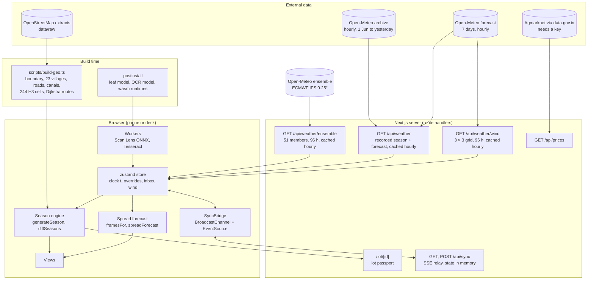
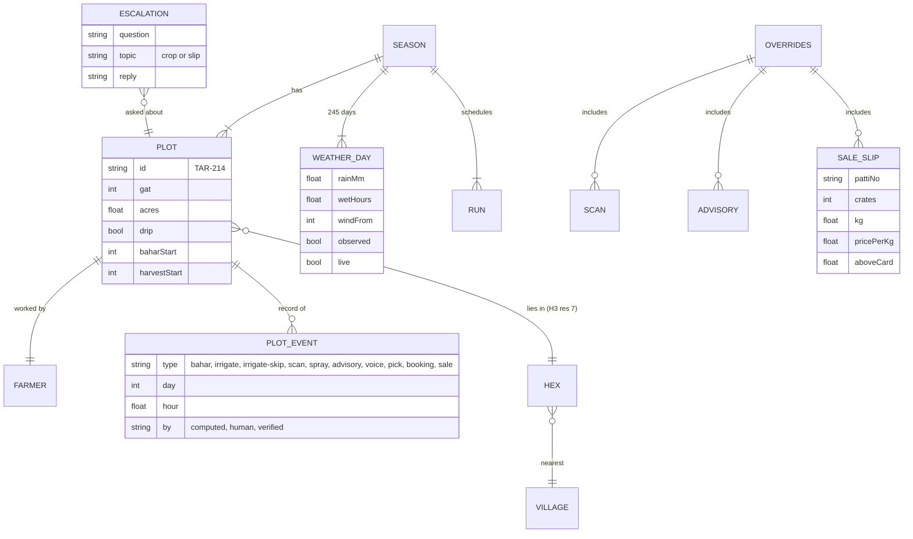
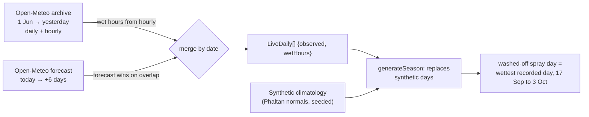
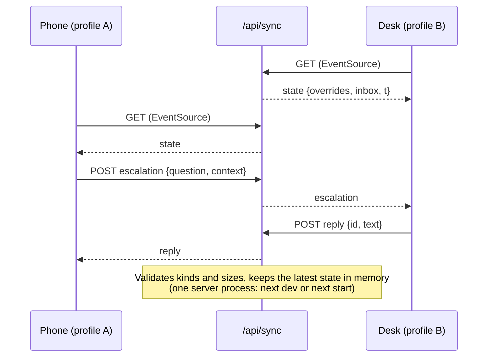
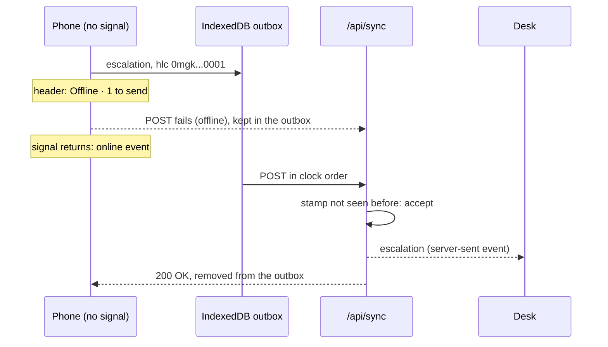

# Architecture

Status: 20 October 2026, third push. One Next.js 16 app; the season engine runs in every browser; a small server provides weather, wind, prices and a sync relay.

## System



## The local backend

The prototype runs on one laptop, so its backend is local and restart-proof rather than hosted:

| Piece | What it does | Code |
| --- | --- | --- |
| **SQLite database** | One file, `web/data/khetkundli.db`, through Node's built-in `node:sqlite`. Tables: `events` (every durable synced message, keyed by its clock stamp, so a retry is recognised), `kv` (the relay's current overrides and inbox), `messages` (advisories with sent, delivered and read times), `agent_log` (every answer with its route, engine, guard result and timing), `snapshots` (the last good weather, wind and ensemble answers) | `src/lib/server/db.ts` |
| **Relay** | Accepts messages from devices, writes them to the database, fans them out over server-sent events; on start it reloads its state from the database | `src/lib/server/relay.ts`, `app/api/sync` |
| **Messages** | `POST /api/messages` sends an approved batch; the demo phone sends its own receipts; a gateway simulator marks the others after a few seconds and says so | `app/api/messages` |
| **Offline mode** | `KHETKUNDLI_OFFLINE=1` serves the saved weather, wind and ensemble; any network failure falls back to them too | `src/lib/server/snapshot.ts` |
| **Start-up** | `instrumentation.ts` warms the local models; `npm run demo` checks everything, starts the app on the Wi-Fi (optionally HTTPS with a self-signed certificate) and prints a QR code; `/status` shows it all | `src/instrumentation.ts`, `scripts/demo.mjs`, `scripts/cert.mjs`, `app/status` |

## The agent backend

`/api/agent/ask`, `/api/agent/advisories` and `/api/agent/health` run the reasoning pipeline on the server: the season engine regenerated from the phone's overrides and the recorded weather, a router trained in `ml/router/`, tools over the record, Llama 3.1 8B and `nomic-embed-text` through a local Ollama server, and deterministic guards. Design, training and evaluation are in [AGENTS.md](AGENTS.md).

## Principles in the code

- **One clock.** `t` is a float of season days (day 0 = 1 June 2026; the fraction is the hour). The date stamp, season track, kundli wheel, map, registers and forecast all read it. On load it rolls to the real date in IST.
- **Overrides, not mutations.** Anything that changes the season (a scan, demo rain, a picking date and market, an officer's advisory, a sale slip) is an entry in `Overrides`. The season is regenerated from `(seed, recorded weather, overrides)` and `diffSeasons(before, after, day)` writes the ripple. Same inputs, same season, on every device.
- **Causal isolation.** Randomness is drawn per `(plot, day, salt)` with a hash, not from a shared stream, so an injected event changes only what it causes. `scripts/simtest.ts` asserts that a scan far from the hero leaves other plots unchanged.
- **Provenance is visible.** Every event carries `by`: `computed` (typed), `human` (ballpoint) or `verified` (stamp), and the views draw it in that ink.
- **Doses from rules only.** `src/lib/sim/rules.ts` is the single spray table.

## Module map

| Area | Files | Notes |
| --- | --- | --- |
| Engine | `src/lib/sim/season.ts`, `rules.ts`, `weather.ts`, `calendar.ts`, `selectors.ts`, `rng.ts`, `types.ts` | ~150 ms for a 245-day season of 192 plots |
| Spread forecast | `src/lib/spread.ts`, `components/desk/forecast.tsx` | 72 hourly frames, kernel per source cell per hour (~5 ms); storm brush; ensemble of 51 runs in batches |
| Lot passport | `src/lib/lot.ts`, `app/lot/[id]/page.tsx`, `components/lot/*`, `components/record/qr.tsx` | Buyer's page per picking, export pre-harvest check, QR drawn on the device |
| Geography | `src/lib/geo.ts`, `src/data/phaltan.json`, `components/desk/map-geometry.ts` | Mercator fit, Voronoi village areas, label placement |
| Store and sync | `src/lib/store.ts`, `sync.tsx`, `channel.ts`, `outbox.ts`, `app/api/sync/route.ts` | Hybrid logical clocks, IndexedDB outbox, idempotent relay, last-writer-wins |
| Terrain | `src/data/terrain.json`, `scripts/build-terrain.ts`, `components/desk/map-geometry.ts` | Copernicus DEM via Open-Meteo; d3-contour lines; low-lying cells |
| Share card | `src/lib/share-card.ts`, `components/farmer/share-card.tsx` | Wheel SVG with computed styles, drawn to a canvas |
| Phone | `components/farmer/*` | wheel, today slip, neighbour pulse, scan lens with photo check, ask (replies read aloud), harvest date, lot passports, passbook, slip check |
| Desk | `components/desk/*` | survey map, wind field, forecast panel, figure sheet, register, inbox, plot extract, ledger |
| Pitch | `components/pitch/*` | scroll-driven season story on the live engine |
| On-device ML | `public/workers/scan-lens.js`, `src/lib/scan.ts`, `src/lib/ocr.ts`, `src/lib/patti.ts` | |
| Voice | `src/lib/voice.ts`, `components/farmer/ask-sheet.tsx` | |

## Data model



The season is a pure function. Derived arrays are precomputed for the views: `eventsByDay`, `eventsByPlot`, `hexRisk[day][hex]`, `hexDetections`, `infected[day][plot]`, `harvestByWeek`, `prices[market][day]`, `runsByDay`, `waterSavedByDay`.

## Weather: recorded, forecast, simulated



If the archive fails, the forecast still loads; if both fail, the season is fully synthetic and every stamp says so. The hero's washed-off spray moves to the wettest recorded day in its window (21 September 2026, 24 mm), so the story agrees with the real weather.

## Sync protocol

Two transports carry one message stream: `BroadcastChannel("khetkundli")` between windows on one device, and `/api/sync` (POST in, server-sent events out) between devices on a network.

| Message | Sent when | Effect |
| --- | --- | --- |
| `hello` / `state` | A window opens | Peers (or the relay) answer with overrides, inbox and clock |
| `overrides` | Any local override | Receivers regenerate the season and show the ripple with the sender's label |
| `time` | The clock moves (throttled to 250 ms on the network) | Receivers follow the clock |
| `escalation` | A question the record cannot answer, or a slip dispute | Lands in the desk inbox |
| `reply` | The officer answers | Lands in the farmer's Ask sheet |
| `reset` | Reset on the desk | Clears overrides, inbox and messages everywhere, including the relay and its database |
| `message` | The officer approves an advisory batch (or warns downwind) | The server sends it to every screen; the farmer's phone shows a banner and adds it to Messages |
| `receipt` | A phone receives or opens a message; or the gateway simulator, for farmers with no phone in the room (`simulated: true`) | The desk's advisory console shows *delivered* and *read* |



Messages carry a `from` id so a window ignores its own echo.

**Offline first.** Durable messages (overrides, escalation, reply, reset) are stamped with a **hybrid logical clock**: wall-clock milliseconds, a counter, and the window's id, encoded so that string order is causal order. On the phone they go into an **IndexedDB outbox** and are sent in clock order when the relay can be reached; a network error stops the run (retried on the `online` event and every 8 s), a rejected message is dropped so it cannot block the queue, and a newer overrides message replaces any older one still queued. The relay is **idempotent** (a stamp it has seen is acknowledged and not delivered twice) and applies the season's overrides **last-writer-wins** by clock, so a phone that comes back online with older changes cannot overwrite newer ones; every screen applies the same rule to what it receives.



The relay is still a demo transport: no authentication, state in one server process. The roadmap replaces it with accounts, an event store and a hosted realtime channel.

## Offline

The service worker (production builds) precaches the phone page, the leaf model, ONNX Runtime, the OCR worker and English model, and the sample images; it caches the OCR core on first use (the worker picks one of three builds by SIMD support). Static assets are cache-first; pages are network-first with cache fallback. Scan Lens and the slip check need no network once cached.

## Performance (measured on a laptop, Chrome)

| Operation | Time |
| --- | --- |
| `generateSeason` (192 plots, 245 days, recorded weather) | ~150 ms |
| `spreadForecast` (72 frames, up to 48 source cells) | ~5 ms |
| Ensemble: 51 member runs, six per tick | ~250 ms in the background |
| Scan Lens, MobileNetV2 fp32, one leaf | ~60–90 ms (plus a 7 × 7 occlusion map in batches) |
| Slip OCR, English LSTM, one 1800 px photo | ~1.6–1.9 s |
| Slip OCR, Marathi + English, after an English pass | ~3.2–3.6 s in all |
| Forecast backtest, 76 days × 2 forecasts | ~5 s |
| Wind field | 460 particles at display refresh rate, canvas |

## Tests

| Command | What it proves |
| --- | --- |
| `npm run backtest` | Spread-forecast skill over the recorded season: ROC AUC, precision and recall of the warn cells, against distance-only and oracle baselines |
| `npm run smoke` | 22 checks in real Chrome, including the pomegranate model finding blight on a held-out photo, the share card, the Marathi slip and an offline question held in the outbox and delivered on reconnect: two on-device scans, a voice answer citing the recorded washed-off spray, the Marathi answer, phone-to-desk ripple, recorded season loaded, live 9-point wind grid, demo rain entering the 72-hour forecast, the 51-member ensemble, a storm drawn with the brush, a lot passport with its export check and QR, the neighbour pulse, escalation and reply across browser profiles, slip OCR finding ₹1,863, slip ripple and dispute in the inbox |
| `npm run test:slips` | The three specimen slips (two English, one Marathi) read in Node; gross, net, charge count and the amount above the card |
| `npx tsx --tsconfig tsconfig.json scripts/simtest.ts` | Engine statistics and causal isolation |
| `npx tsc --noEmit`, `npx eslint src`, `npm run build` | Types, lint, production build |

## Running

```bash
cd web
npm install
npm run dev                      # http://localhost:3000, /farmer, /desk
npm run dev -- -H 0.0.0.0        # for a phone on the same Wi-Fi (allowedDevOrigins covers private ranges)
npm run build && npm start       # production, with the service worker
node scripts/capture-docs.mjs    # regenerate docs/images
npm run report:figures && npm run report   # redraw docs/report/figures and rebuild docs/KhetKundli-Report.docx and .pdf (Word on Windows)
```

## Open items

- **Spray table.** Streptocycline has been removed; curative sprays are copper hydroxide 77% WP at 2 g per litre and preventive sprays 1% Bordeaux, from ICAR-NRCP advisories (sources and open questions in [AGRONOMY.md](AGRONOMY.md)). An agronomist still has to review the table, the final gazette status of the antibiotic ban has to be confirmed, and pre-harvest intervals are not yet checked.
- 22 Marathi village names are best-effort transliterations (`mrVerified: false`).
- The leaf model's licence on Hugging Face is listed as "other"; confirm before distributing beyond the demo.
- Recorded weather is a reanalysis grid (several kilometres), not a station in the orchard; the wind grid has nine points over the taluka.
