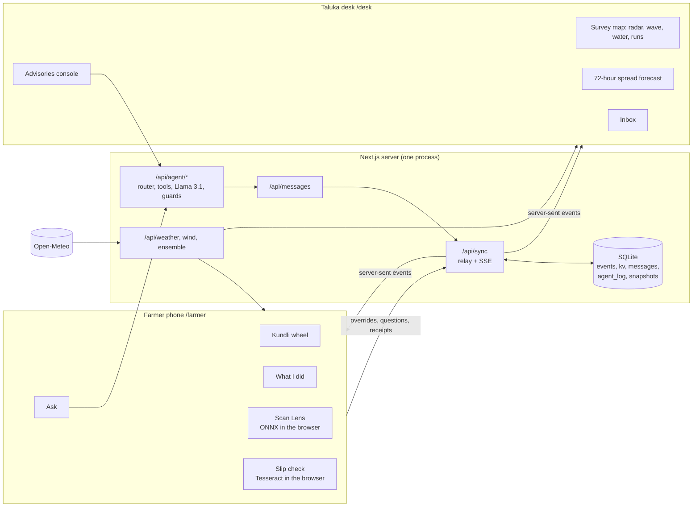

# Context: KhetKundli from zero

This is the handover document. Anyone (a new teammate, a reviewer, or an AI agent) who reads only this page should know what KhetKundli is, why it is shaped the way it is, what is real, what is not, what was decided and why, and where to go next. It links to the detailed documents rather than repeating them.

Status: 3 November 2026, on `main`; Phase 1 of [PRODUCT-PLAN.md](PRODUCT-PLAN.md) has started (the season record as events) at [github.com/vizsh/KhetKundli](https://github.com/vizsh/KhetKundli).

---

## 1. In one paragraph

KhetKundli gives every pomegranate plot in **Phaltan taluka (Satara district, Maharashtra)** a living season record, its *kundli*, kept on the farmer's phone in Marathi. Every feature writes to that record and reads from it. A **taluka desk** for the extension officer or FPO coordinator reads all the records together and shows what no single farmer can see: where bacterial blight is and where wind and rain will carry it in 72 hours, which village picks which week, how much groundwater is kept, and whether a commission agent's sale slip matched the agreed rate card. It was built by **Team Outliers** for the **Phaltan Hackathon (agriculture track)**, and as of 3 November 2026 the aim is to take it from a prototype to **an actual product with a real demonstration** (see [PRODUCT-PLAN.md](PRODUCT-PLAN.md)).

## 2. The words you need

| Word | Meaning here |
| --- | --- |
| **Kundli** | A birth chart. Here: the plot's season record, which keeps updating |
| **Bahar** | The forced flowering of pomegranate by withholding water. *Mrig* bahar (June–July) is the season the app follows; *Ambia* (Jan–Feb) and *Hasta* (Sep–Oct) are the others |
| **Telya** | Bacterial blight of pomegranate, *Xanthomonas axonopodis* pv. *punicae*. The most feared disease; spreads by wind-driven rain splash |
| **Gat** | A land survey number. Sunita's plot is gat 214 |
| **Patti** | The commission agent's sale slip: gross, commission (*adat*), loading (*hamali*), weighment, freight, net |
| **Adatiya** | Commission agent at the market (APMC) |
| **FPO** | Farmer Producer Organisation, the natural owner of the desk and the data steward |
| **KVK** | Krishi Vigyan Kendra, the district agricultural extension centre |
| **H3 cell** | A hexagon of Uber's H3 grid; resolution 7 is about 5 km². Shared maps never go finer than this |
| **Override** | Any change to the season (a scan, a logged spray, an advisory, a slip). The season is recomputed from seed + weather + overrides |
| **Ripple** | The list of consequences one override caused, shown on every screen |
| **Ink** | Provenance: *typed* = computed, *ballpoint* = entered by a person, *stamp* = verified |

More in [GLOSSARY.md](GLOSSARY.md).

## 3. Why it exists (the problem)

Six problems that are really one, because **each plot's information is trapped in that plot**: blight spreads unseen between orchards; sprays are washed off by rain the farmer did not see coming; groundwater is shared but used alone; a whole village picks the same week and gluts the market; small lots travel in half-empty vehicles; nobody checks the patti. The decisions that matter (warn, spray, irrigate, pick, pool, check) depend on many plots and the weather together.

The hackathon brief combined six problem statements, and the product answers all of them with one record:

| Source | Statement | Answered by |
| --- | --- | --- |
| Govt. of Punjab | Smart crop advisory | Today slip and spray window from the plot's record and the live forecast |
| Govt. of Kerala | AI personal farming assistant | The kundli wheel and Ask |
| Govt. of Kerala | Gamified sustainable practices | Water Commons (a shared village goal, not a leaderboard) |
| Govt. of Kerala | Farmer query support | Marathi voice questions, escalated to the officer |
| Qualcomm, ID 26257 | On-device detection | Scan Lens, offline in the browser |
| Team Outliers | "Uber for Harvest" | Harvest Wave, pooled runs, slip check |

Detail: [PROBLEM.md](PROBLEM.md). The 24-page report: [KhetKundli-Report.pdf](KhetKundli-Report.pdf).

## 4. The people

- **Sunita Jadhav** is the demo persona: gat 214, Taradgaon, 1.5 acres on drip, Mrig bahar. She is synthetic, as are the other 191 farmers. Every screen says so.
- **The farmer**: often low-literacy, Marathi-speaking, a shared or low-end Android phone, patchy signal in the orchard. Voice and offline come first.
- **The extension officer / FPO coordinator**: works at a laptop, watches the taluka, sends advisories, answers questions.
- **The judges** (for the hackathon): must see one integrated product, not six apps, and believe it is real.
- Secondary: owner-drivers, collection-point agents, adatiyas, buyers (who see the lot passport).

## 5. Decisions that shape everything, and why

| Decision | Why | Do not undo without asking |
| --- | --- | --- |
| **Phaltan and pomegranate**, not Nashik or grapes | The hackathon is local; pomegranate is Phaltan's high-value orchard crop and blight is its defining risk | Yes |
| **No named lenders, no SANKALP framing, no carbon credits** | The user dropped Satin Finserv and the SANKALP Climate Edition framing as a mistake | Yes |
| **One Next.js app**, no separate Python service at runtime | A reliable live demo; Python is used only offline to train models | Revisit in Phase 1 of the product plan if a worker is needed |
| **The season is a pure function** of seed, recorded weather and overrides | Same inputs give the same season on every device; this is what makes the time machine, the ripple and the agent's evidence possible | Keep the property even when the store moves to the server |
| **Doses only from the fixed spray table** (`web/src/lib/sim/rules.ts`) | A model may phrase advice, never invent a product, dose or date. The guard enforces it | Yes |
| **Streptocycline removed**; copper hydroxide 77% WP (curative) and Bordeaux 1% (preventive) | India's draft order to ban the antibiotic in agriculture (S.O. 5295(E), 17 Dec 2021); final gazette not found | Needs an agronomist's review ([AGRONOMY.md](AGRONOMY.md)) |
| **Everything labelled LIVE, RECORDED or SIMULATED** | "Prove, don't claim" | Yes |
| **Shared maps aggregate to H3 cells**; photos and slips are read on the phone | Privacy; the farmer's data stays hers | Yes |
| **Marathi is first-class**, not a translation layer | The farmer reads and speaks Marathi | Yes |
| **The LLM is not fine-tuned**; Llama 3.1 8B runs as released behind tools, a schema and guards | Safer: a guarded model cannot get an invented dose past the checks | Say so plainly whenever asked |
| **The "Living Record" design**: manila board, ruled paper, typed / ballpoint / violet stamp | Makes provenance visible and the product feel like a Maharashtra plot record, not a generic dashboard | See [EXPERIENCE.md](EXPERIENCE.md), [../DESIGN.md](../DESIGN.md) |
| **Direction change, 3 Nov 2026**: from "local prototype only" to "an actual product with a real demonstration" | The user wants real impact shown with real farmers and real channels | [PRODUCT-PLAN.md](PRODUCT-PLAN.md) supersedes the local-only scope of [NEXT-STEPS.md](NEXT-STEPS.md) |

## 6. How it works, in one page



1. **Every browser runs the same season engine** (`web/src/lib/sim/season.ts`): 192 plots, 245 days from 1 June 2026, on the recorded Open-Meteo weather to yesterday and the live forecast after. About 150 ms.
2. **A change is an override.** The phone or desk adds it, regenerates the season, computes the ripple with `diffSeasons`, and posts the new overrides to the relay.
3. **The relay** (`web/src/lib/server/relay.ts`) stores the message in SQLite by its hybrid-logical-clock stamp (a retry is a no-op), keeps the latest overrides, and pushes it to every connected screen over server-sent events.
4. **The phone works offline**: messages wait in an IndexedDB outbox and go in clock order when signal returns.
5. **The agent** regenerates the same season on the server from the overrides it is sent, routes the question, gathers facts with tools, lets Llama 3.1 8B compose under a JSON schema, and passes the draft through deterministic guards.
6. **Advisories**: the desk asks the agent pipeline for a batch, the officer approves it, `/api/messages` stores and broadcasts it; Sunita's phone sends real receipts; for everyone else a gateway simulator marks receipts and says *sim*.

Detail: [ARCHITECTURE.md](ARCHITECTURE.md), [MODELS.md](MODELS.md), [AGENTS.md](AGENTS.md), [DATA.md](DATA.md). A file-by-file guide: [CODEBASE.md](CODEBASE.md).

## 7. What is real, recorded, simulated or missing

| Thing | Status |
| --- | --- |
| Phaltan weather 1 June → yesterday, hourly with leaf-wet hours | **Recorded** (Open-Meteo archive, a reanalysis grid, not an orchard station) |
| 7-day forecast, 72-hour hourly, 9-point wind grid, 51-member ensemble | **Live** (Open-Meteo) |
| Taluka boundary, 23 villages, roads, canals; terrain contours | **Real** (OpenStreetMap; Copernicus DEM) |
| Scan Lens inference; slip OCR; router; guarded LLM | **Real**, on the device or the laptop |
| Pomegranate model accuracy (99.7%) | **Real but optimistic**: a random split of one public fruit-photo dataset, none from Phaltan |
| Sunita's own logged sprays, waterings, pickings | **Real entries** since 3 Nov 2026 (the rest of her record is simulated) |
| 192 farmers, their plots, history, scans, sales, prices (without a key), three specimen slips | **Simulated**, labelled |
| Spread and blight model parameters | **Hand-calibrated**, not fitted to field data |
| Receipts from farmers with no phone in the room | **Simulated**, marked *sim* |
| Accounts, consent, multi-farmer phones, real SMS/WhatsApp, hosting, server-side truth | **Missing**; see [GAPS.md](GAPS.md) |

## 8. History

All work so far happened between 19 October and 3 November 2026.

| Commit | Date | What it added |
| --- | --- | --- |
| `663b6de` | 20 Oct | The taluka desk, the farmer phone, the season engine, on-device Scan Lens |
| `c6b9a2a` | 20 Oct | Pitch page, two-device relay, officer inbox, sale slip check |
| `fb201d8` | 20 Oct | The season on recorded weather; live wind; the 72-hour spread forecast; the docs |
| `8034bad` | 20 Oct | Streptocycline removed from the spray table; copper schedule cited |
| `136007b` | 20 Oct | Storm brush, ensemble uncertainty, lot passports, phone helpers |
| `70ee8a5` | 20 Oct | Offline outbox, Marathi slips, terrain, forecast backtest, the project report |
| `74ac692` | 20 Oct | The reasoning agent backend (router, tools, Llama 3.1 via Ollama, guards) |
| `e9fa3bd`, `8583d86` | 20 Oct | NEXT-STEPS, then rewritten for a local-only prototype |
| `6fda547` | 20 Oct | SQLite, advisories that arrive, `npm run demo`, offline mode, a pomegranate model trained locally |
| `cd40d62` | 3 Nov | The farmer logs her own work (*What I did*); smoke test at 24 checks (25 from Phase 1 slice 1) |
| `4ac8611` | 3 Nov | CONTEXT, CODEBASE, GAPS and the backend-first PRODUCT-PLAN |
| Phase 1, slice 1 | 3 Nov | Season events with a zod contract; the append-only, hash-chained Postgres record; per-event sync (no lost updates); the agent reads the server's record; property, tamper and crash tests; CI |
| Phase 1, slice 2 | 3 Nov | Accounts and sign-in, roles, authorisation on every route and event, Postgres inbox and messages, advisories by stored batch, backups and a restore drill; `docs/REMAINING.md`

## 9. Run it

```bash
cd web
npm install          # also fetches models and WebAssembly runtimes
npm run demo         # checks everything, starts the app for the laptop and Wi-Fi, prints a QR for the phone
```

`npm run demo -- --https` gives phones a secure origin (camera, microphone). `npm run demo -- --offline` uses saved forecasts. `/status` shows models, database, snapshot and connected screens. The agent needs Ollama with `llama3.1:8b` and `nomic-embed-text`; without it, answers fall back to the rules builder.

Checks: `npm test` (29 unit and property tests on embedded Postgres), `npm run test:crash` (kill -9 mid-write, exactly once), `npm run restore:drill` (the newest backup restores as the same record), `npx tsx scripts/api-check.mts` (16 HTTP checks with real sign-ins), `npm run check` (types, lint, tests, slips, router), `npm run smoke` (27 in Chrome)

## 10. Gotchas worth knowing before you touch anything

- **This Next.js is version 16.** Read `web/node_modules/next/dist/docs/` before writing Next code; `web/AGENTS.md` is regenerated by `next dev`.
- **Only one `next dev` per folder.** A second one refuses to start.
- **The database** is `web/data/khetkundli.db` (gitignored), through Node's built-in `node:sqlite`. Desk → Reset clears overrides, inbox and messages; the smoke test leaves entries behind.
- **The GPU is 8 GB (RTX 4060 laptop).** Unload Ollama's model (`keep_alive: 0`) before training on the GPU. On Windows keep DataLoader `num_workers` low.
- **HTTPS for phones** uses a self-signed certificate on purpose; do not run `mkcert -install` (it changes the Windows trust store).
- **The project report** (`docs/KhetKundli-Report.docx/.pdf`) is laid out page by page; any content change reflows it. Rebuild with `npm run report:figures && npm run report` and check every page.
- **Season changes are events, not state** (since 3 Nov 2026). To change the season, add an event kind in `web/src/lib/events.ts` and handle it in `foldEvents`; never set `overrides` directly. The season record is an append-only, hash-chained Postgres table: embedded (PGlite, `web/data/pg`) unless `DATABASE_URL` is set. Rows cannot be deleted to "clean up" (the triggers refuse it); Desk → Reset adds a reset event instead.
- **Everyone signs in** (since slice 2). The phone (`/farmer`) is for farmers, the desk and `/status` for the officer and the FPO admin. Until SMS exists the code is shown on screen and the demo people are listed on the sign-in sheet: Sunita Jadhav (+91 90000 00001), Shankar Chavan (…0002), the extension officer (…10001), the FPO coordinator (…10002), all synthetic. Phone and desk keep separate sessions, so both can be open in one browser. Codes are limited to three per number in ten minutes: test scripts reuse sessions from `web/data/test-sessions.json`.
- **One server process per folder.** Embedded Postgres must never be opened by two processes: if a `next dev` is left running from an earlier session, stop it before starting another (Next refuses a second one in the same folder, which protects the data).

## 11. Open questions that need a person, not code

1. An agronomist (ICAR-NRCP Solapur, MPKV Rahuri or the KVK) to review the spray table and label field photos.
2. A pilot FPO in Phaltan taluka willing to run the desk and share its rate card.
3. Real pattis, real field photos from Phaltan orchards, and a handful of farmers willing to try the app.
4. The final gazette status of the Streptocycline ban.
5. Licence confirmation for the tomato/capsicum leaf model (Hugging Face lists "other").
6. Verified Marathi spellings for 22 village names (`mrVerified: false`).
7. Who owns the product after the hackathon (team, FPO, institution) and who holds the data.

## 12. Where to read next

| If you want… | Read |
| --- | --- |
| The gaps, honestly | [GAPS.md](GAPS.md) |
| The plan to make it a real product (backend first, three phases) | [PRODUCT-PLAN.md](PRODUCT-PLAN.md) |
| What is left, in order, and what *done* means | [REMAINING.md](REMAINING.md) |
| Whether it works for real people, scenario by scenario, and what breaks | [SCENARIOS.md](SCENARIOS.md) |
| How it all works, with diagrams and screenshots, start to end | [TECHNICAL.md](TECHNICAL.md) |
| A guided tour of the code and how to extend it | [CODEBASE.md](CODEBASE.md) |
| The system design and the sync protocol | [ARCHITECTURE.md](ARCHITECTURE.md) |
| The models and their equations | [MODELS.md](MODELS.md) |
| The agent | [AGENTS.md](AGENTS.md) |
| Data sources and schemas | [DATA.md](DATA.md) |
| The demo script | [DEMO.md](DEMO.md) |
| The long-range roadmap | [ROADMAP.md](ROADMAP.md) |
