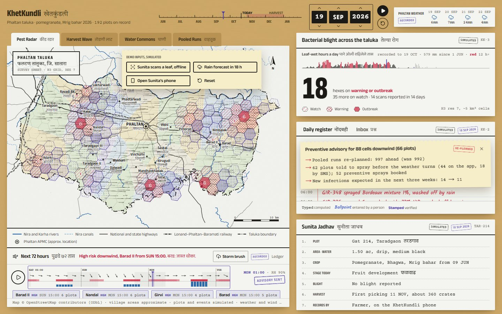
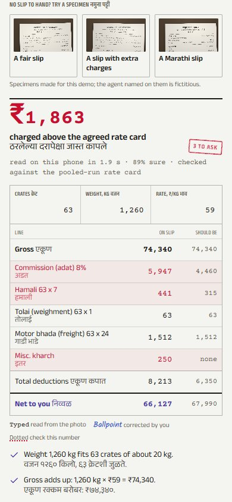
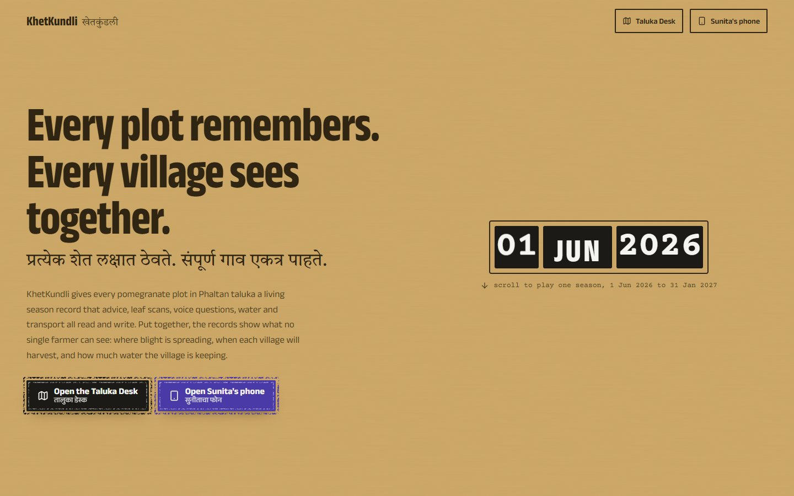

# Experience

The full design system is in [DESIGN.md](../DESIGN.md). This document explains the choices and how each surface behaves.

## The Living Record

Maharashtra's farm paperwork is the visual world: the manila board of a government file, ruled register paper, the 7/12 land-record extract, a rubber date stamp, a perforated slip torn from a book. It is familiar to the farmer and the officer, it carries authority, and it gives every number a place to have come from.

**Ink is provenance.**

| Ink | Means | Example |
| --- | --- | --- |
| Typed (Courier Prime) | Computed by the system | "Irrigation skipped on 41 plots for forecast rain" |
| Ballpoint blue (Kalam) | Entered by a person | Sunita's scan, a number she corrected on a slip, the officer's reply |
| Violet stamp | Verified | An officer's visit; "Advisory sent"; "Checked" |
| Red | Needs attention | A washed-off spray, an overcharge, a warning cell |

## Surfaces

### Taluka desk (`/desk`)

- **Survey sheet**: the real taluka from OpenStreetMap, village areas as Voronoi fields, an H3 grid, cartouche, north arrow and scale bar.
- **Four layers**: Pest Radar (red hatching by reported level, violet stipple for the 72-hour forecast, and the live wind drawn as pencil strokes), Harvest Wave (crates by village for a week), Water Commons (water kept in the ground), Pooled Runs (routes and vehicles moving at the stamped hour).
- **Date stamp and season track**: the rolling date stamp and a season ruler set one clock for every view; play replays the season.
- **72-hour forecast panel**: the hour strip (night bands, rain bars with the ensemble's 10–90% band behind them, hatched demo rain, red wet-canopy band, wind arrows every three hours) is a slider; drag or play it and the plume grows across the map. Villages are ranked chips with the ensemble's chance; one stamp button warns the plots downwind.
- **Storm brush**: press *Storm brush* and drag across the sheet. The track is inked in canal blue, a hatched rain cell rides along it as the strip plays, the wind strokes inside it swing to the gust front, and the plume follows. The warn button reads *What-if only* until the storm is cleared.
- **Leaf-wet strip** in the Pest Radar sheet: one bar per day of the season, red where the canopy stayed wet for 12 hours or more; hover any day to read it.
- **Register and inbox**, **plot record** in the farmer's inks, **village ledger**.

### Farmer phone (`/farmer`)

| Home | Ask | Slip check |
| :---: | :---: | :---: |
|  |  |  |

- **Kundli wheel**: the season as a dial: stage ring, rain ticks (recorded rain in 2026), water dots, sprays, scans, pickings. Drag the violet knob to scrub the season; months in English and Marathi stay upright.
- **Today slip**: one action, in both languages, and a 72-hour spray ribbon with bad hours hatched.
- **Two stamp buttons** at the thumb: *Scan a leaf* and *Ask*. The camera view checks sharpness and light twice a second; the officer's reply has a *Listen* button.
- **Around your plot**: a small radar of the cells within 4 km, with red for reported blight, violet stipple for the next 72 hours' exposure, a wind arrow on the rim, and a slow sweep.
- **Lot passports**: one card per picking; tapping it opens a QR to show the buyer.
- **Harvest date strip and market ledger**, **record** with Marathi twin lines, **sale-slip check**.

### Pitch (`/`)

The season told in seven scroll chapters, each driving the real engine: the wheel, the radar, the washed-off spray answer, a ripple computed live, the harvest wave, runs and the slip, and the season's ledger.

## Motion

Motion is used where something physical happens, never as decoration.

| Element | Motion | Why | With reduced motion |
| --- | --- | --- | --- |
| Stamp buttons | Press drops 2 px, shadow collapses, ink spreads | A rubber stamp being pressed: an irreversible act | Press without the ink spread |
| Date stamp | Bands roll to the new date | The clock is a physical stamp | Instant change |
| Ripple slip | Slides in under the register's header | News from another screen, in the register's own paper | Appears without sliding (Motion `reducedMotion="user"`) |
| Wind field | Graphite trails drift with the hour's wind, blue in rain | Makes the forecast's driver visible | Static arrows on a grid |
| Forecast play | The plume accumulates hour by hour over 7 s | The officer sees when and where, not just whether | Jumps to 72 h |
| Slip check | Red pen rings draw round overcharges, ticks on the rest | The officer's pen on a paper slip | Drawn instantly |
| Storm brush | The drawn storm plays across its track; the rain cell and gust front move hour by hour | The officer sees what a storm would do before it comes | The plume shown at hour 4, no playback |
| Neighbour pulse | A radar arm sweeps the cells round her plot every 6 s | The village watching together, at a glance | Still |
| Counters | Poster figures roll | Large numbers read as changing values | Instant |

## Marathi

Every farmer-facing line has a Marathi twin set in Anek Devanagari or Tiro Devanagari Marathi; numbers on the phone use Devanagari numerals in Marathi lines; month names on the wheel are bilingual. Voice questions work in Marathi (`mr-IN`) and answers are read aloud. Village names on the map have Marathi labels where space allows; names not yet verified locally are marked in the data.

## Accessibility

- Touch targets of 44 px or more on the phone; primary actions at the thumb.
- Sliders (season track, forecast hour strip, kundli knob) are keyboard operable with arrow keys and expose `aria-valuetext`.
- Colour never carries meaning alone: risk levels have distinct hatching, exposure has stipple density and outline style, overcharges have rings and text.
- `prefers-reduced-motion` is honoured: a global CSS rule shortens transitions, `MotionConfig reducedMotion="user"` stops Motion's movement, and the canvas, forecast play and pen rings have their own fallbacks listed above.
- The phone works offline after one visit (production build), with on-device inference.
