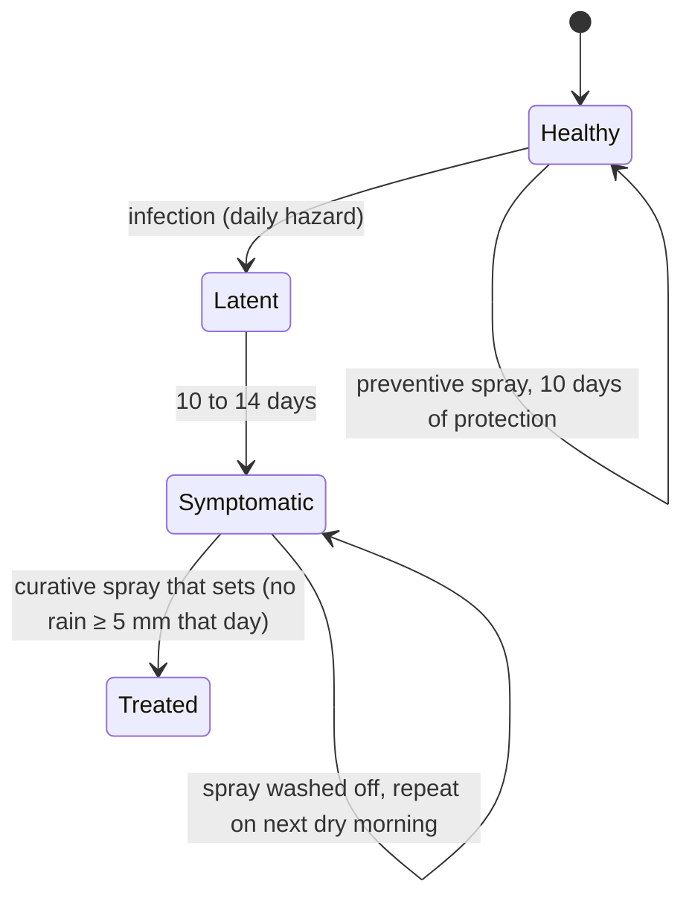
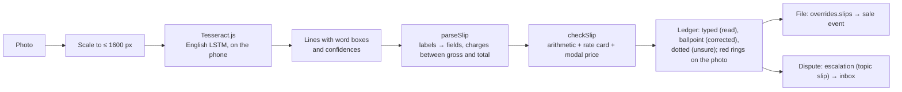

# Models

Everything below runs in the browser from `web/src/lib`. Parameters are demo calibrations chosen to give a plausible season. They are not fitted to field data yet; the pilot (see [ROADMAP.md](ROADMAP.md)) is where they get fitted and validated.

## 1. Weather

Each season day has rain, temperature range, mean humidity, maximum wind and dominant direction, ET0, and **leaf-wet hours**:

$$
\text{wet}_d = \#\{\, h \in d : 18 \le T_h \le 35\ ^\circ\text{C} \ \wedge\ (\text{RH}_h \ge 85\% \ \vee\ P_h \ge 0.2\ \text{mm}) \,\}
$$

| Days | Source | `observed` | `live` |
| --- | --- | --- | --- |
| 1 June to yesterday | Open-Meteo archive (reanalysis), wet hours from its hourly series | yes | yes |
| Today to +6 days | Open-Meteo forecast, wet hours from the hourly forecast | no | yes |
| Beyond | Seeded synthetic climatology for the Phaltan rain shadow (monthly normals, wet-spell persistence) | no | no |

In 2026 the recorded canopy was wet about 11 hours a day from July to September and under an hour a day in October; 579 mm of rain fell from 1 June to 19 October.

## 2. Bacterial blight

### States

### Favourability

$$
f_d = \underbrace{\min\!\left(1, \tfrac{\text{wet}_d}{12}\right)}_{\text{wet canopy}} \cdot \underbrace{\begin{cases}1 & 25 \le T_{\max} \le 37\\ 0.5 & \text{otherwise}\end{cases}}_{\text{warm}} \cdot \underbrace{\begin{cases}1.5 & P_d > 2\ \text{mm}\\ 1 & \text{otherwise}\end{cases}}_{\text{splash}}
$$

On simulated days without hourly data the wet-canopy term falls back to $\text{clamp}\big((\overline{RH}_d - 58)/27\big)$.

### Infection hazard

For a healthy plot $p$ on day $d$, with neighbours $q$ within 6 km at distance $k_{pq}$ and bearing $\beta_{pq}$, and the day's wind blowing towards $\theta_d$:

$$
\text{pressure}_p = \sum_{q:\,\text{sym or treated}} e^{-k_{pq}/1.4}\cdot s_q \cdot \big(0.55 + 0.9\,\max(0, \cos(\beta_{qp} - \theta_d))\big), \qquad s_q = \begin{cases}1 & \text{symptomatic}\\0.25 & \text{treated}\end{cases}
$$

$$
\Pr[\text{infection}] = 1 - \exp\!\big(-(0.0007 + 0.085\,\text{pressure}_p)\, f_d \cdot \sigma_p\big), \qquad \sigma_p = \begin{cases}0.35 & \text{within 10 days of a preventive spray}\\ 1 & \text{otherwise}\end{cases}
$$

Six seed infections arrive between days 46 and 79 (mid-July to mid-August). Random draws are hashed per (plot, day, salt), so changing one plot never reshuffles another.

### Detection, advice, sprays

- A symptomatic plot is found each day with probability 0.28 if the farmer uses the app (her own scan) and 0.06 otherwise (an officer's visit, stamped *verified*).
- A confirmed scan books a curative spray on the **first sprayable day**: rain under 1 mm, rain chance under 45%, wind under 15 km/h, maximum under 36 °C. Up to eight app-using neighbours within 2.5 km are warned, and 75% of them book a preventive spray for the same morning.
- A spray on a day with 5 mm of rain or more is washed off and repeated.

### Pest Radar (what the desk knows)

Built only from **reported** scans, never from the hidden infection state. For each H3 cell, scans in the last 14 days count with freshness $1 - \text{age}/14$; neighbouring cells add $0.3 + 0.35\cdot\text{align}$ of theirs; the sum is scaled by $0.6 + 0.6 f_d$. Levels: watch ≥ 0.16, warning ≥ 0.55, outbreak ≥ 1.2.

### Calibration check: the same engine on recorded and synthetic weather

| By 20 October 2026 | Synthetic weather | Recorded 2026 weather |
| --- | --- | --- |
| Plots ever infected | 91 of 192 | 65 of 192 |
| Blight scans reported over the whole months of Jul / Aug / Sep / Oct | 10 / 31 / 23 / 20 | 3 / 18 / 22 / 18 |
| Cells on warning or outbreak at end of September | 16 | 12 |
| Washed-off spray (hero) | 27 Sep, 14 mm scripted | 21 Sep, 24 mm recorded |

The recorded season is drier than the climatology (mean RH 73 to 77% against 79 to 82%), and October was almost rainless, so spread stalls in October. That is what the screens now show.

## 3. Spread forecast (72 hours)

`src/lib/spread.ts`. A forecast of **where reported blight can travel** in the next 72 hours, from the stamped hour.

**Frames.** 72 hourly frames with wind $(u, v)$ in km/h towards east and north at nine grid points, plus mean rain, humidity and temperature. When the clock is inside the live forecast, frames come from `/api/weather/wind`, nine Open-Meteo points over the taluka's bounding box, and wind at any location is bilinear between them. For any other hour, frames are built from that day's recorded (or simulated) daily weather: humidity peaks at dawn, temperature mid-afternoon, rain falls 15:00 to 20:00, and one wind (0.6 of the daily maximum) blows over the taluka. A demo rain input is laid over the first six hours of its day with a gust front of at least 14 km/h.

**Hourly favourability.**

$$
\phi_h = w_T \cdot \begin{cases} \min(1,\ 0.6 + P_h/5) & P_h \ge 0.2\ \text{mm (rain splash)} \\ 0.45 & \text{RH}_h \ge 90\% \text{ or within 4 h after rain (wet canopy)} \\ 0.25 & \text{RH}_h \ge 85\% \\ 0 & \text{otherwise} \end{cases}, \qquad w_T = \begin{cases}1 & 18 \le T_h \le 35\\ 0.4 & \text{otherwise}\end{cases}
$$

**Kernel.** For each source cell $s$ (reported level $L_s$: watch, warning, outbreak, weights 0.5, 1.2, 2) and each hour, the wind at $s$ has speed $U$ and unit direction $\hat{u}$. A target cell at displacement $\vec{d}$ (km) has along-wind distance $x = \vec{d}\cdot\hat u$ and cross-wind distance $y$:

$$
K(x, y) = \begin{cases} e^{-x/R}\, e^{-y^2 / 2\sigma(x)^2} & x > 0 \\ 0.35\, e^{-|\vec d|/0.7} & x \le 0 \end{cases}, \qquad R = 0.8 + 0.12\,U, \quad \sigma(x) = 0.35 + 0.25\,x
$$

$$
E_j = \sum_h \sum_s w(L_s)\, \phi_h\, K_{sj,h}
$$

Exposure tiers: low ≥ 0.35, moderate ≥ 1.2, high ≥ 4. The desk shows exposure accumulated up to the scrubbed hour, each cell's peak hour, and the cells to warn (moderate or high, not already on warning).

**Closing the loop.** *Warn* adds `{ day, hexes }` to `overrides.advisories`. In the engine, every plot in those cells that is not already symptomatic gets the advisory; app users book a preventive spray on the first sprayable day, and SMS recipients do so with probability 0.45. The ripple reports plots told, sprays booked, and the change in new infections over three weeks. On 19 September with the recorded weather: 62 plots told, 52 sprays booked, new infections 14 → 11.

**What it is not.** It is not fitted. Rain splash and wind-driven rain carry *Xanthomonas* over short distances; the reach and widths above are plausible placeholders. Validation plan: compare forecast exposure with the cells where scans are reported in the following 14 days during the pilot, and fit $R$, $\sigma$ and the weights by maximum likelihood.

## 4. Water Commons

Every three days from bahar + 20 days, each plot needs

$$
V = \Big(\sum_{d-2}^{d} \text{ET}_0\Big)\cdot K_c(\text{stage}) \cdot \text{acres} \cdot 4047 \cdot 0.55 \ \text{litres}
$$

with $K_c$ from 0.3 (rest) to 0.9 (fruit development). Irrigation is skipped after 10 mm of rain; when 5 mm or more is forecast for tomorrow, app users skip and the litres count as **kept in the ground**. The village goal is 80% of plots following forecast irrigation.

## 5. Harvest Wave and markets

- Four pickings at harvest start + 0, 8, 16, 25 days, sharing 20, 35, 30 and 15% of the expected crop (about 20 kg a crate). Rain of 8 mm or more on or after a picking day brings it a day earlier to avoid cracking.
- Grade follows infection at harvest start: never infected A, treated B (88% of the crop), symptomatic C (60%). Grade price factors 1, 0.68, 0.42.
- Prices by market and day: a monthly base, an AR(1) noise, and pressure from arrivals, $\text{price} \propto \text{clamp}\big(1 - 0.42(a/\bar a - 1)\big)$, with a seasonal hump in arrivals and a **Pune glut** around 17 November. Grade A lots go to the market with the best net after freight and commission.

## 6. Pooled runs

Bookings are grouped by day, village collection point and market and packed largest-first into 75-crate vehicles, splitting a lot across vehicles when needed. Runs to Phaltan leave at 05:15, to Pune at 01:30 and to Vashi at 21:00. Routes follow the real road graph from each collection point (Dijkstra in `build-geo.ts`).

## 7. Scan Lens (on device)

- MobileNetV2, PlantVillage, 38 classes, fp32 ONNX in ONNX Runtime Web (wasm, single thread), in a module worker. 224 × 224, ImageNet normalisation.
- **Crop-conditioned**: the farmer picks the crop, the softmax is renormalised over that crop's classes, and the unconditioned first guess is shown when it disagrees.
- **Where it looked**: a 7 × 7 occlusion map, batched, drawn as a red heat overlay.
- Honest numbers: 95.4% on PlantVillage lab photos (model card); on three public field photos it misread two diseases. Pomegranate has no class in PlantVillage, so the pomegranate result is scripted until `ml/train.py` is run on Phaltan photos.

## 8. Sale slip check

Checks: weight against crates × 20 kg (flag below 95%); gross = weight × rate; each charge against the rate card (commission 6% of gross, hamali ₹5 and weighment ₹1 a crate, freight the run's rate a crate); any charge not on the card; deductions add up to the total; gross less total equals net. The rate is compared with the day's modal price for the grade (information only). Numbers read with under 75% confidence are underlined for the farmer to check.

## 9. Voice

Intent by keyword in Marathi and English (spray failure, next spray, irrigation, harvest date, market, sale, blight nearby), answered by builders that quote the record with dates and amounts, with sources and *sure* chips. Unknown intents go to the officer with the plot's last five entries. Speech in and out through the Web Speech API (`mr-IN`).
