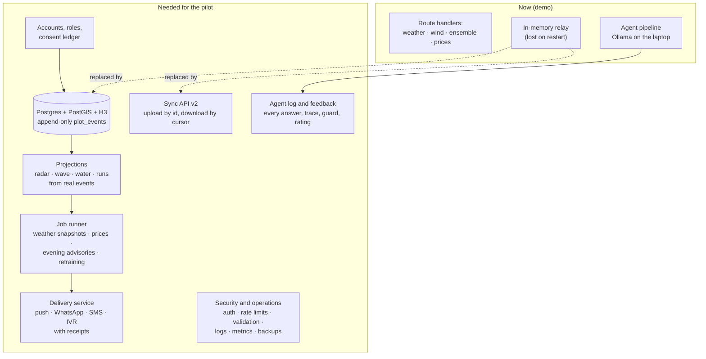
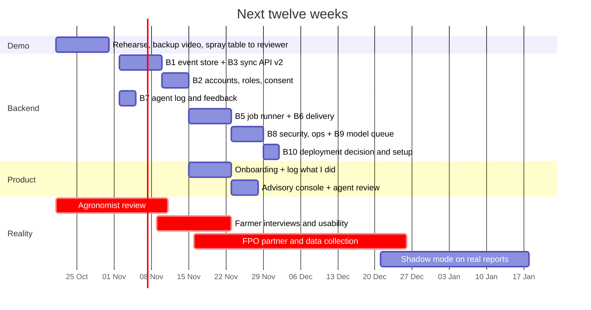

# What remains, and how to proceed

Status on 20 October 2026, after commit `74ac692`. This document is the working plan: what is built, what is only simulated, what is missing, and the order to do it in. [ROADMAP.md](ROADMAP.md) keeps the long view (horizons, target architecture, metrics); this is the next twelve weeks in detail. Effort is in working days for one developer and is an estimate.

## 1. Where things stand

| Area | Built and working | Simulated or scripted | Missing |
| --- | --- | --- | --- |
| **Farmer phone** | Kundli wheel, today slip, spray window, Scan Lens (on device), Ask (voice, rules answer + agent answer), slip check (English and Marathi OCR), lot passports, neighbour pulse, share card, offline outbox | The farmer's history (192 synthetic plots); the pomegranate scan result | Onboarding, entering her own sprays, irrigation and pickings, notifications, settings, more than one plot, household profiles |
| **Taluka desk** | Survey sheet with real terrain, live wind, 72-hour spread forecast with ensemble, storm brush, Pest Radar, Harvest Wave, Water Commons, pooled runs, register, inbox with agent drafts | Every plot, scan, picking and sale behind the maps | Advisory approval and sending screen, visit planner, agent answer review, cohort and adoption views, login |
| **Models** | Season engine on recorded weather; spread kernel with backtest; slip parser with self-proving corrections; router trained here; retrieval; guarded Llama 3.1 8B | Scan Lens for pomegranate (no trained model yet); spread kernel parameters (not fitted); prices without a key | A pomegranate leaf model, a fitted spread model, harvest-date and price models, a run optimiser |
| **Backend** | 8 route handlers: weather, wind, ensemble, prices, sync relay, agent ask, advisories, health; the agent pipeline | Message delivery (SMS, WhatsApp, IVR are shown, not sent) | A database, accounts, consent, job scheduling, delivery, audit logs, security, observability, deployment (section 2) |
| **Evidence** | Recorded weather, real terrain and map, 51-member ensemble, sourced problem figures | Outcomes in the demo season | Any farmer, officer or FPO using it; any real scan, slip, picking or price; an agronomist's review |

## 2. Why the backend looks empty, and what it actually needs

**Today the server is thin by design.** The season engine runs in every browser, so the demo works on venue Wi-Fi with no database. The server proxies open data (weather, wind, ensemble, prices), relays events between two devices, and now runs the agent. Its state lives in memory: restart the server and the inbox and the overrides are gone. That was right for a demo. For a pilot it is the main gap.

What a pilot needs from the backend, with the reason for each:

| # | Backend piece | Why it is needed (not nice to have) | How | Effort |
| --- | --- | --- | --- | --- |
| B1 | **Event store** | A farmer's season must survive a lost phone and a server restart; the radar must read real reports | Postgres 16 with PostGIS and the `h3` extension; the `plot_events` table already designed in ROADMAP 1.1; migrations with Drizzle or Prisma; nightly backup | 4 |
| B2 | **Accounts, roles and consent** | Anyone on the Wi-Fi can reply to farmers today; the DPDP Act 2023 needs purpose-bound, revocable consent | Phone-number OTP; roles farmer, household member, officer, FPO staff; consent stored as events (`share-scans-with-fpo`, `share-pickings-for-runs`, `share-slips-for-index`); export and erase | 5 |
| B3 | **Sync API v2** | The phone's outbox exists; the server must accept its events idempotently and send back others' events | `POST /events` (UUIDv7, HLC, ignore seen ids), `GET /events?cursor=`; server-sent events or WebSocket for live updates; replaces the in-memory relay | 4 |
| B4 | **Projections from real events** | The desk must show what was reported, not what was simulated | Materialised views per day: radar cells, wave by village and week, water kept, runs; the browser engine stays as the what-if simulator | 5 |
| B5 | **Job runner** | Advisories must go out every evening without someone pressing a button; forecasts must be reproducible later | `pg-boss` (queues in Postgres): weather and ensemble snapshot every 6 h (stored, so any advice can be replayed), Agmarknet prices daily, evening advisory pipeline, weekly backtest, router retraining | 3 |
| B6 | **Delivery service** | Today "warn by SMS" is a simulated outcome; the pilot metric is "reached within 2 hours" | One outbox table, adapters for Web Push, WhatsApp Business templates, an SMS gateway and a missed-call IVR; delivery receipts, retries, quiet hours, language per farmer | 5 |
| B7 | **Agent log and feedback** | The only way to improve the router and the answers is to keep them; the officer must be able to audit what the machine told a farmer | Store every question, route, facts, draft, guard result and final answer; a thumbs up or down on the phone; the officer's correction becomes a label; weekly report of guard failures and fallbacks | 3 |
| B8 | **Security and operations** | A GPU endpoint open to anyone can be exhausted; errors must be seen before farmers report them | Auth on every write and agent route; rate limits per user; request validation with zod; HTTPS; structured logs, metrics (latency, fallback rate, delivery success) and error tracking; a health page | 4 |
| B9 | **Model serving** | One GPU, many users: requests must queue, and a smaller model must take over when it is busy | A queue in front of Ollama; per-request timeout; `phi3:mini` or a 3B model as fallback; model and router versions recorded with every answer | 2 |
| B10 | **Deployment** | The pilot cannot depend on a laptop on a desk | Option A: a small GPU box at the FPO office (Ollama, Postgres, the app) with a tunnel. Option B: the app and database in the cloud, the model on a rented GPU or a CPU-sized model. Decide after measuring latency of a 3B model on CPU | 3 |

Total for B1–B10: about 38 days of work, which is why section 5 starts with B1, B2, B3 and B7 and leaves the rest to follow.

## 3. Functionality and features still to build

### Farmer phone

| Feature | Why | Effort |
| --- | --- | --- |
| **Onboarding**: phone number, plot by gat number and a GPS walk of the boundary, bahar date, crop and variety, consent in Marathi | Without it there is no real plot | 4 |
| **Log what I did**: "I sprayed today", "I watered", "I picked 40 crates" by voice or two taps; ballpoint entries in the record | Today the record fills itself from the simulation; a real one needs the farmer's own entries | 4 |
| **Notifications**: the 05:30 spray-window message, warnings from the desk, officer replies; a notification list on the phone | The spray window only helps if it reaches her before she sprays | 3 (with B6) |
| **Several plots and a shared phone**: switch plot, switch person | Two-thirds of rural users share a phone | 2 |
| **Agent answer feedback**: was this useful? and read the agent's answer aloud in Marathi | Labels for retraining; low-literacy users | 1 |
| **Settings**: language, text size, voice speed, notification times | Accessibility and trust | 1 |

### Taluka desk

| Feature | Why | Effort |
| --- | --- | --- |
| **Advisory console**: preview the evening batch from `/api/agent/advisories`, edit, approve, send, see receipts | The pipeline exists; the officer needs to control what goes out | 3 |
| **Agent review**: answers given today, guard failures, fallbacks, low ratings; correct an answer | Accountability for machine advice | 2 |
| **Visit planner**: today's visits from the inbox and the radar, shortest route | Officer time is the scarcest resource | 3 |
| **Adoption and outcomes**: weekly active farmers, scans per cell, advisories reached, sprays washed off | The pilot's own metrics, live | 2 |
| **Login and roles** | The desk is open today | with B2 |

### Models

| Model | What to do | Needs |
| --- | --- | --- |
| **Scan Lens for pomegranate** | Photo campaign, labels by a plant pathologist, fine-tune MobileNetV3 or EfficientNet-Lite, test on a village never seen, INT8 for the phone | 1,000+ consented photos per class |
| **Spread forecast, fitted** | Run the existing backtest harness on real reports; fit reach, width and weights by maximum likelihood | One monsoon of real reports |
| **Router v2** | Retrain on real questions from the agent log, relabelled by the officer | A few hundred real questions |
| **Answer model** | Keep Llama 3.1 8B with tools and guards; after the pilot, a LoRA fine-tune on officer-approved answers, evaluated with the same harness | Officer-approved answers |
| **Harvest dates and prices** | Gradient boosting on bahar date, degree days and real pickings; quantile price forecasts from Agmarknet arrivals | Real pickings; a data.gov.in key |
| **Pooled runs** | OR-Tools vehicle routing with time windows, in a small Python service | Real bookings and vehicles |

## 4. UI and UX

| Item | Why | Effort |
| --- | --- | --- |
| **Usability test with five farmers** on their own phones: ask, scan, slip, spray window | Every screen was designed without a farmer in the room | 2 field days |
| **Marathi copy review** by a native writer; verify the 22 village names marked `mrVerified: false` | Marathi must be first-class, not translated | 2 |
| **Low-end phone budget**: test on a 2 GB Android; first load under 3 s on 3G; Marathi OCR only on demand | The real device, not a laptop | 2 |
| **Sunlight and TalkBack pass**: contrast outdoors, screen reader order, touch targets | Accessibility commitments in PRODUCT.md | 1 |
| **Agent answer card**: shorter trace by default (tap to expand), clearer "machine Marathi" marking, listen button | A farmer needs the answer, an officer needs the trace | 1 |
| **Desk on a tablet** at the collection point | Mornings happen there, not at a desk | 2 |

## 5. Reality exposure: from demo to evidence

This matters more than any feature. Nothing in the product has met a farmer yet.

| Step | What | Who to approach | Done when |
| --- | --- | --- | --- |
| R1 | **Agronomist review** of the spray table, the 60-day interval, and the agent's guard list; confirm the antibiotic ban's gazette status | A plant pathologist at ICAR-NRCP Solapur, MPKV Rahuri or the district KVK | A named reviewer signs off; AGRONOMY.md records it |
| R2 | **Ten farmer interviews** in two villages: how they decide to spray, irrigate, pick and sell; what phones they use; who reads the patti | Through an FPO or the agriculture office | Notes written up; the three biggest surprises change the backlog |
| R3 | **Usability sessions** with the prototype on their phones | The same farmers | Tasks completed without help; failures fixed |
| R4 | **One FPO partner** willing to share rate cards and run the desk weekly | FPOs in Phaltan taluka | A letter of intent for the Ambia bahar pilot |
| R5 | **Real data**: 200 leaf photos in blight weather, 30 pattis (names blurred), one season of picking dates and prices from the FPO | The FPO and its members, with consent | Data in the event store with consent records |
| R6 | **Shadow mode**: run the forecast and the advisory pipeline on real reports for four weeks without sending anything; compare with what happened | The officer | Backtest on real reports published, good or bad |
| R7 | **Pilot**: 150 farmers, three villages, the Ambia bahar of 2027 | FPO and officer | The pilot metrics in ROADMAP.md, measured |

## 6. How to proceed: the next twelve weeks

**Weeks 1–2 (to 2 November): finish the demo.** Rehearse the [DEMO.md](DEMO.md) script twice on a real phone, record the backup video, send the spray table to a reviewer (R1). No new features. Decide the pilot hosting question (B10) in principle.

**Weeks 3–4: make the record real.** B1 event store and B3 sync API, so the phone's outbox writes to Postgres; B7 agent log from the first day, because every answer is future training data. Start R2 interviews in parallel; they will change the onboarding design.

**Weeks 5–6: people and consent.** B2 accounts, roles and consent; onboarding and "log what I did" on the phone. Login on the desk. Usability sessions (R3) on the onboarding.

**Weeks 7–8: the evening loop.** B5 job runner (weather snapshots, prices, the advisory pipeline every evening) and B6 delivery (Web Push and SMS first, WhatsApp when the template is approved); the advisory console on the desk, so the officer approves before anything is sent.

**Weeks 9–10: harden.** B8 security and operations, B9 model queue and fallback model, agent review on the desk, the low-end phone budget, the Marathi copy review.

**Weeks 11–12: shadow mode.** Deploy (B10), run everything on real reports from the FPO's members without sending advice (R6), and compare the forecast and the advisories with what happened. Go or no-go for the Ambia bahar pilot on that evidence.

## 7. Decision gates

| Gate | Question | Evidence needed | If no |
| --- | --- | --- | --- |
| End of week 2 | Is the spray table safe to show farmers? | Reviewer sign-off | The agent shows "ask the officer" instead of any product |
| End of week 6 | Will farmers enter their own data? | Usability: 4 of 5 log a spray without help | Simplify to voice-only logging; FPO staff enter on the farmer's behalf |
| End of week 10 | Does a 3B model on CPU answer well enough? | `eval:agent` scores within 10 points of Llama 3.1 8B | Budget a GPU box for the FPO office |
| End of week 12 | Does the forecast beat distance on real reports? | Shadow-mode backtest | Keep the radar and the warnings, drop the forecast from farmer screens until fitted |

## 8. What not to build yet

- A national or multi-crop platform: one crop, one taluka, until the pilot shows people keep the record.
- A fine-tuned LLM: tools, schemas and guards first; fine-tune only on officer-approved real answers.
- Payments, loans or any lender integration: out of scope for this product.
- Carbon or sustainability credits: no claims without measured outcomes.
