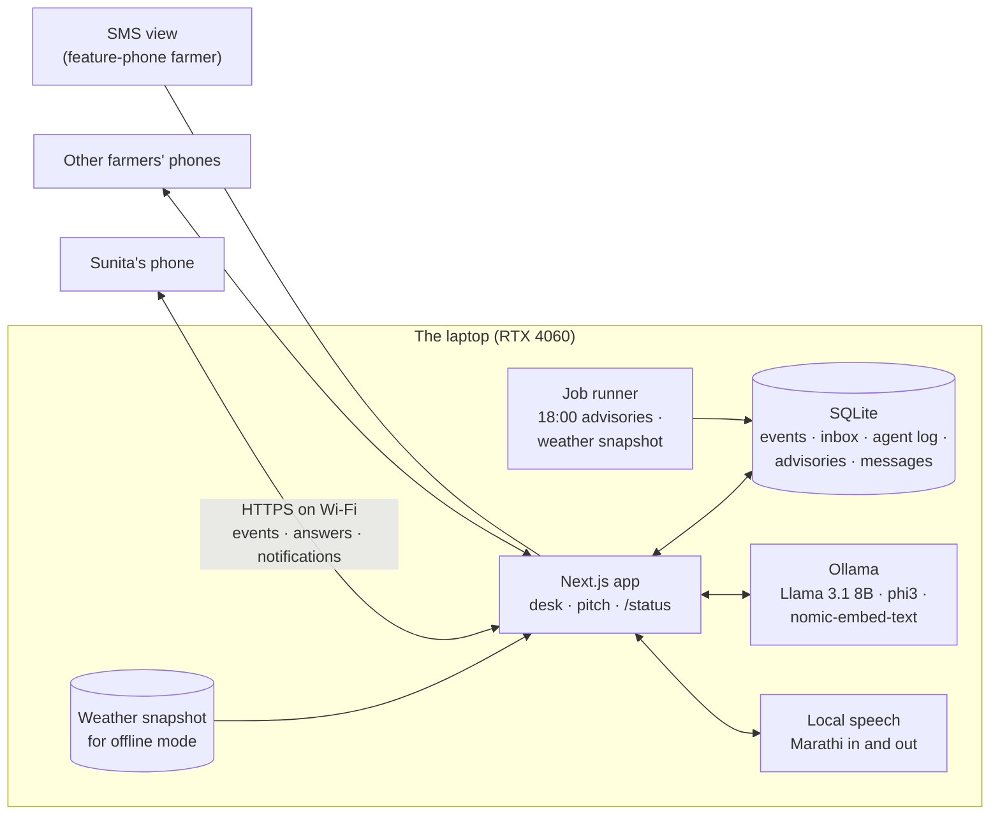
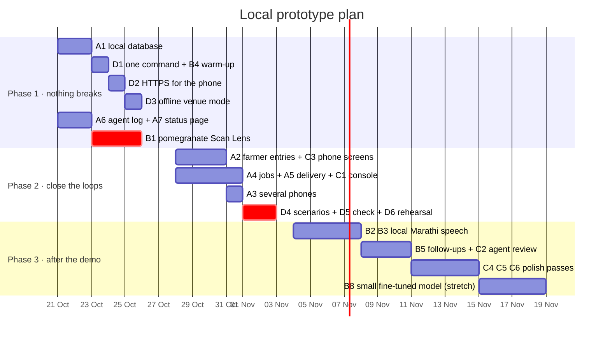

# Next steps: an excellent local prototype

Status on 20 October 2026, after commit `e9fa3bd`. KhetKundli will not be registered or deployed. The goal is a prototype that runs on one laptop (with a phone on the same Wi-Fi), where **every button does something real, nothing is lost on a restart, it works with no internet in the room, and nothing breaks in front of judges**. This plan is ordered by that goal. Effort is in working days for one developer and is an estimate. [ROADMAP.md](ROADMAP.md) keeps the long view, if the project ever goes live.

## 0. Done on 20 October: the top five

| Item | What now works | Where |
| --- | --- | --- |
| **A1 Local database** | One SQLite file (`web/data/khetkundli.db`, Node's built-in driver). The relay keeps its overrides and inbox there; every synced event is appended by clock stamp (a retry is recognised); messages, receipts, agent answers and weather snapshots are stored. A server restart loses nothing | `src/lib/server/db.ts`, `relay.ts` |
| **A5 + C1 Advisories that arrive** | Desk → *Advisories* tab: prepare a batch (plots under a radar warning, or one village), read the English and Marathi SMS, untick anyone, approve and send. The phone shows a banner and a message bell; its own receipts come back (*delivered*, *read*). Farmers with no phone in the room get receipts from a gateway simulator, marked *sim*. *Warn downwind* on the forecast now sends real messages too | `components/desk/advisories.tsx`, `app/api/messages`, `components/farmer/messages.tsx` |
| **D1 + B4 One command, warm models** | `npm run demo` checks Ollama and the models, the database and the saved forecast, warms the models and every route, starts the app for the laptop and the Wi-Fi, and prints the desk and phone addresses with a QR code. The server also warms the models itself at start-up | `scripts/demo.mjs`, `src/instrumentation.ts` |
| **D2 HTTPS for the phone** | `npm run demo -- --https` serves a self-signed certificate for this laptop's Wi-Fi addresses. Nothing is installed into Windows' trust store; the phone accepts a one-time warning and then has camera and microphone | `scripts/cert.mjs` |
| **D3 Offline venue mode** | Every successful weather, wind and ensemble answer is saved; `npm run demo -- --offline` serves the saved forecast, labelled *saved forecast · offline* on the desk | `src/lib/server/snapshot.ts` |
| **B1 Pomegranate Scan Lens** | A MobileNetV3 trained on this laptop's GPU on 5,099 pomegranate fruit photos (CC BY 4.0) replaces the scripted result, with its test accuracy shown in the app | `ml/scanlens/train_pomegranate.py`, `public/models/pomegranate/` |
| Also | `/status` page (A7); every agent answer logged (A6, without the review screen yet); the landing page's scroll story rebuilt: visuals fit the screen, a season rail with chapters and months, ← → keys, and a new chapter where the local agent answers live | `app/status`, `components/pitch/season-story.tsx` |

## 1. The bar: what "extremely good, locally functional" means

| Test | Today | Target |
| --- | --- | --- |
| Restart the server mid-demo | Inbox, overrides and agent answers are lost (kept in memory) | Everything comes back from a local database |
| No internet at the venue | Weather, wind, ensemble and the map style need the network; voice needs Chrome's online speech service | The whole demo runs from a recorded snapshot, the local model and local speech |
| A farmer does something | Her record mostly fills itself from the simulation | She logs a spray, a watering or a picking; the record, the agent and the desk change |
| The officer warns downwind | A ripple shows what would happen | Messages actually arrive on the phones in the room, with sent, delivered and read |
| A pomegranate leaf is scanned | The pomegranate result is scripted | A model trained on this laptop gives the result, with its measured accuracy |
| Someone asks in Marathi by voice | Works in Chrome with internet | Works offline with a local speech model |
| The first agent question | Up to 21 s while the model loads | Under 5 s: the models are warmed at start-up |
| Starting the demo | Several terminals and steps | One command, with a status page and a QR code for the phone |

## 2. Where things stand

| Area | Real and working | Still simulated or scripted | Missing for an excellent local prototype |
| --- | --- | --- | --- |
| **Farmer phone** | Kundli wheel, spray window, Scan Lens (on device), Ask with the reasoning agent, slip check in English and Marathi, lot passports, neighbour pulse, share card, offline outbox | Her history; the pomegranate scan | Logging her own work, notifications, follow-up questions, feedback on answers, choosing which farmer this phone is |
| **Taluka desk** | Survey sheet with real terrain, live wind, 72-hour forecast with ensemble, storm brush, radar, wave, water, runs, register, inbox with agent drafts | Every plot behind the maps | Advisory console (approve and send), agent review, a status page |
| **Backend** | 8 route handlers; the agent pipeline on Llama 3.1 8B through Ollama; router trained here; retrieval | Message delivery | A local database, a job runner, a delivery simulator, an agent log, a weather snapshot for offline use, model warm-up |
| **Models** | Season engine on recorded weather; spread forecast with backtest; slip parser; router; guarded LLM | Pomegranate Scan Lens; spread parameters (not fitted); prices without a key | A pomegranate model trained here; local Marathi speech; optional small fine-tuned answer model |

## 3. The work, in five tracks

### Track A · A real local backend

The server is thin today because the demo began as browser-only. These make it a real, restart-proof backend on the laptop, with no accounts or cloud.

| # | Item | What it does | How | Effort |
| --- | --- | --- | --- | --- |
| A1 | **Local database** | Inbox, replies, overrides, farmer entries, agent answers, advisories and messages survive restarts | One SQLite file (`web/data/khetkundli.db`) through Node's built-in `node:sqlite` or `better-sqlite3`; an append-only `events` table with the hybrid logical clock the phone already stamps; the relay reads and writes it instead of memory | 2 |
| A2 | **Farmer entries** | A farmer logs "sprayed today", "watered", "picked 40 crates" by two taps or by voice; they become ballpoint lines in her record | New override kinds (`sprays`, `irrigations`, `picks`) the season engine applies like scans; the agent's `plot_record` tool sees them at once | 2 |
| A3 | **Several phones, several farmers** | Each phone in the room picks a farmer (Sunita and three others in different villages); the desk sees all of them | A "this phone is…" picker stored on the device; per-farmer inbox and messages | 1 |
| A4 | **Job runner** | The evening advisory pipeline runs at 18:00 (or "run now" on the desk); weather is snapshotted every six hours | A small scheduler in the server process (`node-cron`), writing to the database; jobs listed on the status page | 1 |
| A5 | **Delivery simulator** | Warnings and officer replies arrive on the phones as notifications, with sent, delivered and read times; an SMS view shows what a feature-phone farmer would receive | A `messages` table and a channel per phone over the existing server-sent events; Web Push where the browser allows it (it needs HTTPS on the phone, see D2); a desk view of receipts | 2 |
| A6 | **Agent log and review** | Every question, route, facts used, draft, guard result and answer is kept; the farmer rates the answer; the officer reviews and corrects | `agent_log` table; thumbs up or down on the phone; a review tab on the desk; corrected questions become new router training data (`npm run train:router` reads them) | 1.5 |
| A7 | **Status page** | One screen shows Ollama and the models, the database, the jobs, the weather snapshot and its age, and the phones connected | `/status`, built on `/api/agent/health` | 0.5 |

### Track B · Models that really run here

| # | Item | What it does | How | Effort |
| --- | --- | --- | --- | --- |
| B1 | **Scan Lens for pomegranate** | Removes the biggest scripted piece: a real diagnosis of bacterial blight and the fungal spots on pomegranate leaves and fruit | Train on a public pomegranate disease image dataset (several exist on Mendeley Data and Kaggle; check the licence), on the laptop's RTX 4060 (install the CUDA build of PyTorch; today's is CPU-only); fine-tune MobileNetV3 or EfficientNet-Lite with `ml/train.py`; export ONNX for the phone; report per-class recall and the confusion matrix on a held-out split in the app's model card | 3 |
| B2 | **Local Marathi speech** | Voice questions work with no internet | Run a speech model locally: Whisper (it supports Marathi) through `faster-whisper` on the GPU, compared on 20 recorded Marathi questions with AI4Bharat's open Indic speech models; pick the better one; a `/api/speech` route | 2 |
| B3 | **Local Marathi voice out** | Answers are read aloud in Marathi even without a Marathi system voice | An open Indic text-to-speech model (AI4Bharat publishes Marathi voices) served locally; falls back to the browser voice | 1.5 |
| B4 | **Faster, warmer agent** | First answer under 5 s; tokens appear as they are written | Warm both models at server start; stream the compose step; keep `phi3:mini` as a fallback when the GPU is busy | 1 |
| B5 | **Follow-up questions** | "And if it rains on Tuesday?" continues the same conversation, with a what-if run of the engine | Conversation memory per plot; a `what_if` tool that applies a rain or a spray date to a copy of the season and returns the ripple | 2 |
| B6 | **Router v2** | Fewer misroutes on real phrasings | More templates, Hindi and code-mixed questions, and the questions collected in A6; retrain and re-run `eval:agent` | 0.5 |
| B7 | **Real prices** | Market answers use real numbers | A free data.gov.in key for Agmarknet, or a committed CSV of last season's pomegranate prices at Pune, Phaltan, Vashi and Solapur for offline use | 1 |
| B8 | *Stretch:* **a small fine-tuned answer model** | Faster answers in the right format and better Marathi on a 3B model | QLoRA on Llama 3.2 3B (fits in 8 GB) with answers generated by the guarded 8B pipeline over many engine states; must beat or match the 8B on `eval:agent`. Stated honestly as distillation on synthetic data | 3–4 |

### Track C · UI and UX

| # | Item | Why | Effort |
| --- | --- | --- | --- |
| C1 | **Advisory console** on the desk: preview the evening batch, edit, approve, send, watch receipts arrive | The officer stays in control of what goes out | 1.5 |
| C2 | **Agent review** on the desk: today's answers, ratings, guard failures and fallbacks, with the trace | Shows that machine advice is accountable | 1 |
| C3 | **Phone: log what I did, notifications, follow-ups, feedback**, and a shorter agent trace (tap to expand) | The farmer's side of A2, A5, A6 and B5 | 2 |
| C4 | **Error and empty states**: model down, no weather, no camera, no microphone, nothing in the inbox | A prototype is judged by how it fails | 1 |
| C5 | **Visual QA pass** at phone and desk sizes, motion review, Marathi typography, the 22 unverified village names | Polish that judges notice | 1.5 |
| C6 | **Accessibility pass**: sunlight contrast, touch targets, screen-reader order, reduced motion | Commitments in PRODUCT.md | 1 |

### Track D · Demo robustness

| # | Item | How | Effort |
| --- | --- | --- | --- |
| D1 | **One command**: `npm run demo` checks Ollama and the models, warms them, starts the server, opens the desk and shows a QR code with the phone's Wi-Fi address | A Node script; clear messages when something is missing | 1 |
| D2 | **HTTPS on the local network**, so the phone gets the camera, microphone, service worker and notifications (browsers allow these only on secure origins, and `http://192.168…` is not one) | `next dev --experimental-https` with a local certificate authority (mkcert) installed on the demo phone | 0.5 |
| D3 | **Offline venue mode**: the season, forecast, wind field and ensemble from a saved snapshot; local map tiles; local speech | A `--offline` flag that serves the snapshot through the same routes; tested with Wi-Fi off | 1 |
| D4 | **Scenarios and reset**: start at "19 September, monsoon", "a storm tonight", "glut week in Pune"; reset restores the database snapshot | Saved database files per scenario | 1 |
| D5 | **One check command**: `npm run check` runs types, lint, slip tests, router parity, the smoke test and the agent evaluation, and prints one table | Wraps the existing scripts; add the new flows to the smoke test | 1 |
| D6 | **Rehearsal and backup video** of the full script on the real phone | Twice, on venue-like Wi-Fi | 1 |

### Track E · Honesty and evidence, without going live

None of this needs registration, and all of it makes the prototype more credible.

- **Show it to three to five farmers and one officer** informally, on their own phones; note what confused them and fix the top three.
- **Ask an agronomist to look at the spray table** (it is one page) and record their comments in AGRONOMY.md.
- **Use real public data wherever it exists**: pomegranate disease photos (B1), last season's prices (B7), the recorded weather (already).
- **Keep labelling**: every simulated thing stays marked SIMULATED; every model shows its measured accuracy and what it was trained on.

## 4. The target, on one laptop

## 5. Order of work

**Phase 1 (21–27 October): nothing breaks.** The database first (A1), because every later item writes to it. Then one command with warmed models (D1, B4), HTTPS so the phone's camera and microphone work over Wi-Fi (D2), and offline mode (D3). In parallel, the agent log and status page (A6, A7) and the pomegranate model (B1), the single biggest credibility gain. *Done when:* pull the network cable, restart the server, and the full demo script still runs, with a real pomegranate diagnosis.

**Phase 2 (28 October – 2 November): close the loops.** The farmer logs her own work (A2), the officer approves the evening advisories and they arrive on the phones in the room with receipts (A4, A5, C1), several phones act as different farmers (A3). Then scenarios, the one check command and two rehearsals (D4–D6). *Done when:* one event typed on a phone visibly changes the desk, the agent's next answer and another farmer's phone.

**Phase 3 (after the demo): depth.** Local Marathi speech in and out (B2, B3), follow-up questions with what-if (B5), agent review (C2), the polish passes (C4–C6), and, if there is time, the small fine-tuned model (B8).

## 6. If time is short, do these five

1. **A1 local database**: without it, a restart loses the demo.
2. **D2 + D3 HTTPS and offline mode**: venue Wi-Fi is the most likely failure.
3. **B1 pomegranate Scan Lens**: replaces the one result that is scripted today.
4. **A5 + C1 advisories that actually arrive**: the clearest proof that the collective layer works.
5. **D1 + B4 one command, warm models**: the first answer in front of judges is fast.

## 7. Out of scope (the project is not going live)

Accounts and OTP login, consent records under the DPDP Act, real SMS or WhatsApp gateways, cloud hosting, multi-tenant FPOs, payments. ROADMAP.md keeps them for a future pilot; none of them makes the local prototype better.
