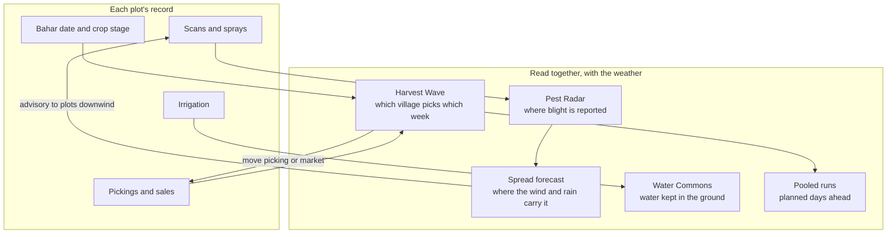

# The problem: one orchard cannot see the season

## Where

**Phaltan taluka**, Satara district, western Maharashtra. It sits in the rain shadow east of the Sahyadri: the season's rain is modest and patchy, so most orchards run on drip irrigation from wells and the Nira canals. The recorded season so far (1 June to 19 October 2026, Open-Meteo archive at Phaltan) brought **579 mm**: 131 mm in June, 269 mm in July, 86 mm in August, 91 mm in September and 2 mm in October.

The hero crop is **pomegranate** (mostly the Bhagwa variety). Growers force flowering by withholding water and pruning, a practice called taking a **bahar**: Ambia bahar flowers in January and February, Mrig bahar in June and July, Hasta bahar in September and October. KhetKundli follows a Mrig bahar season: bahar in June, fruit through the monsoon, pickings from November into January.

## Who

| Person | Job to be done | Today |
| --- | --- | --- |
| **The farmer** (our persona: Sunita Jadhav, gat 214, Taradgaon, 1.5 acres on drip) | Catch blight early, spray when it will stick, irrigate only when needed, pick and sell at the right time and place, get paid what was agreed | Advice is generic and in English; her own history lives in her memory and a notebook; she cannot see her neighbours' orchards |
| **The extension officer / KVK** | Know where disease is moving and warn the right farmers before it arrives; answer questions | Hears about outbreaks late, by phone; too many farmers to visit |
| **The FPO coordinator** | Plan transport and market for many small lots; negotiate fair deductions | Pickings and lot sizes are known only on the morning; transport is booked plot by plot |

## Six problems that are really one

1. **Bacterial blight spreads unseen.** Bacterial blight (*telya*, caused by *Xanthomonas axonopodis* pv. *punicae*) is the most feared disease of pomegranate in Maharashtra. It moves between orchards in wind-driven rain splash and on wet canopies, and through tools and cuttings. Once established in an orchard it is very hard to clear, so the value lies in warning the next orchard before it is infected. No single farmer can see a front that crosses village boundaries.
2. **Sprays are wasted.** A copper spray needs a few dry hours to set. A spray at three in the afternoon before evening rain is money and chemical washed into the soil; the farmer often does not know why it failed.
3. **Water is shared but used alone.** Irrigation decisions ignore the forecast: a plot is watered the day before 10 mm of rain, and the aquifer that the whole village draws on pays for it.
4. **Everyone picks the same week.** Crop stage decides harvest timing, so a village's orchards come due together, Pune and Vashi markets glut, and prices fall exactly when most fruit arrives.
5. **Transport is booked lot by lot.** Small lots (20 to 100 crates) travel in half-empty vehicles because nobody knows the neighbour's picking date three days ahead.
6. **The sale slip is not checked.** The commission agent's *patti* lists gross, commission, hamali, weighment and freight. Few farmers check the arithmetic or compare the charges with what was agreed.

The common cause is that **each plot's information is trapped in that plot**, while the decisions that matter (warn, spray, irrigate, pick, pool, check) depend on many plots and on the weather together.

## The idea

Give every plot a **season record** (its *kundli*) that every feature writes to and reads from. Then read the records together:

The key claim: **the crop-advisory layer is the demand forecast for the logistics layer**, because crop stage on every plot predicts when each village will pick. And the disease layer is only as good as the reports flowing into it, which is why the farmer's phone has to be worth opening every day.

## The six problem statements, answered by one record

| Source | Problem statement | KhetKundli module | Where |
| --- | --- | --- | --- |
| Govt. of Punjab | Smart crop advisory for small and marginal farmers | Advice from the plot's own record and the live forecast | Phone: today slip, spray window |
| Govt. of Kerala | AI-powered personal farming assistant | The kundli wheel: one plot, one season, remembered | Phone: wheel, record |
| Govt. of Kerala | Gamified platform for sustainable practices | Water Commons: a shared village goal, not a leaderboard | Desk: Water Commons |
| Govt. of Kerala | AI-based farmer query support | Marathi voice questions answered from the record, escalated to the officer when needed | Phone: Ask; desk: inbox |
| Qualcomm, ID 26257 | On-device detection of disease, pests and deficiencies | Scan Lens: a leaf model that runs with no signal | Phone: Scan a leaf |
| Team Outliers | "Uber for Harvest": shared transport for small lots | Harvest Wave and pooled runs planned days ahead; the sale slip checked | Desk: Wave, Runs; phone: slip check |

## Principles

1. **One record, many faces.** Nothing stands alone; every feature reads and writes the record.
2. **Collective sight is the point.** Show what only many plots together reveal.
3. **Prove, don't claim.** Real weather, real map, on-device models; everything simulated is labelled.
4. **Doses never come from a model.** Spray products and doses come from a fixed rules table that agronomists must verify.
5. **The farmer's data stays hers.** Shared maps aggregate to roughly 5 km² cells; photos and slips are read on the phone and are not uploaded.
6. **Marathi first where the farmer is.** Every farmer-facing line has a Marathi twin; voice works in Marathi.
