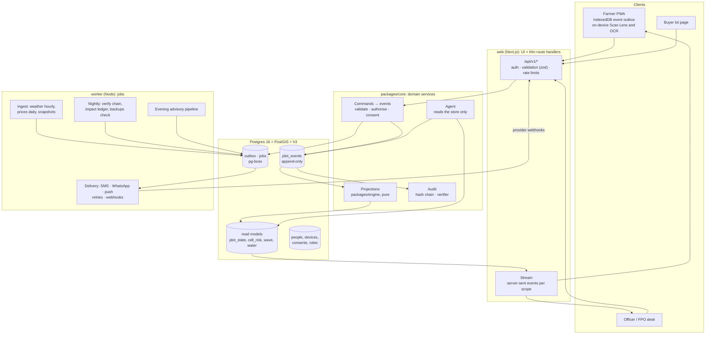
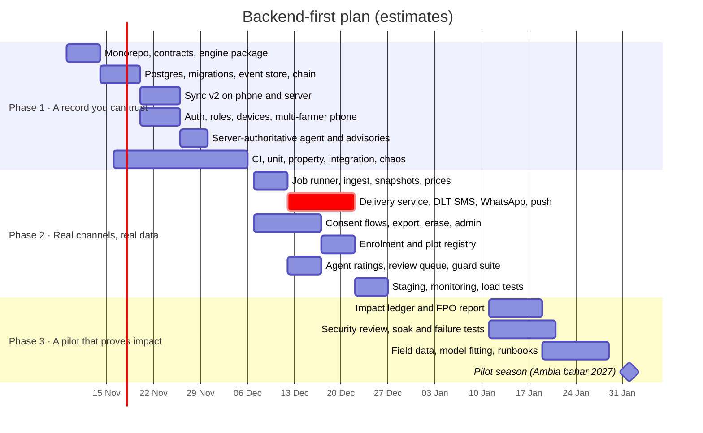

# Product plan: from prototype to a real product, backend first

Written 3 November 2026. On this date the goal changed: KhetKundli is no longer only "an excellent local prototype". It is to become **an actual product with a real demonstration**, where every feature shows real impact through a realistic implementation. This plan replaces the local-only scope of [NEXT-STEPS.md](NEXT-STEPS.md) and turns the pilot horizon of [ROADMAP.md](ROADMAP.md) into three buildable phases. The phases put the **backend** first, because a farmer's record has to be impossible to lose, impossible to forge quietly, and provable to an outsider. The gaps it closes are listed in [GAPS.md](GAPS.md).

Effort figures are estimates for one to two developers. Nothing below has been agreed with a partner yet; every partner, provider and price is a requirement, not a fact.

---

## 1. What changes when it is real

| Prototype (today) | Product |
| --- | --- |
| Every browser simulates 192 farmers; the server stores what clients send | The **server holds the record**: append-only events from real, consented farmers. Simulation is a labelled background layer that shrinks as real plots join |
| One global overrides object, newest wins | **Per-event sync**: events are facts with ids; nothing a device sends can overwrite another device's fact |
| Anyone on the Wi-Fi can do anything | **Accounts, roles and consent** checked on every request |
| Messages reach browsers in the room; other receipts are simulated | **Real SMS and WhatsApp** through registered templates, with receipts from the provider |
| "Water kept" and "sprays saved" come from the model | An **impact ledger** derives every litre and rupee from real events, against a baseline, with the events one click away |
| Confidence comes from a demo that works | Confidence comes from **tests that try to break it**: reordering, duplication, crashes, tampering, load |

### What "a real demonstration" will mean

At the end of Phase 3, in front of judges or a funder, the following happens live with real data, nothing scripted:

1. A pilot farmer's real season is on screen. She has consented, and her name and plot are hers.
2. The officer approves a blight warning. A judge's own phone, registered as a test recipient, receives a Marathi SMS. The desk shows *delivered*, reported by the SMS provider.
3. A phone is put in airplane mode and three things are logged; it reconnects; each arrives exactly once.
4. The server process is killed mid-demo and restarted. Nothing is lost, and the integrity check is green.
5. The impact ledger shows, for example, "sprays moved off rainy days", "kL kept before rain" and "₹ flagged on slips". Clicking a number lists the events behind it.
6. A question asked in Marathi is answered from her real record, and the guard's checks are visible.

## 2. Principles for the backend

1. **The server is the source of truth.** Clients send *commands*; the server validates them and records *events*. Projections (plot state, radar, wave, water, runs) are computed from events by the same pure engine the phone runs.
2. **Events are facts and are never edited.** A correction is a new event that supersedes an old one. History keeps its inks.
3. **Never trust the client.** Every read the agent or the advisory pipeline does comes from the store, not from the request body. Every message text is generated and stored by the server, and sending refers to it by id.
4. **Every number has a lineage.** Any figure on any screen can be traced to the events and the data snapshot that produced it.
5. **Offline is normal.** The phone keeps working for a week without signal; sync is idempotent, order-independent and convergent.
6. **Fail closed and say so.** If a model, provider or feed is down, the product says what it is falling back to (as it does today with LIVE / SIMULATED).
7. **Simulation is a layer, never a mixture.** Real and simulated plots are separate sources in every query and every label.
8. **Boring infrastructure.** Postgres, a job queue on Postgres, one TypeScript codebase. No new moving part without a test that needs it.

## 3. Features that show real impact

Each feature is chosen because its impact can be **measured from events** in a single season with a small cohort. "Built" means a working version exists in the prototype.

| # | Feature | What the user gets | Impact measure (from events) | What makes it realistic | Phase |
| --- | --- | --- | --- | --- | --- |
| F1 | **Enrolment and plot registry**, assisted by the FPO | A farmer is registered with her phone number, a plot by gat number and a map pin or a GPS walk, a bahar date | Plots enrolled; share active each week | Done at the FPO office or a village meeting, by a coordinator, in 5 minutes | 1–2 |
| F2 | **Work log** (built, taps; voice later) | She records sprays, watering and pickings; advice follows her real record | Weekly active loggers; entries per plot | Two taps, Marathi, works offline | 1 (server), 2 (voice) |
| F3 | **Spray timing with a washout check** | Before: the next sprayable morning from the hourly forecast. After: if recorded rain falls within 6 hours, the record says it washed off and books a repeat | Share of logged sprays washed off, against the pre-pilot baseline; ₹ of copper not wasted (FPO's price list) | Recorded hourly rain is already ingested; cost per spray comes from the FPO | 2 |
| F4 | **Blight report → warning downwind**, officer-approved | A confirmed report triggers a batch for the consented plots in the 72-hour plume; the officer approves; SMS, WhatsApp or app | Median minutes from report to *delivered*; share of plume plots reached within 2 hours | DLT-registered SMS templates; receipts from the provider | 2 |
| F5 | **Skip watering before rain** | The today slip says skip when ≥5 mm is forecast; her log confirms it | kL kept (ET0 × Kc estimate), checked against flow meters on 5 plots | Five low-cost flow meters with readings logged weekly | 2–3 |
| F6 | **Sale slip check and a fair-slip index** | She photographs the patti; overcharges against the FPO's agreed card are ringed | ₹ flagged; ₹ recovered after the FPO raises it with the agent | The FPO's real rate card in the admin screen; aggregate index only, never naming an agent | 2 |
| F7 | **Picking calendar and pooled pickup** | Farmers declare expected picking dates; the FPO books one vehicle per village per day | Fill rate of pooled pickups; ₹ per crate against individual hire | The FPO already arranges transport; this gives it three days' notice | 3 |
| F8 | **Officer console** | Approve advisories, answer the inbox, review agent answers, see receipts | Inbox response time; advisory approval time; agent answers corrected | Officer at the FPO or KVK, weekly | 1–2 |
| F9 | **Impact ledger and weekly FPO report** | One page per village and per farmer: what changed this season, with every number traceable | It *is* the measurement | Computed nightly from events; exported as a PDF for the FPO | 3 |
| F10 | **Lot passport with the export pre-harvest check** (built) | A buyer scans the QR and sees sprays and the 60-day copper check from the real record | Lots with a passport; buyer scans | Real once sprays and pickings are real (F2) | 2 |
| F11 | **Ask, grounded in the server record** (built) | Marathi or English questions answered from her record; escalation to the officer | Answers rated useful; escalations answered within a day | The guard already blocks invented doses and numbers | 1 (server truth), 2 (ratings) |

Deferred, deliberately: satellite plot health, IVR, a route optimiser, price forecasting, other crops. Each is worth doing after a season of real events exists to support it.

## 4. Target backend architecture



### Shape of the code

One TypeScript monorepo, two processes:

```
packages/engine     the season engine, moved out of web/src/lib/sim unchanged (pure, deterministic)
packages/contracts  zod schemas for every command, event, API request and response; shared by phone, server, worker
packages/core       domain services: commands, events, projections, consent, audit, agent, delivery (no HTTP)
apps/web            Next.js: pages + /api/v1 route handlers that only parse, authorise and call core
apps/worker         pg-boss jobs: ingest, delivery, nightly integrity, evening pipeline
infra/              docker compose (dev and the offline venue kit), migrations, IaC for staging and prod
```

The engine and the contracts are the two things every part depends on; keeping them pure and shared is what makes the phone, the server and the tests agree.

### The event store

```sql
create table plot_events (
  id           uuid primary key,                 -- UUIDv7, minted on the device: retries are no-ops
  plot_id      text not null references plots(id),
  kind         text not null,                    -- spray, irrigate, irrigate_skip, pick, scan, sale, advisory, correction …
  occurred_at  timestamptz not null,             -- when it happened in the orchard
  hlc          text not null,                    -- hybrid logical clock from the device, for causal order
  by           text not null check (by in ('computed','human','verified')),
  actor_id     uuid not null references people(id),
  device_id    uuid references devices(id),
  payload      jsonb not null,                   -- validated against packages/contracts by kind and version
  schema_v     int  not null,
  supersedes   uuid references plot_events(id),  -- corrections and undo point at what they replace
  consent      text[] not null,                  -- purposes this event may be shared under
  recorded_at  timestamptz not null default now(),
  prev_hash    bytea not null,                   -- hash chain: tamper-evident
  hash         bytea not null
);
create index on plot_events (plot_id, occurred_at);
revoke update, delete on plot_events from app_role;  -- the application can only append
```

- **Idempotency** comes from the device-minted id: the same event sent twice is accepted once.
- **Convergence** comes from the events being an append-only set and the projections being a pure function of that set. Any order of arrival gives the same state. This closes the lost-update gap (G-B1).
- **Undo and correction** are `supersedes` events, so the record keeps who changed what and when (G-B8).
- **Tamper evidence**: each row's `hash = H(prev_hash ‖ canonical(row))`. A nightly verifier walks the chain, and the day's head hash is sent to the FPO as a signed daily digest. An edit made directly in the database is then detectable (G-B12).

### Sync protocol v2

| Call | Does |
| --- | --- |
| `POST /api/v1/events` (batch ≤ 200) | Each event validated, authorised and consent-checked; the response lists `accepted`, `duplicate` or `rejected` with a reason, per event |
| `GET /api/v1/events?scope=plot:X&after=cursor` | Pull by cursor; scope limited by role (a farmer sees her plots; an officer sees consented events in their villages) |
| `GET /api/v1/stream?scope=…` | Server-sent events carrying new event ids and projection versions; fan-out across processes with Postgres `LISTEN/NOTIFY` |

The phone's existing outbox and hybrid logical clocks carry over. What changes is that the phone sends events instead of a whole overrides object.

### Identity, roles and consent

- **People and devices**: farmers sign in with a phone number and a one-time code. One person can have several plots, and one shared phone can switch between household members (G-P1). Officers and FPO staff have accounts with roles.
- **Roles**: `farmer`, `officer`, `fpo_admin`, `buyer` (read-only lot pages), `system`. An authorisation matrix is enforced in `core`, never in the UI.
- **Consent** follows the DPDP Act 2023 and the DPDP Rules, 2025 (check which provisions are in force on the pilot date). It is stored as grant and revoke events, one per purpose: *Pest Radar*, *pooled transport*, *fair-slip index*, *research*. Every shared projection filters by consent. Export and erase are supported; erase deletes a per-farmer encryption key for personal fields, so the hash chain stays intact.

### Delivery

An outbox row is written in the same transaction as the event that causes it. The worker sends through a **provider adapter**: DLT SMS, WhatsApp Business, web push, in-app, or the labelled simulator kept for demos. Each message moves through `queued → sent → delivered → read | failed`. Retries back off, an idempotency key stops double sends, failures land in a dead-letter queue, and provider webhooks are signature-checked. Costs are recorded per message.

### Observability

Structured JSON logs carry a request id. OpenTelemetry traces cover API → core → database → provider. Errors go to a tracker (a self-hosted GlitchTip or similar). Uptime checks watch the service, and these SLOs are tracked:

| SLO | Target (pilot) |
| --- | --- |
| Event ingest, p99 | < 500 ms |
| Events lost or duplicated | 0, verified nightly |
| Advisory delivered within 2 h to plume plots | ≥ 80% |
| API availability | 99.5% monthly |
| Restore from backup | < 30 min, drilled monthly |

### Hosting

Staging and production run in an India region (for example AWS Mumbai) on managed Postgres with point-in-time recovery, with containers for `web` and `worker`, and infrastructure as code. The **venue kit** stays too: the whole stack runs on one laptop with Docker Compose and the saved snapshots, so a demo never depends on venue Wi-Fi.

## 5. The three phases



The partner work (an agronomist, an FPO, DLT registration, a WhatsApp Business account) has lead times of weeks and **must start in Phase 1**, even though it is only needed in Phase 2.

### Phase 1: A record you can trust (about 4–5 weeks)

**Goal**: one server holds every farmer's record. It cannot lose an event, accept a duplicate, be edited quietly, or be read or written without the right role.

| Deliverable | Closes |
| --- | --- |
| Monorepo: `packages/engine` (moved, unchanged), `packages/contracts` (zod), `packages/core`; `apps/web` routes made thin | G-B9, G-B14 |
| Postgres 16 + PostGIS + h3 with versioned migrations; `plot_events` append-only, with the application role unable to update or delete; read models | G-B2, G-B7 |
| Hash chain and verifier; signed daily digest | G-B12 |
| Sync v2: event batches, per-event results, cursor pull, stream; the phone's outbox sends events | G-B1, G-B6 (partly) |
| Corrections and undo as `supersedes` events | G-B8 |
| Agent and advisory pipeline read only from the store; advisory batches stored server-side and sent by batch id after approval | G-B3 |
| Phone OTP (a development code sink until the DLT sender exists), officer accounts, roles, devices, "this phone is…" with household switching | G-B4, G-P1 |
| Consent data model, enforced in every shared projection (flows come in Phase 2) | G-B5 (model) |
| Per-user real time; the season time machine becomes a read-only replay mode | G-B15 |
| Rate limits and body size limits per route and per device | G-B10 |
| Structured logs, request ids, traces, error tracking | G-B13 |
| CI on every push: types, lint, unit, property, integration (Postgres in a container), the smoke test | G-T1–G-T4 |
| Backups, and a restore drill script that compares projection hashes | G-B7 |

**Acceptance: the tests that give the confidence.** Each runs in CI. Phase 1 is done only when all pass.

| Test | How | Pass when |
| --- | --- | --- |
| **Convergence** | Property test (fast-check): random events from K simulated devices, randomly duplicated, reordered and delayed, applied to fresh stores | Every store reaches the same projection hash, over 10,000 runs |
| **No lost update** | Two devices log different entries for the same plot concurrently, offline, then reconnect in both orders | Both entries present on server and both devices |
| **Exactly once under crash** | Push 1,000 events while the server is killed (`SIGKILL`) at random points, then restarted; the client retries | 1,000 events stored, no duplicates, cursor intact |
| **Tamper detection** | Edit, delete or reorder one row directly in Postgres | The verifier names the first broken row |
| **Authorisation matrix** | Every role × every endpoint × own / other / unconsented plot | Exactly the allowed cells succeed |
| **Contract** | Every API response validated against `packages/contracts` in integration tests; an old client version replayed against the new API | No unvalidated shape; the old client still syncs |
| **Engine golden** | Season hash for fixed seeds, weather snapshots and event sets | Unchanged unless the change is intended and the fixture updated in the same commit |
| **Restore** | Restore the latest backup into an empty database | Projection hashes equal the live ones |
| **Untrusted client** | Send forged overrides or message text to the agent and messages endpoints | Ignored or rejected; nothing sent |

### Phase 2: Real channels, real data (about 5 weeks)

**Goal**: messages reach real phones through registered channels with real receipts. Live data is ingested and kept with provenance. Farmers can be enrolled and can give or withdraw consent.

| Deliverable | Closes |
| --- | --- |
| `apps/worker` with pg-boss: hourly weather (archive, forecast, wind, ensemble) stored with provenance; daily Agmarknet prices with history; snapshots for offline | G-B11, G-D8 |
| Delivery service: outbox, state machine, adapters (DLT SMS, WhatsApp Business templates, web push, in-app, labelled simulator), signed webhooks, retries, dead letter, cost per message | G-C1, G-C2, G-C5 |
| DLT registration of the sender, header and Marathi and English templates; WhatsApp templates approved | G-C1, G-C2 |
| Consent flows in the app (grant and revoke per purpose), privacy notice, export my data, erase | G-B5, G-O3 |
| FPO administration: villages, staff, the agreed rate card, message templates, the copper price list | G-P6 |
| Enrolment: OTP, plot by gat and map pin or GPS walk, bahar date, household members | G-P2 |
| Washout check from recorded hourly rain (F3) | — |
| Agent: farmer ratings, officer review queue, corrections feed the router's training set; guard regression suite in CI; model versions recorded with every answer | G-P4, G-D6 (start) |
| Scan Lens: re-evaluated on a split grouped by near-duplicate images; int8 export; timed on a low-end Android phone | G-D3, G-D5 |
| Voice logging ("फवारणी केली") and an evaluation of offline Marathi speech (Whisper and an AI4Bharat model) | G-P3, G-C4 |
| Staging in an India region, infrastructure as code, dashboards and alerts on the SLOs | G-T6 |

**Acceptance**

| Test | Pass when |
| --- | --- |
| A real DLT SMS in Marathi reaches a registered test phone; the provider's webhook marks it delivered | Desk shows *delivered (provider)* within 2 minutes |
| Provider outage: the adapter returns 5xx for 10 minutes | Messages retried with backoff, none sent twice (idempotency key), none lost; dead letter empty after recovery |
| Consent revoked for Pest Radar | The plot leaves every shared view within 1 minute; its events stay in the owner's record |
| Erase request | Personal fields unreadable; hash chain still verifies |
| Load: 10× the pilot (2,000 farmers, bursts of 50 events a second, 500 open streams) on staging | SLOs met; no errors; database CPU under 60% |
| Deploy during load | Zero lost events; streams reconnect |

### Phase 3: A pilot that proves impact (about 4 weeks to build, then a season)

**Goal**: real farmers use it for a season, and every impact claim is backed by events, a baseline and a method a sceptic can check.

| Deliverable | Closes |
| --- | --- |
| **Impact ledger**: metrics F3–F7 computed nightly from events with lineage (which events, which snapshot, which formula version); per-farmer and per-village views; a weekly PDF for the FPO | G-P5 |
| **Baseline**: a short pre-pilot survey (sprays per season, washouts remembered, watering habit, slip checks, transport cost) stored as events | G-P5 |
| **Hybrid view**: real cohort plus a labelled simulated background; the background shrinks as plots join | G-D1 |
| Field data collection: Phaltan fruit and leaf photos (consented, labelled by the agronomist), real pattis, five flow meters, optionally one leaf-wetness station | G-D4, G-D9, G-D10, G-O4 |
| Model fitting: spread and blight parameters fitted to pilot reports; the backtest re-run on real detections; Scan Lens field accuracy published | G-D2, G-D3, G-D7 |
| Security: OWASP ASVS level 2 checklist, dependency and secret scanning in CI, an external penetration test before real data | — |
| Failure testing: a week-long offline phone, network partitions, database failover on staging, a restore drill | G-T5 |
| Operations: runbooks, on-call rota, a support number answered by the FPO, an incident log | G-O5 |

**Acceptance**: the live demonstration in §1 runs on real data, and the impact ledger's numbers can be recomputed from an export by someone outside the team.

## 6. What only people can unblock (start now)

| Need | Why | Lead time (estimate) | Phase needed |
| --- | --- | --- | --- |
| An agronomist (ICAR-NRCP Solapur, MPKV Rahuri or the KVK) | Sign off the spray table within label claims; label field photos | Weeks | 2 |
| A partner FPO in Phaltan taluka | Users, the desk, the rate card, the support number, the data fiduciary question | Weeks to months | 2 |
| TRAI DLT registration (entity, header, templates) through an SMS provider | No commercial SMS without it | 1–3 weeks | 2 |
| WhatsApp Business account and template approval | The channel farmers already use | 1–2 weeks | 2 |
| data.gov.in API key | Live prices | Days | 2 |
| Hosting account in an India region; a domain | Staging and production | Days | 2 |
| A privacy notice and terms reviewed by someone qualified | DPDP Act compliance | Weeks | 2 |
| Five flow meters and, optionally, one weather station | Check the water and wetness estimates | Weeks | 3 |
| Budget (SMS, WhatsApp, hosting, meters) | To be quoted | — | 2 |

## 7. Decisions to confirm

| Decision | Recommendation | Why | Alternative |
| --- | --- | --- | --- |
| Database | **Postgres 16 + PostGIS + h3**, SQLite kept only for the offline venue kit if needed | Roles, row-level security, LISTEN/NOTIFY, PITR, spatial queries; matches the roadmap | Stay on SQLite with Litestream: simpler, but weaker on concurrency and access control |
| Code shape | **Monorepo, `web` + `worker`, shared `engine` and `contracts`** | One language, one engine everywhere, testable core without HTTP | A separate Python API: duplicates the engine |
| Jobs and outbox | **pg-boss** on the same Postgres | No new infrastructure; transactional with events | Redis + BullMQ |
| Auth | A maintained library or a small in-house OTP + session table; decide in week 1 | OTP via the same SMS provider; sessions in httpOnly cookies | A hosted identity provider (adds a dependency and data transfer) |
| Hosting | An India region, managed Postgres, containers | Data locality, PITR | A single VM (cheaper, more operations work) |

## 8. Risks

| Risk | Mitigation |
| --- | --- |
| DLT or WhatsApp approval takes longer than planned | Start in Phase 1; the delivery service ships with the in-app and simulator adapters first; the demo can use in-app delivery with real receipts |
| No FPO partner by Phase 3 | Run a smaller pilot with farmers recruited through the KVK; the impact ledger works for 10 plots as well as 150 |
| Too few farmers log often enough | F2 is two taps; FPO coordinators log on behalf at weekly meetings (stamped as such); the dashboard shows activity honestly |
| A wrong advisory | Officer approval before any send; doses only from the reviewed table; the guard; an incident process |
| Scope creep from the deferred list | This document is the scope; anything else waits for a season of events |
| The refactor breaks the working demo | The engine moves unchanged with golden tests; the smoke test stays green on every commit; the venue kit keeps today's demo runnable |

## 9. How this relates to the other plans

- [NEXT-STEPS.md](NEXT-STEPS.md) is the record of the local-prototype work to 3 November 2026. Its remaining items fold in here: multi-farmer phones → Phase 1; local speech, agent review → Phase 2; polish passes run alongside.
- [ROADMAP.md](ROADMAP.md) keeps the long view (taluka scale, satellite, optimiser, platform). This plan is its H1 (pilot), made concrete and backend-first.
- [GAPS.md](GAPS.md) is the checklist: each phase's table names the gap ids it closes.
