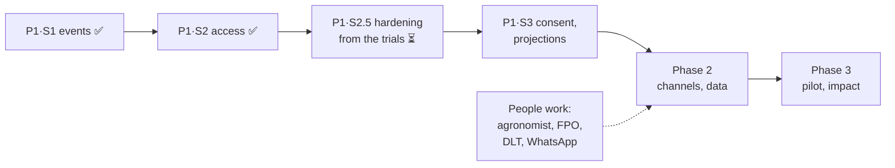

# What remains

The living list of work between today's code and the product in [PRODUCT-PLAN.md](PRODUCT-PLAN.md). **Update it in the same commit as the work**: tick what a commit finishes, add what it leaves behind, keep the dates. The plan says *why* and *how*; [GAPS.md](GAPS.md) is the register of problems; this file says *what is left, in order, and how we will know it is done*.

Last updated: **3 November 2026**, after the scenario trials ([SCENARIOS.md](SCENARIOS.md)), which added slice 2.5 below and items to slices 3 and Phase 2.

---

## Where we are

| Phase | Slice | State |
| --- | --- | --- |
| 1 · A record you can trust | 1 · The season record as events (append-only, hash-chained, per-event sync) | ✅ Done, `6f96543` |
| | 2 · Accounts, roles, authorisation; inbox and messages in Postgres; send by batch id; backups and a restore drill | ✅ Done, `07288d4` |
| | 2.5 · Hardening from the scenario trials: pilot mode, sign-in, lossless outbox, clocks, private lot passports, a truthful record, officer control, encrypted backups, honest guidance | ⏳ **Next** (before any real farmer is enrolled) |
| | 3 · Consent, server-side projections, the last of SQLite, real-Postgres CI, structured logs | ⬜ After 2.5 |
| 2 · Real channels, real data | Job runner, DLT SMS, WhatsApp, enrolment, live ingest, staging | ⬜ Not started (people work must start now: §4) |
| 3 · A pilot that proves impact | Impact ledger, field data, fitted models, security review, operations | ⬜ Not started |

## 0. Phase 1 · slice 2.5: hardening from the scenario trials (next)

Goal: nothing that the trials showed can hurt a real farmer, officer or buyer is left in place before the first real phone number is enrolled. Ids refer to [SCENARIOS.md](SCENARIOS.md) and the reports in [scenarios/](scenarios/). About four to six working days, almost all size S.

| # | Item | Done when | Closes |
| --- | --- | --- | --- |
| 2.5.1 | **Pilot mode.** `KHETKUNDLI_MODE=demo\|pilot`; in pilot: no people list on `/auth/me`, the on-screen code sink refused, no seeding, no demo controls, no Reset; `/status` shows the mode | A pilot-mode test: none of these are reachable | X-6/O-1, O-10, O-5/X-35, X-34 |
| 2.5.2 | **Sign-in hardening.** Client address only from a configured trusted proxy; code attempts and code issue counted atomically in SQL; body size limits on every route; `Origin` check on POSTs; security headers; staff sessions 12 hours with sign-out everywhere | Parallel brute-force and flooding tests fail to get past the limits | X-2, X-3, X-18, X-22, X-10, F-9 |
| 2.5.3 | **Lossless outbox.** Rejected events kept in a "needs attention" list (Marathi), bound to their author and sent only under that person; receipt and date fields validated (400, not 503); a visible "this phone is…" switch on the phone; the store cleared on a switch | Shared-phone test: Sunita's queued work survives Shankar signing in; property: no accepted or queued fact ever disappears from the projection | X-25/F-2, X-39, F-3, F-22 |
| 2.5.4 | **Clocks and versions.** Clocks observe every received event stamp; reset decided by one rule in the fold and the store; the server accepts every schema version up to its own; only staff may move the shared clock | A device a day ahead cannot win slots or erase later events; an old-version event is accepted | X-7, X-8, X-31, X-17/O-17 |
| 2.5.5 | **Private lot passports.** `GET /api/v1/lot/:code` returns a server-computed passport (cached, rate-limited) under an opaque code; the public stream is removed; no gat number, slips or acres | A lot request shows none of the plot's other events; codes cannot be enumerated | M-1/X-4, X-26 |
| 2.5.6 | **A truthful record.** Simulated sprays and sales written as `computed`, never `human` or `verified`; no simulated events on enrolled plots; the scan event carries finding, confidence and model version and counts as a report on its own; the passport's export check says *unknown* when nothing is logged | A test: an enrolled plot's record holds only her events and labelled system advice | X-1/O-2, F-4/O-6, M-5, M-8 |
| 2.5.7 | **Officer control.** "Warn downwind" opens the approval list instead of sending; a guard failure blocks sending; the guard also checks the Marathi text; canned replies state only what was done | No message leaves without an approval showing who, why and the exact text | O-3, O-8/X-23, X-5, O-18 |
| 2.5.8 | **Backups that are safe to keep.** One snapshot transaction; encrypted with a key outside the database; rotated; a copy off the laptop | The drill passes on a backup taken during writes | X-12, X-13 |
| 2.5.9 | **Honest guidance on the phone.** Dates on advisories and forecasts; a stale forecast never shown as live; "Scan a fruit" until a leaf model exists; no preselected "best market"; a soft "please check these lines" slip note | The phone shows the age of every forecast and advice it uses | F-6, F-7, F-12, M-6, M-4 |
| 2.5.10 | **Re-run the four trials** on the same scenarios | The verdict table in SCENARIOS.md improves, and no S1 item from 2.5 remains | — |

## 1. Phase 1 · slice 3

Goal: finish "a record you can trust": consent decides what is shared, the server computes what is shared, nothing important lives outside Postgres, and the same tests pass on a real Postgres server.

| # | Item | Done when | Gap |
| --- | --- | --- | --- |
| 1.3.1 | **Consent model**: grant and revoke events per purpose (*Pest Radar*, *pooled transport*, *fair-slip index*, *research*); a person's consents on `/api/v1/auth/me` | Property test: revoking consent removes the plot from every shared view; the owner still sees her record | G-B5 |
| 1.3.2 | **Server-side projections**: the server computes radar cells, wave and water from events and serves them; farmers stop receiving other farmers' raw events (they get projections and their own record) | A farmer's stream carries no other plot's raw events; the desk is unchanged; season hash from server equals the browser's | G-B2 |
| 1.3.3 | **Agent log and weather snapshots move to Postgres**; SQLite (`web/data/khetkundli.db`) retired | No `node:sqlite` import left; backup covers them; restore drill passes | G-B7 |
| 1.3.4 | **CI against a real Postgres** (a service container) as well as embedded Postgres; first green run on GitHub | `.github/workflows/ci.yml` runs `npm test` twice, `DATABASE_URL` set on the second; badge green | G-T3, G-T4 |
| 1.3.5 | **Run the app on the laptop's PostgreSQL 17** (needs a role and database the user creates; see §4) | `api-check`, smoke and the crash test pass with `DATABASE_URL` set | G-T3 |
| 1.3.6 | **Structured logs and request ids** (JSON lines: route, person, status, ms); errors with a stack in one place | Every API response has `X-Request-Id`; a failing request can be found by it | G-B13 |
| 1.3.7 | **Household switching on a shared phone**: several people signed in on one phone, one tap to switch | Two farmers on one phone, each sees only her plot; outbox items keep their author | G-P1 |
| 1.3.8 | **A signed daily digest** of the season chain's head, kept outside the database (file, and later emailed to the FPO) | Deleting the newest row is detected by comparing with yesterday's digest | G-B12 |
| 1.3.9 | **Contract tests for every API response** (zod schemas for responses, validated in api-check) | No route returns a shape that is not in a schema | G-B9, G-B14 |
| 1.3.11 | **The officer's record of advice**: a correction message type that references the original; an advice log nobody can delete; advisory selection that respects crop stage, the export interval and earlier advisories; receipts labelled simulated wherever counted | A sent advisory can be corrected, and the correction reaches the same plots | O-4, O-8, O-9 |
| 1.3.12 | **Her record on her phone**: events and messages kept in IndexedDB so an offline reload shows her entries, not the simulated plan | Airplane mode, reload: her entries are there | F-1 |
| 1.3.10 | **Rate limits shared across processes** (Postgres) instead of process memory | Two server processes enforce one limit | G-B10 |

## 2. Phase 2 · Real channels, real data

| # | Item | Done when | Blocked on |
| --- | --- | --- | --- |
| 2.1 | Job runner (pg-boss) in a separate worker process; the code split into packages (`engine`, `contracts`, `core`, `web`, `worker`) | Jobs survive a restart; the gateway simulator's timers move into jobs | — |
| 2.2 | Hourly weather ingest with provenance; daily Agmarknet prices with history; snapshots | `/status` shows the age of every feed; offline mode uses the newest snapshot | data.gov.in key |
| 2.3 | **Delivery service**: outbox, state machine, adapters (DLT SMS, WhatsApp, web push, in-app, labelled simulator), signed webhooks, retries, dead letter, cost per message | A real Marathi SMS on a registered phone; provider outage sends nothing twice | DLT registration, SMS provider, WhatsApp Business |
| 2.4 | OTP by SMS (`KHETKUNDLI_OTP_SINK=sms`); the on-screen sink refused when `NODE_ENV=production` | Sign-in works with no code on screen | 2.3 |
| 2.5 | Enrolment at the FPO desk: register a farmer, her plots (gat number, map pin or GPS walk), bahar date, household | A new farmer signs in and keeps a record within 10 minutes of arriving | FPO |
| 2.6 | Consent flows in the app (grant, revoke, export my data, erase with crypto-shredding of personal fields) | Erase leaves the chain verifying and the person unreadable | 1.3.1 |
| 2.7 | FPO admin: villages, staff, the rate card, message templates, the copper price list | The slip check uses the FPO's own card | FPO |
| 2.8 | Agent: farmer ratings, officer review queue, corrections into router training; guard regression suite in CI; model version with every answer | A wrong answer corrected on the desk changes the next router build | — |
| 2.9 | Scan Lens: grouped split, int8 export, timed on a low-end Android phone | Published honest accuracy and latency | a low-end phone |
| 2.10 | Voice logging; offline Marathi speech evaluation (Whisper, AI4Bharat) | "फवारणी केली" logs a spray offline | — |
| 2.12 | **Market advice that is honest**: yesterday's real price, a three-season band, a net range; the advice shown recorded with the sale and compared afterwards; an FPO market allocation (quota per market per day) instead of one "best" for everyone | Advised vs got is visible per sale; no two farmers are herded by the same argmax | M-6, M-7 | data.gov.in key |
| 2.13 | **The money loop**: slip-check sanity guards and lawful levies; slip cases with consented evidence, raised by the FPO in batches; per-plot harvest events; payment events and an advance ledger; farm-gate sales | A disputed slip has a case state and evidence; a late payment is visible | M-3, M-4, M-8, M-10 | FPO |
| 2.14 | **The FPO office**: an enrolment desk (number checked by a test code, gat number and map pin, joint holders, phoneless farmers, household); staff with jurisdictions and deactivation; an audit view with CSV and PDF exports; a data-request register; the spray table as versioned, approved data | 150 farmers enrolled in an afternoon without a wrong number; a data request answered from the register | O-7, O-11, O-12, O-14, O-16 | FPO, agronomist |
| 2.11 | Staging in an India region, infrastructure as code, dashboards and alerts on the SLOs; load test at 10× the pilot | SLOs met under load; a deploy during load loses nothing | hosting account, budget |

## 3. Phase 3 · A pilot that proves impact

| # | Item | Blocked on |
| --- | --- | --- |
| 3.1 | Impact ledger with lineage and a pre-pilot baseline; weekly FPO report | FPO, baseline survey |
| 3.2 | Hybrid view: real cohort plus labelled simulated background | enrolled farmers |
| 3.3 | Field data: Phaltan photos (agronomist-labelled), real pattis, five flow meters, optionally one leaf-wetness station | agronomist, FPO, meters |
| 3.4 | Fit the spread and blight models to pilot reports; re-run the backtest on real detections | pilot data |
| 3.5 | Security: OWASP ASVS level 2 checklist, dependency and secret scanning, an external penetration test | budget |
| 3.6 | Failure testing at scale: a week-long offline phone, network partitions, failover on staging | staging |
| 3.7 | Operations: runbooks, on-call, a support number answered by the FPO, an incident log | FPO |
| 3.8 | **The FPO transport loop and the business model**: driver registry, run offers by SMS with YES/NO, minimum load and a fair split, a collection-point manifest with counts and photos; grade evidence at packing; the payer decided (FPO core, farmer success fee, buyer fee for signed passports) | FPO, drivers |

## 4. Waiting on people (start now)

| Need | For | State |
| --- | --- | --- |
| A Postgres role and database on this laptop's PostgreSQL 17 (`create role khetkundli login password '…'; create database khetkundli owner khetkundli;`, then `DATABASE_URL` in `web/.env.local`) | 1.3.5 | Not done: needs the superuser password, which only the user should type |
| An agronomist (ICAR-NRCP Solapur, MPKV Rahuri or the KVK) | spray table sign-off, photo labels | Not approached |
| A partner FPO in Phaltan taluka | users, rate card, support, data fiduciary | Not approached |
| TRAI DLT registration through an SMS provider | 2.3, 2.4 | Not started (1–3 weeks) |
| WhatsApp Business account and templates | 2.3 | Not started |
| data.gov.in API key | 2.2 | Not requested |
| Hosting account in an India region; a domain | 2.11 | Not started |
| Privacy notice and terms reviewed by someone qualified | 2.6 | Not started |
| Push this branch to GitHub | first CI run (1.3.4) | Pushed 3 Nov 2026 with the scenario trials |

## 5. Known limitations we chose for now

Each is deliberate and has a closing item.

| Limitation | Why it is acceptable today | Closes with |
| --- | --- | --- |
| Sign-in codes are shown on screen (and the demo people are listed on the sign-in sheet) | No SMS sender exists yet; `/status` says so in red | 2.4 |
| Any signed-in farmer receives every plot's raw season events | The season is still computed on each screen | 1.3.2 |
| Rate limits live in one process's memory | One server process | 1.3.10 |
| The gateway simulator uses timers inside a request | No job runner yet; receipts are labelled *sim* | 2.1, 2.3 |
| Desk → Reset deletes the inbox, batches and messages (the season record itself is only reset by an event) | Demo control, staff only | Removed for real deployments in 2.5 |
| Season events recorded before slice 2 have no author, so only staff can undo them | Demo data only | — |
| Staff may record entries for any plot (the FPO logging on a farmer's behalf) | Matches how FPOs work; the row records who wrote it | Consent rules in 1.3.1 may narrow it |
| The agent log and saved forecasts are still in SQLite | Not part of the record; not yet in backups | 1.3.3 |
| Tested on embedded Postgres only | No credentials for the laptop's PostgreSQL 17 | 1.3.4, 1.3.5 |
| CI has never run | Not pushed | §4 |

## 6. Log

| Date | Commit | What changed here |
| --- | --- | --- |
| 3 Nov 2026 | `07288d4` | File created. Slice 2 done: accounts (OTP), sessions per surface, roles, authorisation on every route, Postgres inbox, messages and batches, send by batch id, backups and a restore drill, 29 unit tests, `api-check` (16), smoke with sign-in |
| 3 Nov 2026 | (scenario trials) | Four scenario trials (farmer, institutions, market, adversaries; 44 scenarios, 0 fully working, 15 partly, 29 failing) added slice 2.5 (ten items), 1.3.11, 1.3.12, 2.12–2.14 and 3.8; GAPS.md §7 lists the 93 new gap ids by theme |
