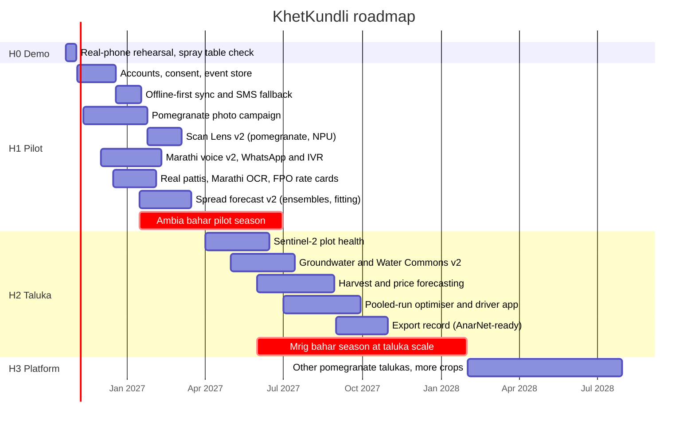
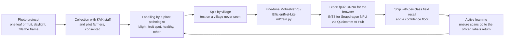
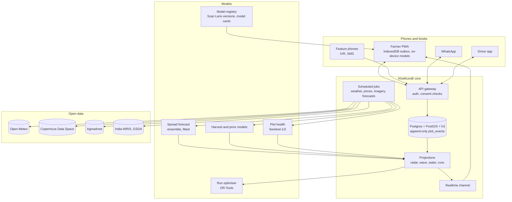

# Roadmap

From a demo that runs on real weather to a record that real farmers keep. Each item says **what the farmer or officer gets**, **how it works**, **what data it needs**, and **when it is done**. Dates are plans; partners named below are organisations we intend to approach, not agreements. Targets are hypotheses to test, not results.

## Where we are (20 October 2026)

The project is being built as a local prototype, not deployed. The working plan for that (a local backend, models trained on the laptop, offline demo, polish) is in [NEXT-STEPS.md](NEXT-STEPS.md); the horizons below describe what a real pilot would add.

Built and tested: the kundli wheel, today slip and spray window; Scan Lens on the device; Marathi voice answers from the record with escalation to an officer; the sale slip check with on-device OCR; the taluka desk with Pest Radar, Harvest Wave, Water Commons and pooled runs; the season engine running on **recorded 2026 weather**; a **live wind field** and **72-hour spread forecast** with one-tap advisories by app or SMS, run on all **51 ECMWF ensemble members** for a chance by cell; the **storm brush** what-if; **lot passports** with QR codes and an **export pre-harvest check**; the **neighbour pulse** on the phone; a **photo check** before scans; officer replies read aloud; **offline-first sync** (an IndexedDB outbox ordered by hybrid logical clocks, an idempotent relay with last-writer-wins); **Marathi slip reading** with self-proving corrections; **contour lines from real elevation** and low-lying wetness; a **forecast backtest**; the **season share card**; a **reasoning agent on the laptop** (a router trained here, tools over the record, Llama 3.1 8B through Ollama, retrieval, deterministic guards, officer drafts and an evening advisory pipeline: [AGENTS.md](AGENTS.md)); the pitch. Simulated: the farmers and their plots, mandi prices without a key, the specimen slips.

## Horizons



---

## H0 · Demo week (to 2 November 2026)

| Task | Done when |
| --- | --- |
| **Review the spray table.** Streptocycline is removed and the table now follows ICAR-NRCP's copper and Bordeaux advice ([AGRONOMY.md](AGRONOMY.md)); confirm the antibiotic ban's final gazette notification, and have a plant pathologist review doses and the 60-day pre-harvest interval for copper | A named reviewer signs off the table |
| Rehearse on a real Android phone over venue-like Wi-Fi, both the two-device and one-laptop setups | The [DEMO.md](DEMO.md) script runs twice without a reset |
| Record a backup video of the full script | A 7-minute file on two drives |
| Finish review of the pitch page and slip check | Findings fixed or explained |

---

## H1 · Pilot: one FPO, three villages, the Ambia bahar of 2027

Goal: about 150 farmers keep their record for a full season, the officer uses the desk weekly, and every model gets its first field numbers.

### 1.1 Accounts, consent and a real record store

*Farmer gets*: her record survives a lost phone; she decides who sees what. *Officer gets*: the real taluka, not a simulation.

- **Identity**: phone-number accounts (OTP), one farmer to many plots, plots registered by gat number and a GPS walk of the boundary (or chosen from the village map with the farmer).
- **Consent** (Digital Personal Data Protection Act 2023): purpose-bound, revocable consents stored as events: *share reported scans with my FPO for Pest Radar*, *share pickings for pooled runs*, *share sale slips anonymously for the fair-slip index*. A record export and an erase request in the app.
- **Store**: Postgres 16 with PostGIS and the `h3` extension. Append-only `plot_events`; projections as materialised views; the browser engine stays as the simulator and the "what if".

```sql
create table plot_events (
  id          uuid primary key,           -- UUIDv7, made on the phone
  plot_id     text not null references plots(id),
  occurred_on date not null,
  hour        real,
  kind        text not null,              -- scan, spray, irrigate, pick, sale, advisory, correction …
  by          text not null check (by in ('computed','human','verified')),
  payload     jsonb not null,
  device_id   text not null,
  hlc         text not null,              -- hybrid logical clock, for ordering across devices
  consent     text[] not null,            -- scopes this event may be shared under
  recorded_at timestamptz not null default now()
);
create index on plot_events (plot_id, occurred_on);
-- Pest Radar is a projection: reported blight scans by H3 cell in the last 14 days, freshness-weighted.
```

- **Corrections** are new events that point at the old one, so the record keeps its history and its inks.

*Done when*: a farmer can reinstall the app and see her season; the desk reads only consented events.

### 1.2 Offline-first sync

**Built in October 2026 (phone side and relay):** durable messages are stamped with a hybrid logical clock and kept in an IndexedDB outbox until the relay accepts them; the relay ignores stamps it has seen and keeps the newest overrides by clock, so a phone reconnecting with older changes cannot overwrite newer ones; the phone header shows *Synced*, *Sending* or *Offline · N to send*. Still to do for the pilot: the server-side event store below, and SMS.

- The phone keeps an outbox of events in IndexedDB; each event has a UUIDv7 and a hybrid logical clock. Upload is idempotent (the server ignores ids it has seen); download is by cursor. Because events are append-only, there are no merge conflicts to resolve.
- Background Sync where the browser supports it; otherwise retry on open.
- **SMS fallback** for the events that cannot wait: a blight scan is packed into one 160-character message (plot, day, finding, confidence) to an SMS gateway number.
- Live updates over a hosted WebSocket channel replace the demo relay.

*Done when*: a week offline syncs in one go with no duplicates, and a scan in a no-data area reaches the desk by SMS.

### 1.3 Scan Lens v2: pomegranate, on the NPU



- Classes start with what matters most: bacterial blight on leaf and fruit, healthy leaf and fruit, and "something else, ask the officer"; fungal fruit spots (Cercospora, Alternaria, anthracnose) follow as data allows.
- Report **per-class recall on a held-out village**, not overall accuracy on random splits.
- A curative recommendation needs a confident scan or the officer's confirmation; below the floor, the farmer is asked to retake or send to the officer.
- Image quality check before inference: blur (variance of the Laplacian), exposure and leaf coverage, with on-screen guidance.

*Done when*: blight recall on the held-out village is published, with the confusion matrix, in the app's model card.

### 1.4 Marathi voice v2, WhatsApp and IVR

- **Speech**: Marathi ASR from open Indic models (AI4Bharat IndicConformer) or the Bhashini APIs, with on-device Web Speech as the offline fallback; Marathi TTS for answers.
- **Understanding**: a small multilingual intent classifier (IndicBERT or MuRIL) trained on the pilot's real questions; answers still built from the record by code.
- **Language models** only rephrase an answer the code has already built, and draft replies for the officer to edit; never doses, never facts that are not in the record or the rules table.
- **Channels**: WhatsApp Business messages for advisories and replies (voice notes in Marathi); a missed-call IVR that calls back with today's action, for farmers without a smartphone. The spread forecast's *by SMS* path becomes real here.

*Done when*: farmers without smartphones receive the same advisories, and the Ask log shows the intents the classifier gets wrong.

### 1.5 Real pattis and the FPO's rate card

- Collect slips from the pilot farmers (names blurred) to tune the parser to each agent's layout.
- **Built in October 2026:** Tesseract's Marathi model loads on demand when English reads noise; Devanagari digits and Marathi labels are parsed; a misread is corrected only when its own line proves it (a multiplication on the label, a percentage of the gross, or the one weak line under a clearly read total), unreadable numbers are left blank, and a total or net is never corrected. Next: a table-layout pass for column slips, and a handwritten-digit model (Devanagari and Western) for hand-written amounts.
- The **rate card becomes data**: the FPO records what it agreed with each agent, per market and season; the slip check compares against that.
- **Fair-slip index** (anonymous, aggregated): share of slips with charges above the card, per market, for the FPO's negotiations; no agent is named on farmer screens.

### 1.6 Live mandi prices

Agmarknet daily modal prices and arrivals for pomegranate at Phaltan, Pune, Vashi and Solapur through the data.gov.in API; the slip check's rate comparison and the market ledger become live.

### 1.7 Spread forecast v2

- **Uncertainty** (built in October 2026): the forecast runs on each of the 51 ECMWF ensemble members at Phaltan, and the desk shows the share of members in which each cell reaches moderate exposure, with the 10–90% range of rain in the hour strip. Next: per-member wind fields at the nine grid points rather than one wind per member.
- **Fit the kernel**: the scoring harness is built (`npm run backtest`): over the recorded season the forecast scores ROC AUC 0.577 against 0.559 for distance alone and 0.643 for an oracle that sees every symptomatic orchard, scored on reports 8 to 24 days later to allow for the latent period. During the pilot, run it on real reports and fit reach $R$, width $\sigma$ and source weights by maximum likelihood.
- **Second channel**: pruning gangs and shared sprayers carry bacteria between orchards; let farmers log who worked in the orchard and add that contact network to the forecast.
- **Terrain**: built in part: real elevation (Copernicus DEM via Open-Meteo) draws the survey sheet's contours and marks 28 low-lying cells where dew holds two hours longer. Next: slope and aspect, and wind channelled along the valleys.

*Done when*: the forecast beats the distance-only baseline on the pilot's detections, or we say plainly that it does not.

---

## H2 · Taluka: the Mrig bahar of 2027 at scale

### 2.1 Plot health from Sentinel-2

- Sentinel-2 L2A (10 m, about every 5 days) from the Copernicus Data Space Ecosystem (STAC search plus openEO or the Process API). NDVI and NDRE per plot polygon, with clouds and shadows removed using the scene classification layer.
- Sentinel-1 radar backscatter fills the monsoon gaps when clouds hide the optical images.
- **Anomaly**: compare each plot with plots of the same village and bahar stage; flag a canopy falling behind for a scan or a visit.
- On the phone: a thin greenness ring on the kundli wheel, one tick per clear image.

### 2.2 Water Commons v2: the aquifer as a passbook

- Groundwater levels from GSDA and CGWB observation wells (India-WRIS), plus farmer-reported well depths (a photo of a marked rope, monthly).
- A village water budget: recharge from recorded rain, withdrawals from the irrigation the records imply (ET0 × Kc), shown as a passbook with deposits and withdrawals.
- Flow meters on a sample of drip systems to verify that "skipped before rain" saves what the model says.

### 2.3 Harvest and price forecasting

- **Picking dates**: a gradient-boosted model on bahar date, growing degree days from recorded temperature, canopy greenness and the pilot's actual pickings, with prediction intervals.
- **Prices and gluts**: Agmarknet arrivals and modal prices for pomegranate at the main terminal markets, plus our own forecast of arrivals from the taluka, festival calendar and weather; LightGBM quantile models (or a temporal fusion transformer if the data supports it), compared against a seasonal naive baseline.
- On the phone: *If you pick on 12 November and sell in Pune, expect ₹x to ₹y a kg*, with the uncertainty shown.

### 2.4 Pooled runs, optimised

- Capacitated vehicle routing with time windows (OR-Tools): collection points as pickups, market opening as the deadline, real vehicles with capacity and cost per km; re-solved each evening from the next day's bookings.
- A driver app: route, pickups, crate counts with a photo at each stop, GPS trace; cost split per crate on the farmers' slips.
- **Lot passport** (built in October 2026): a QR per picking (cell, picking date, grade, sprays, water, run, export check) that the buyer can scan; next, sign the passport so a buyer can trust it was not edited.

### 2.5 Export-ready record

The first piece is built: each lot passport checks copper sprays against the 60-day pre-harvest interval from the APEDA list and says when a picking would clear it.

Pomegranate exports to the EU go through APEDA's AnarNet traceability system. The record already holds every spray with product and date; add each product's label pre-harvest interval and residue limits, check them against the planned picking date, schedule residue tests, and produce the plot's spray dossier for registration.

### 2.6 The officer's console

Accounts and roles for officers and FPO staff; field visit planning from the inbox and the radar (shortest route through today's visits); cohort views of adoption and outcomes; the fair-slip index.

---

## H3 · Platform (2028 onward)

- **More talukas**: the pomegranate belts of Solapur, Sangli and Ahmednagar districts share the crop, the disease and the markets.
- **More crops**: grapes, onion and sugarcane in Phaltan itself; the record, the radar and the wave are crop-agnostic, the models are not.
- **Public systems, with consent**: link to AgriStack Farmer ID and the digital crop survey where available; ONDC for direct sales.
- **Open data**: an API of aggregated, delayed, k-anonymous cell-level disease and harvest data for researchers and the agriculture department.
- **Federated learning** for Scan Lens: improve the model from phones without moving photos.

---

## Interactive features that serve a real use

Each of these should be as good to demonstrate as it is useful in the field.

| Feature | What the user sees | Real use | Data | Build notes | Horizon |
| --- | --- | --- | --- | --- | --- |
| **Storm brush** | The officer drags a rain cell across the survey sheet; the plume and the ripple follow the cursor | Training, and "what if the forecast shifts east" planning | Forecast frames, spread kernel | Pointer → a moving rain cell with a gust front; the forecast runs in ~5 ms | **Built** |
| **Ensemble plume** | The plume drawn as several faint layers that agree where the risk is likely | Honest uncertainty for advisories | Open-Meteo ensembles | Run the kernel per member (in small batches); show the share of members | **Built** |
| **Neighbour pulse** | A radar sweep on the phone: "3 blight scans within 2 km this week" | Makes the collective visible to the farmer, and rewards reporting | Pest Radar cells | Cell-level only, never a neighbour's plot | **Built** |
| **Spray window push** | A 05:30 notification on a sprayable morning when a spray is due | Fewer washed-off sprays | Hourly forecast, record | Web Push, WhatsApp template, IVR call | H1 |
| **Officer voice notes** | The reply plays as Marathi audio in Ask | Low-literacy farmers | TTS or recorded audio | Built as text read aloud; recorded audio next | **Built (TTS)** |
| **Scan guide** | A frame that turns green when one leaf is sharp, lit and fills the view | Better scans, fewer misreads | Camera frames | Laplacian variance and exposure built; a leaf-coverage mask next | **Built** |
| **Season film** | One click renders a 60-second replay of the village season with captions, to share at a gram sabha | Shows the village what it achieved together | The season | Canvas capture to MP4 with WebCodecs | H1 |
| **Kundli share card** | A Marathi image of the farmer's wheel and season summary | A record she can show a buyer or a scheme officer | Her record | Drawn on the phone (canvas, 1080 × 1350) and shared as an image; QR to the passport next | **Built** |
| **3D survey sheet** | The taluka in relief, wind flowing over the hills, exposure extruded by cell | Explains valleys and ridges in spread | Copernicus DEM | Contour lines built; a 3D view with deck.gl next | **Contours built** |
| **Mandi river** | Arrivals flowing from talukas into Pune and Vashi, with the price line and a glut band ahead | Choose when and where to sell | Agmarknet, Harvest Wave | Streamgraph with forecast band | H2 |
| **Aquifer passbook** | The village's groundwater as a bank passbook with deposits and withdrawals | A shared goal people understand | Wells, rain, records | Monthly statement, Marathi | H2 |
| **Collection-point board** | A tablet at the collection point showing today's lots, grades and vehicles | Smooth mornings, fewer disputes | Bookings, runs | Kiosk mode, offline | H2 |
| **Lot passport** | A QR on each lot that opens its history | Trust with buyers, export traceability | Record, runs | Minimal fields built, with the export check; signing next | **Built** |

---

## Target architecture



---

## How we will know it works

| Question | Measure | Target for the pilot (hypothesis) | How measured |
| --- | --- | --- | --- |
| Do farmers keep the record? | Weekly active farmers | 60% of enrolled | Event log |
| Does the radar see enough? | Plots with a scan in the last 14 days during the monsoon | 50% | Event log |
| Are sprays wasted less? | Sprays followed by 5 mm of rain within 6 hours | Half of the pre-pilot baseline | Records against recorded weather; baseline survey |
| Does the forecast warn the right plots? | ROC AUC of 72-hour exposure for detections in the next 14 days | Above the distance-only baseline | Pilot detections |
| Do advisories reach people in time? | Plots in the plume reached within 2 hours, by any channel | 80% | Delivery receipts |
| Is water kept? | Litres skipped before rain on metered plots | Within 20% of the model's estimate | Flow meters |
| Are slips fair? | Slips flagged; rupees recovered after a dispute | Measured, not targeted | Slip checks, follow-up |
| Do runs fill? | Average fill of pooled runs | 80% | Run records |

---

## Risks

| Risk | Mitigation |
| --- | --- |
| Too few scans make the radar blind | Officer visits recorded as verified scans; Neighbour pulse to reward reporting; SMS reporting |
| A wrong diagnosis leads to a wrong spray | Confidence floor; officer confirmation for curative advice; doses only from the reviewed table |
| Spray advice falls out of date or breaks a regulation | Table owned by a named agronomist, reviewed each season against current approvals |
| Agents push back on slip checks | Compare against the FPO's own agreed card; aggregate index only; the farmer decides whether to dispute |
| Connectivity in orchards | Offline-first, SMS for urgent events, IVR |
| Low-end phones | Test on 2 GB RAM Android; models under 10 MB; OCR only on demand |
| Privacy and trust | Consent per purpose, cell-level maps, photos on the device, FPO as data steward |
| The model's licence or data rights | Train our own pomegranate model on consented photos; publish its card |

## What we need

- **Agronomy**: a plant pathologist to review the spray table and label photos (ICAR-NRCP Solapur, MPKV Rahuri or KVK staff, to be approached).
- **A pilot FPO** in Phaltan taluka willing to share rate cards and run the desk weekly.
- **Field time**: photo collection days in blight season; slip collection after pickings.
- **Devices**: three low-end Android phones for testing; flow meters for a sample of plots.
- **Keys and services**: a data.gov.in API key; an SMS gateway and WhatsApp Business account; hosting for Postgres and the realtime channel.
