# KhetKundli: the technical guide

Everything about how KhetKundli works, from the farmer's first tap to the buyer scanning a crate, in one place: the stack, the architecture, every moving part and what it does, the data, the flows, the security model, the tests, and how to run it. The diagrams are Mermaid (GitHub draws them); the screenshots are from the running app (taken 20 October 2026, before sign-in was added).

Status: 3 November 2026, `main` after Phase 1 slice 2 and the first part of slice 2.5. For the background see [CONTEXT.md](CONTEXT.md); for what is left, [REMAINING.md](REMAINING.md).

---

## Contents

1. [What it is, in one picture](#1-what-it-is-in-one-picture)
2. [The tech stack](#2-the-tech-stack)
3. [System architecture](#3-system-architecture)
4. [The journey, start to end](#4-the-journey-start-to-end)
5. [The season engine](#5-the-season-engine)
6. [Season events: the record](#6-season-events-the-record)
7. [Sync, offline and the relay](#7-sync-offline-and-the-relay)
8. [Accounts, sessions and the policy](#8-accounts-sessions-and-the-policy)
9. [The models: forecast, Scan Lens, slip reader, agent](#9-the-models)
10. [The screens and what each part does](#10-the-screens)
11. [Data model](#11-data-model)
12. [API reference](#12-api-reference)
13. [Testing and proof](#13-testing-and-proof)
14. [Running, deploying, configuring](#14-running-deploying-configuring)
15. [Repository map](#15-repository-map)
16. [Limits today](#16-limits-today)

---

## 1. What it is, in one picture

Every pomegranate plot in Phaltan taluka gets a living season record (its *kundli*). The farmer's phone writes to it; a taluka desk reads all records together and sees what no single farmer can: where blight is moving, which village picks which week, how much water stays in the ground, whether a sale slip was fair.

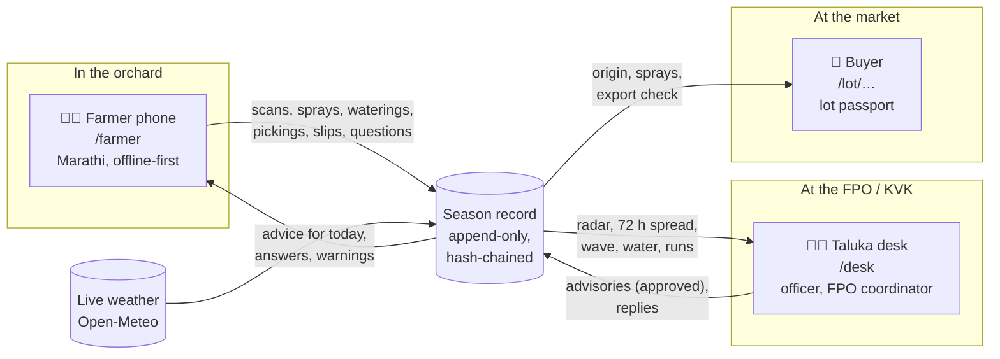

| Screen | | |
| :---: | :---: | :---: |
| 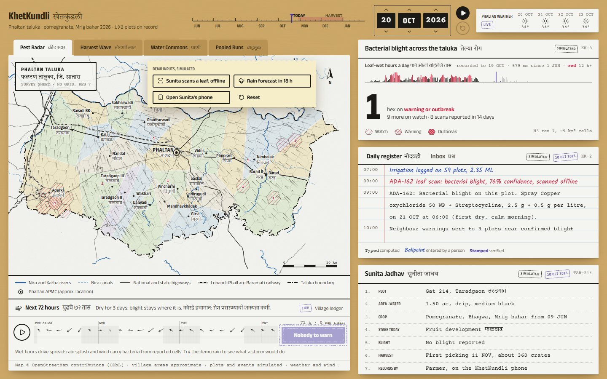 | 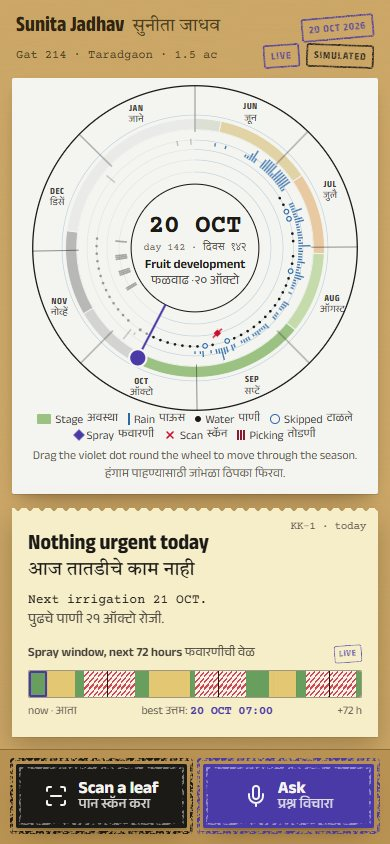 | 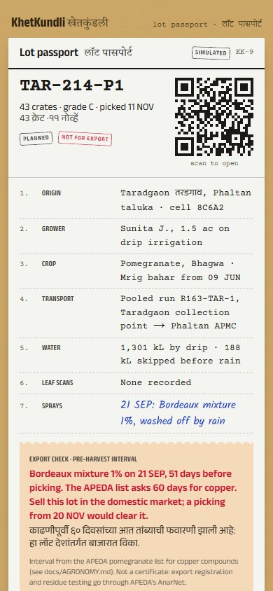 |
| **The taluka desk**: survey map, radar, forecast, register | **The farmer's phone**: the season wheel and today's one task | **The lot passport**: what a buyer sees for one picking |

## 2. The tech stack

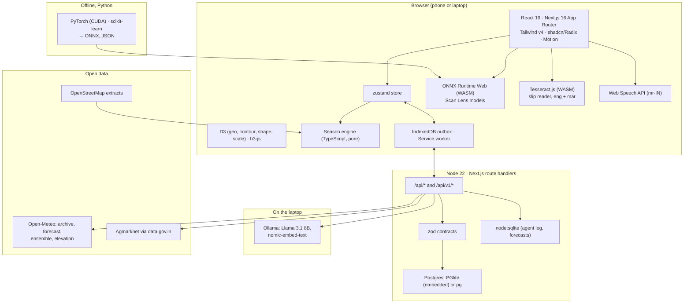

| Layer | Technology | Why |
| --- | --- | --- |
| UI | Next.js 16 (App Router), React 19, TypeScript 5 | One app for phone, desk, pitch and lot pages; server routes in the same codebase |
| Styling and motion | Tailwind CSS v4, shadcn/Radix primitives, Motion | The "Living Record" design: paper, ink, stamps; accessible components |
| Charts and maps | D3 (geo, contour, delaunay, shape, scale), h3-js | A hand-drawn survey sheet, H3 hexagon cells (resolution 7, about 5 km²), contours from real elevation |
| State | zustand | One store per screen: clock, events, season, ripple, inbox, messages |
| Simulation | Pure TypeScript engine (`lib/sim`) | Same inputs give the same season on every device and on the server |
| On-device ML | ONNX Runtime Web (WebAssembly) in a worker | Disease scans with no signal; the photo never leaves the phone |
| OCR | Tesseract.js (English + Marathi LSTM) | Sale slips read on the phone in about 1–2 s |
| Voice | Web Speech API (`mr-IN`) | Marathi questions and answers read aloud |
| Offline | Service worker, IndexedDB outbox, hybrid logical clocks | Scans, entries and questions wait for signal and arrive once |
| Contracts | zod | One schema for every season event, shared by phone and server |
| Database | Postgres 16+ via PGlite (embedded, zero install) or `pg` (a server with `DATABASE_URL`) | Append-only record with triggers, transactions, advisory locks |
| Local file | `node:sqlite` | Agent log and saved forecasts (moving to Postgres in slice 3) |
| Agent | Ollama (Llama 3.1 8B Q4_K_M, nomic-embed-text) on the laptop GPU | Answers in Marathi and English from the farmer's own record; nothing leaves the laptop |
| Training (offline) | Python, PyTorch (CUDA), scikit-learn | The pomegranate model (MobileNetV3) and the question router |
| Tests | Node test runner via tsx, fast-check, Puppeteer | Property tests, real-database tests, crash tests, browser smoke tests |
| CI | GitHub Actions | Types, lint, tests, crash test, slips, router parity on every push |

## 3. System architecture

### 3.1 The whole system

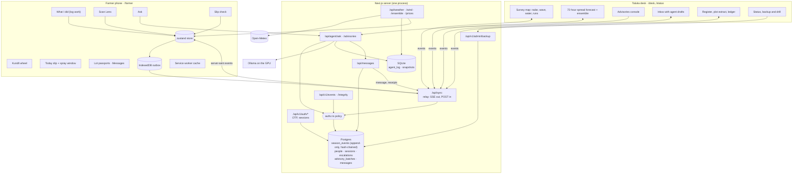

### 3.2 The key design decision: one pure engine, many faces

The season is not stored as rows of state. It is **computed**: `generateSeason(seed, recorded weather, overrides)` produces 192 plots × 245 days of events, radar cells, harvest waves, runs and prices in about 150 ms. The overrides are themselves **folded from the season events** (the facts people recorded). So every screen and the server run the same function on the same facts and get the same season.

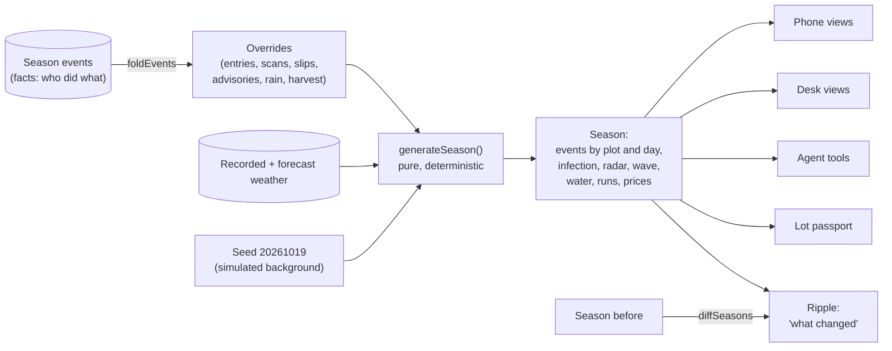

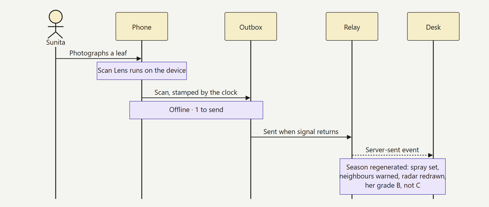

## 4. The journey, start to end

This is one season told as the system sees it: sign in, work in the orchard, an outbreak, the officer's warning, picking, the sale, the buyer.

```mermaid
sequenceDiagram
  autonumber
  actor S as Sunita (farmer)
  participant P as Phone /farmer
  participant O as Outbox (IndexedDB)
  participant R as Server relay + record
  participant D as Desk /desk
  actor K as Extension officer
  actor B as Buyer

  S->>P: Open the app, enter mobile number
  P->>R: POST /api/v1/auth/otp
  R-->>P: code (on screen in demo; FPO desk or SMS in pilot)
  S->>P: Enter code
  P->>R: POST /api/v1/auth/verify → session cookie kk_phone
  R-->>P: SSE /api/sync: every season event since the last reset
  P->>P: foldEvents → generateSeason → her plot's wheel and today's task

  Note over S,P: Morning, no signal
  S->>P: "What I did: sprayed Bordeaux"
  P->>P: record event (UUIDv7, clock stamp) → regenerate → "What changed"
  P->>O: queue the event
  S->>P: Scan a fruit
  P->>P: ONNX model in a worker: blight 0.94, on the phone
  P->>O: queue the scan

  Note over O,R: Signal returns
  O->>R: POST /api/sync {events}
  R->>R: contract ✓ · policy (her plot) ✓ · append + hash chain
  R-->>O: accepted (per event)
  R-->>D: SSE events → desk regenerates → ripple
  D->>K: Radar cell turns red; 72-hour plume over the next villages

  K->>D: Prepare tonight's batch
  D->>R: POST /api/agent/advisories → stored batch (who, why, Marathi text)
  K->>D: Untick two plots, approve
  D->>R: POST /api/messages {batchId}
  R-->>P: SSE message → banner; phone sends "delivered", then "read"
  R-->>D: receipts

  S->>P: Ask by voice: "पुढची फवारणी कधी करू?"
  P->>R: POST /api/agent/ask (her plot, from the server's record)
  R->>R: route → tools → Llama 3.1 → guard
  R-->>P: answer in Marathi, with citations, read aloud

  S->>P: Log picking: 40 crates, grade A
  P->>R: event → Harvest Wave and runs re-plan on the desk
  S->>P: Photograph the patti at the adatiya's shop
  P->>P: Tesseract on the phone → parse → check against the rate card
  P->>R: file the slip (event); escalate a dispute (inbox)

  B->>R: Scan the lot QR → /lot/…
  R-->>B: origin cell, sprays, water, export pre-harvest check
```

### The same journey, as screens

| 1 · Her season | 2 · Ask, in Marathi | 3 · Around her plot |
| :---: | :---: | :---: |
|  | 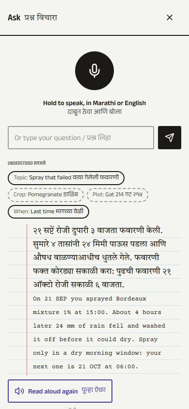 | 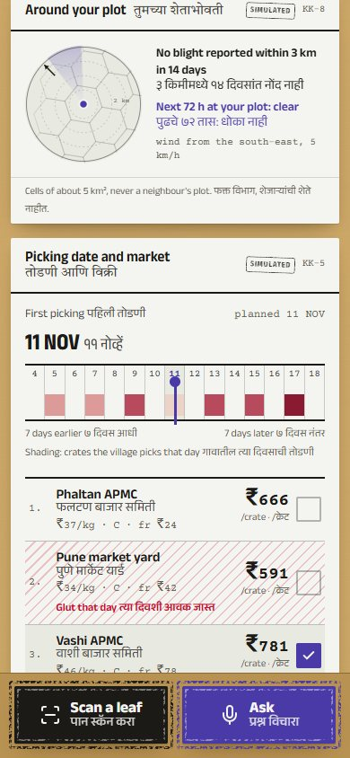 |
| **4 · The sale slip** | **5 · Marathi slip** | **6 · The lot QR** |
| 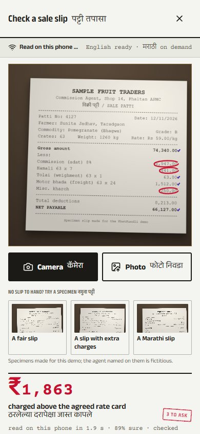 | 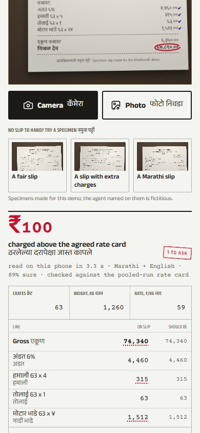 | 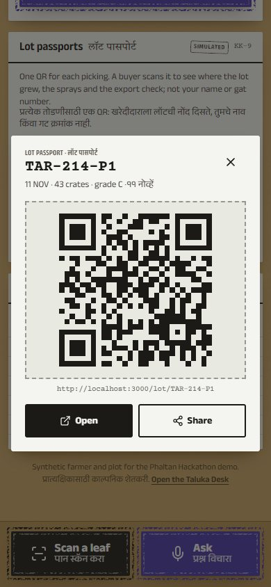 |
| **7 · Desk: storm in the forecast** | **8 · Desk: Harvest Wave** | **9 · Desk: pooled runs** |
| 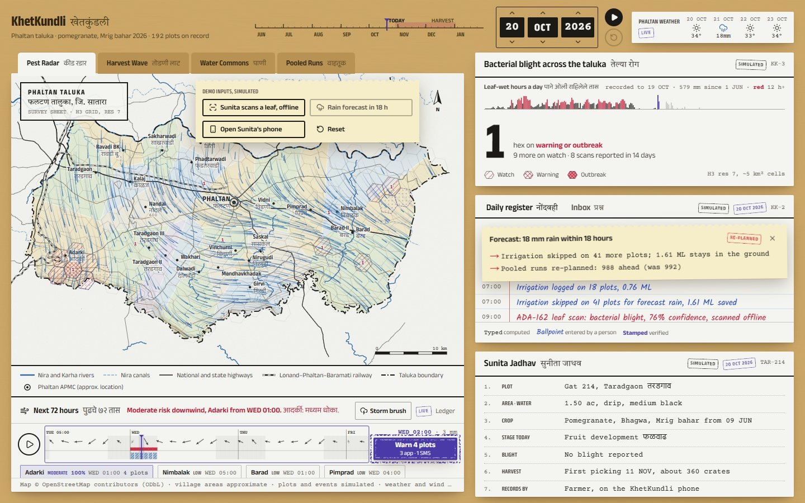 | 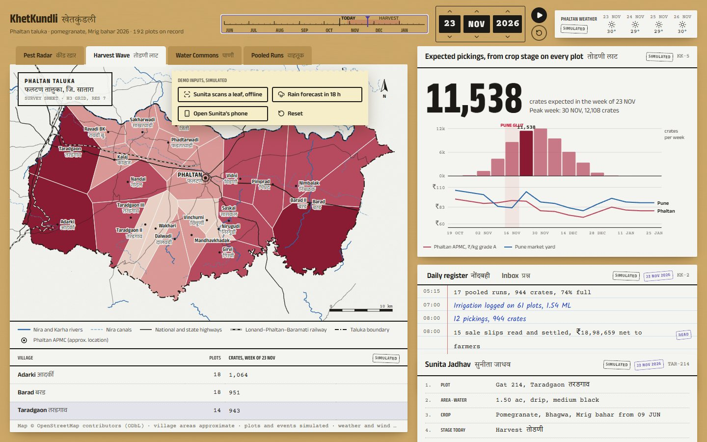 | 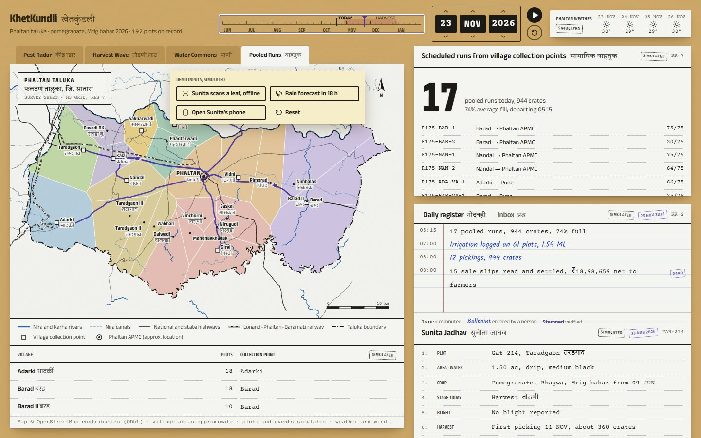 |

## 5. The season engine

`web/src/lib/sim/season.ts`, about 500 lines, pure TypeScript. Day 0 is 1 June 2026; the season runs 245 days to 31 January 2027 (one Mrig bahar crop).

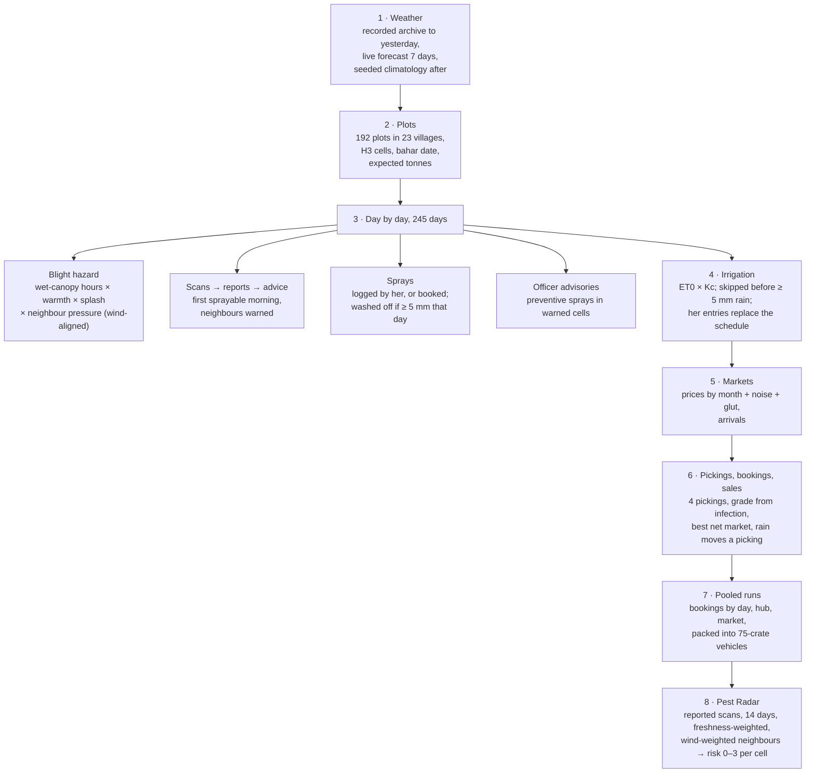

**The blight model** (from [MODELS.md](MODELS.md)):

- favourability `f = min(1, wetHours/12) × warmth × splash`
- pressure on a plot = Σ over infected neighbours within 6 km of `e^(−km/1.4) × state × (0.55 + 0.9·max(0, cos(bearing − wind)))`
- daily infection probability = `1 − exp(−(0.0007 + 0.085·pressure)·f·shield)`, where a preventive spray gives `shield` 0.35 for 10 days
- states: healthy → latent (10–14 days) → symptomatic → treated (a curative spray that sets)

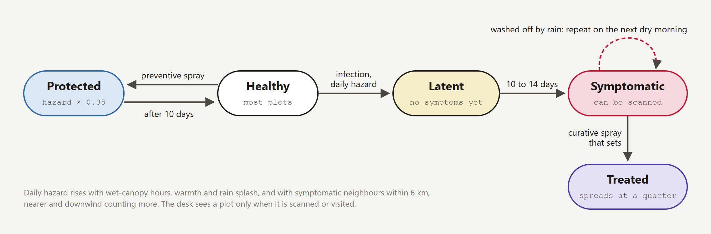

**Causal isolation.** Every random draw is `hash01(seed, plot, day, salt)`, not a shared stream, so one farmer's scan changes only what it causes. `scripts/simtest.ts` checks that a scan far from the hero leaves other plots unchanged.

**The 72-hour spread forecast** (`lib/spread.ts`) runs separately on the hourly forecast and a 3 × 3 live wind grid: each reported source cell spreads a wind-shaped kernel hour by hour, low-lying cells hold dew two hours longer, and the whole forecast is re-run on all 51 ECMWF ensemble members to give a chance per cell. The **storm brush** lets the officer draw a storm track as a what-if.

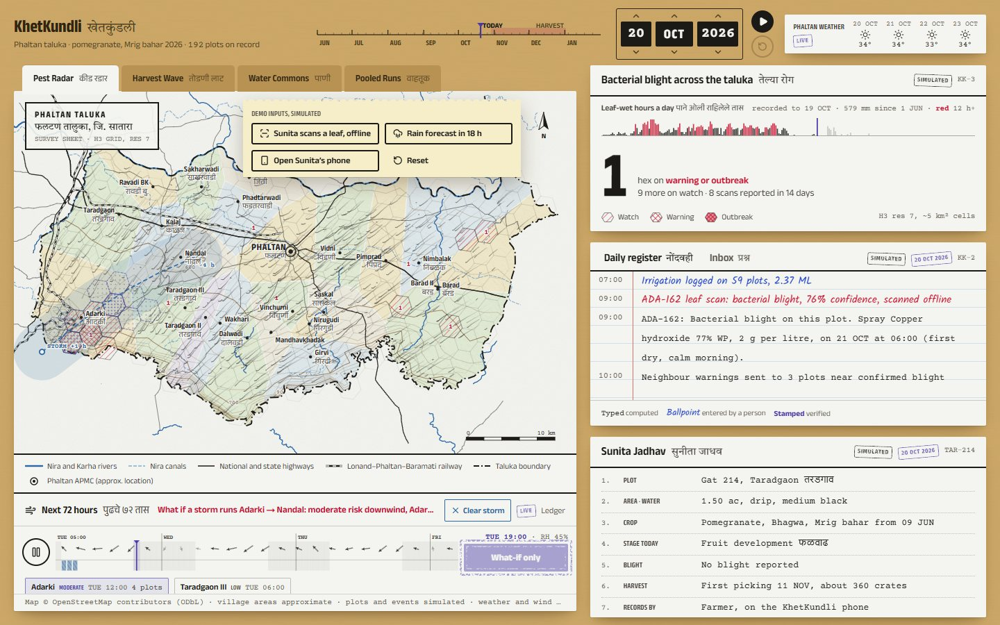

## 6. Season events: the record

Every change to the season is one immutable **season event** (`web/src/lib/events.ts`), validated by a zod contract shared by phone and server.

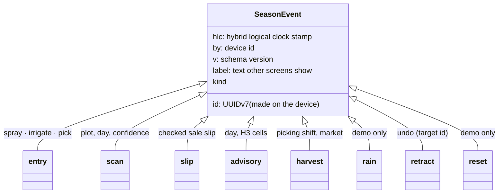

**Folding.** `foldEvents(events)` sorts by clock stamp, drops what precedes the last reset and what was retracted, and where two facts compete for one slot (the same plot, day and kind of entry; one day's advisory; the harvest choice) the later stamp wins. Devices merge events by id (set union), so the same events in any order, with any duplicates, give the same season everywhere. A property test checks this over 10,000 random histories.

**Storage.** The server keeps the events in an append-only, hash-chained table:

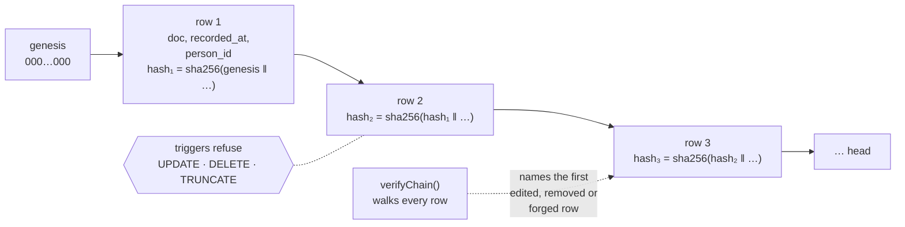

- **Idempotent**: an id already stored is answered *duplicate*; an id reused with different content is *rejected*.
- **Tamper-evident**: an edit made around the triggers (with database access) is found by `GET /api/v1/integrity`.
- **Attributed**: since slice 2, the person who recorded each event is stored and covered by its hash.
- **Proven under crashes**: `npm run test:crash` kills a writer with SIGKILL mid-transaction again and again while it appends 1,000 events; each is stored exactly once and the chain verifies.

## 7. Sync, offline and the relay

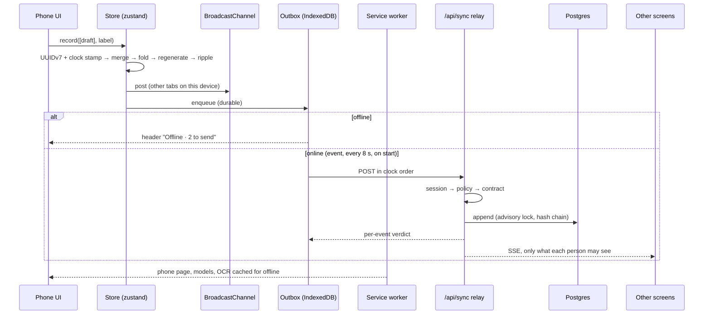

| Message | Sent when | Who may send | Who receives it |
| --- | --- | --- | --- |
| `events` | Any change to the season | Farmer (own plots), staff | Every signed-in screen (farmers too, until slice 3's projections) |
| `escalation` | A question the record cannot answer, or a slip dispute | Farmer (own plot), staff | Staff; the asking farmer |
| `reply` | The officer answers | Staff | Staff; that plot's farmer |
| `message` | An approved advisory batch is sent | Server only | Staff; that plot's farmer |
| `receipt` | A phone receives or opens a message | That plot's farmer, staff | Staff; that farmer |
| `time` | The demo clock moves | Staff only (none in pilot) | Everyone |
| `reset` | Desk → Reset (demo only) | Staff (none in pilot) | Everyone |
| `state` | A screen connects | Server | That screen: events, its inbox, its messages |

## 8. Accounts, sessions and the policy

```mermaid
sequenceDiagram
  participant B as Browser (phone or desk)
  participant A as /api/v1/auth
  participant DB as Postgres
  B->>A: POST otp {phone}
  A->>DB: lock the number → count codes in 10 min (max 3) → store keyed hash (5 min)
  A-->>B: "sent" (same answer for unknown numbers)
  Note over A: demo: code on screen<br/>pilot: FPO desk or SMS
  B->>A: POST verify {phone, code}
  A->>DB: count the try atomically (max 5) → compare in constant time → consume once
  A->>DB: device + session (sha256 of token; 30 days farmer, 12 h staff)
  A-->>B: Set-Cookie kk_phone or kk_desk (http-only, SameSite=Lax)
  B->>A: every request: X-KK-Surface → cookie → person → policy
```

**Sessions per surface.** The phone (`kk_phone`) and the desk (`kk_desk`) keep separate sessions, so the desk can open Sunita's phone in a popup in the same browser and both stay signed in as different people.

**The policy** (`web/src/lib/server/authz.ts`) is pure functions, tested as a matrix of every role against every action:

| Action | Farmer (own plot) | Farmer (other plot) | Officer / FPO admin | Buyer | Nobody |
| --- | :---: | :---: | :---: | :---: | :---: |
| Read the season | ✓ | ✓ | ✓ | ✗ | ✗ (401) |
| Record an entry, scan or slip | ✓ | ✗ | ✓ | ✗ | ✗ |
| Undo | her own only | ✗ | ✓ | ✗ | ✗ |
| Ask, escalate | ✓ | ✗ | ✓ | ✗ | ✗ |
| Reply, prepare and send advisories, status | ✗ | ✗ | ✓ | ✗ | ✗ |
| Backup | ✗ | ✗ | ✓ | ✗ | ✗ |
| Reset, demo rain, move the clock | ✗ | ✗ | demo only | ✗ | ✗ |

**Hardening** (slice 2.5, part 1): codes issued and tried atomically; unknown numbers counted like known ones; client address only from a trusted proxy; a body size limit and an `Origin` check on every POST; security headers; `KHETKUNDLI_MODE=pilot` turns off every demo affordance.

## 9. The models

### 9.1 Scan Lens (on the phone)

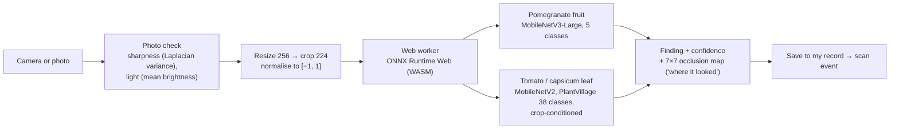

| Model | Trained on | Result | Honest note |
| --- | --- | --- | --- |
| Pomegranate (MobileNetV3, fp32, 16.8 MB) | 5,099 fruit photos, CC BY 4.0, on this laptop's RTX 4060 in about 5 min | 99.7% on 765 held-out photos | One dataset, random split, fruit only, none from Phaltan: an upper bound |
| Tomato and capsicum (MobileNetV2) | PlantVillage | 95.4% on lab photos | Misread two of three field photos |

### 9.2 The slip reader (on the phone)

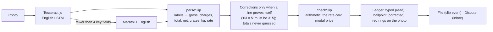

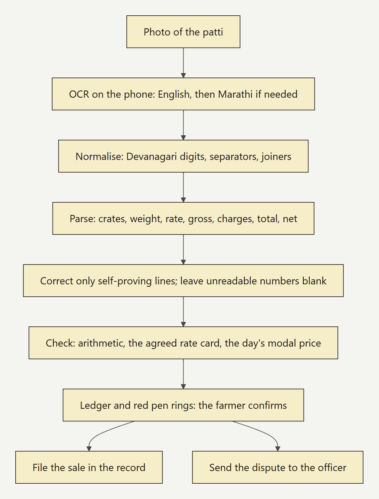

### 9.3 The reasoning agent (on the laptop)

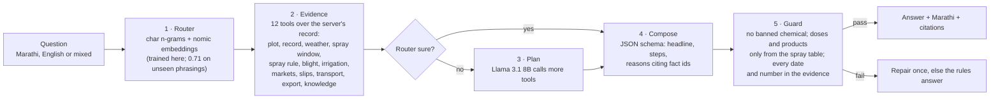

The model is **not fine-tuned**. On 14 test questions: all routed correctly, every delivered answer passed the guard, median 4.6 s on the laptop GPU. Every answer is logged.

### 9.4 Forecast skill

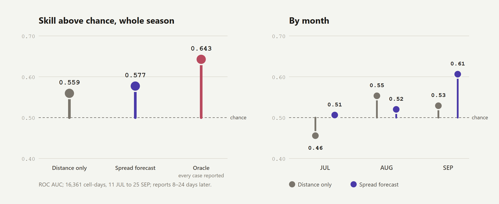

`npm run backtest` scores the 72-hour spread forecast over the recorded season: ROC AUC 0.577 against 0.559 for a distance-only baseline, on simulated reports.

## 10. The screens

### The farmer's phone (`/farmer`)

| Part | What it does | Code |
| --- | --- | --- |
| Sign-in sheet | Mobile number and a 6-digit code, English and Marathi | `components/record/sign-in.tsx` |
| Kundli wheel | The whole season on one dial: stage, rain, water, sprays, scans, pickings; drag to move through time | `farmer/season-wheel.tsx` |
| Today slip | The one thing to do today; 72-hour spray window from the hourly forecast | `farmer/today-slip.tsx`, `lib/farmer.ts` |
| What I did | Log a spray, a watering (or one skipped), a picking; shows what changed; undo | `farmer/log-work.tsx` |
| Around your plot | Radar of the cells within 4 km and the next 72 hours | `farmer/neighbour-pulse.tsx` |
| Picking date and market | Move the picking; compare markets net of freight and charges | `farmer/harvest-date.tsx` |
| Lot passports | A QR per picking | `farmer/lot-passports.tsx` |
| Passbook | Sales, gross to net | `farmer/passbook.tsx` |
| Scan Lens | On-device diagnosis with photo check and "where it looked" | `farmer/scan-lens.tsx`, `public/workers/scan-lens.js` |
| Ask | Voice or typed question; answer read aloud; handed to the officer when needed | `farmer/ask-sheet.tsx`, `agent-answer.tsx` |
| Slip check | Photograph the patti; every number read and checked | `farmer/slip-check.tsx`, `lib/patti.ts` |
| Messages | Advisories with delivered and read receipts | `farmer/messages.tsx` |
| Sync chip | *Synced*, *Sending*, *Offline · N to send* | `farmer/sync-chip.tsx` |

### The taluka desk (`/desk`)

| Part | What it does | Code |
| --- | --- | --- |
| Survey map | The taluka on a survey sheet: villages, roads, canals, contours, H3 cells; layers Pest Radar, Harvest Wave, Water Commons, Pooled runs | `desk/survey-map.tsx`, `map-geometry.ts` |
| Wind field | 460 particles on the live 9-point wind grid | `desk/wind-field.tsx` |
| Spread forecast | 72 hourly frames, ensemble chance, storm brush, *Warn downwind* | `desk/forecast.tsx`, `lib/spread.ts` |
| Figure sheet | Today's numbers: warnings, water kept, pickings | `desk/figure-sheet.tsx` |
| Register and plot extract | The day's entries; one plot's record in its inks | `desk/register.tsx`, `plot-extract.tsx` |
| Advisories console | Prepare a batch, read the SMS in both languages, untick, approve, send, watch receipts | `desk/advisories.tsx` |
| Inbox | Farmers' questions with agent drafts; reply | `desk/inbox.tsx` |
| Status | Models, database, hash chain, sessions, backup and restore drill | `components/status-board.tsx` |

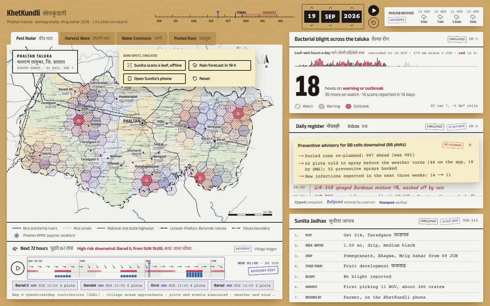

## 11. Data model

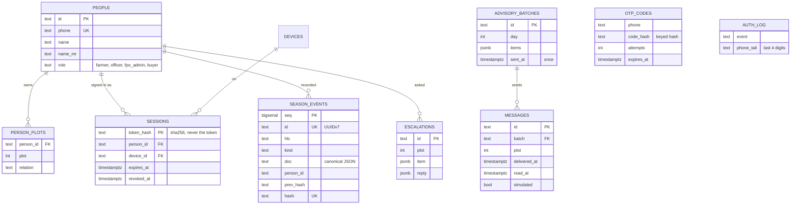

Schema changes are versioned migrations in `web/src/lib/server/schema.ts` (never edit one that has shipped). Live, recorded and simulated data are labelled on every screen: see [DATA.md](DATA.md).

## 12. API reference

| Route | Method | Who | Does |
| --- | --- | --- | --- |
| `/api/v1/auth/otp` | POST | anyone | Issue a code for a number (rate-limited) |
| `/api/v1/auth/verify` | POST | anyone | Check the code, open a session (cookie per surface) |
| `/api/v1/auth/me` | GET | anyone | Who is signed in; mode; demo people (demo only) |
| `/api/v1/auth/logout` | POST | signed in | Sign out here, or `?everywhere=1` |
| `/api/sync` | GET | signed in | Server-sent events: state, then live messages |
| `/api/sync` | POST | signed in | Events, escalations, replies, receipts, clock, reset (policy per kind) |
| `/api/v1/events` | GET, POST | signed in | Pull by cursor; post a batch (a verdict per event) |
| `/api/v1/integrity` | GET | signed in | Walk the hash chain |
| `/api/agent/ask` | POST | farmer (own plot), staff | The five-stage agent, streamed |
| `/api/agent/advisories` | POST | staff | Prepare and store an advisory batch |
| `/api/messages` | GET, POST | signed in / staff | Read messages; send a stored batch once |
| `/api/v1/admin/backup` | GET, POST | staff | List backups; back up now and run the restore drill |
| `/api/status` | GET | staff | Models, record, chain, sessions, codes waiting |
| `/api/weather`, `/wind`, `/ensemble` | GET | anyone | Recorded and live weather, cached hourly, saved for offline |
| `/api/prices` | GET | anyone | Agmarknet with a key; otherwise says it is simulated |

## 13. Testing and proof

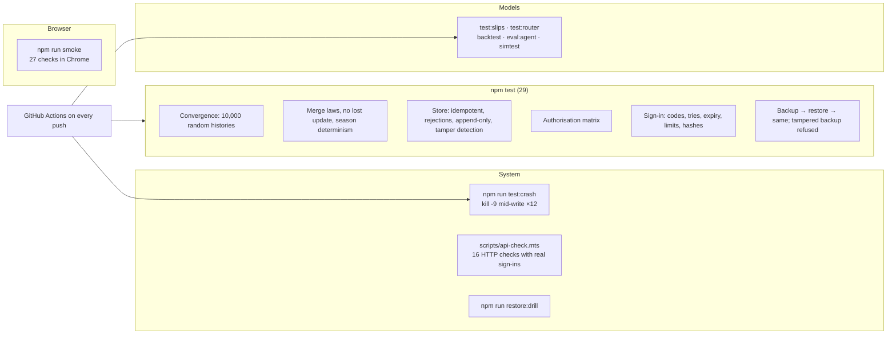

Every test was checked to fail when the code it guards is broken (mutation checks on the fold, the policy and the backup). The **scenario trials** ([SCENARIOS.md](SCENARIOS.md)) test the product the other way: 44 real-life situations with farmers, officers, the market and adversaries, argued for and against.

## 14. Running, deploying, configuring

```bash
cd web
npm install          # also fetches models and WebAssembly runtimes
npm run demo         # starts the app for the laptop and the Wi-Fi, prints a QR for the phone
```

| Command | Does |
| --- | --- |
| `npm run demo -- --https` | Self-signed HTTPS for phones (camera, microphone) |
| `npm run demo -- --offline` | Serve saved forecasts; no internet needed |
| `npm run check` | Types, lint, tests, slips, router |
| `npm run smoke` | 27 browser checks (server running) |
| `npm run test:crash` · `npm run restore:drill` | Exactly-once under crashes · the newest backup restores the same |
| `npm run train:pomegranate` · `npm run train:router` | Retrain on this laptop |

| Setting | Effect |
| --- | --- |
| `KHETKUNDLI_MODE=demo\|pilot` | Demo affordances on or off (people list, on-screen codes, seeding, rain, reset, clock) |
| `KHETKUNDLI_OTP_SINK=screen\|desk\|sms` | Where sign-in codes go (`screen` refused in pilot) |
| `KHETKUNDLI_BOOTSTRAP_ADMIN="+91…,Name"` | The first FPO admin in a pilot |
| `DATABASE_URL` | Use a Postgres server instead of embedded PGlite (`web/data/pg`) |
| `KHETKUNDLI_TRUSTED_PROXY=1` | Believe `X-Forwarded-For` (only behind your own proxy) |
| `KHETKUNDLI_SECRET` | Key for code hashes (otherwise made and kept in the database) |
| `DATA_GOV_IN_API_KEY` | Live mandi prices |
| `KHETKUNDLI_OFFLINE=1` | Serve saved weather only |

**Target deployment** (Phase 2, [PRODUCT-PLAN.md](PRODUCT-PLAN.md)):

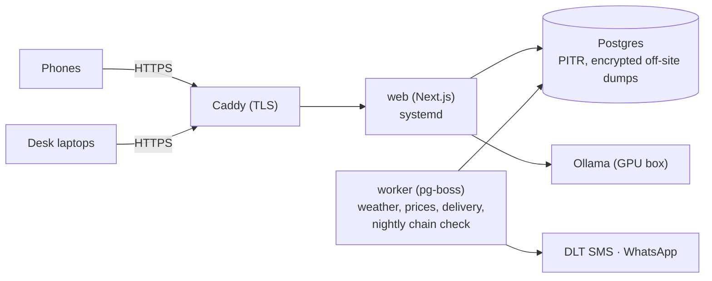

## 15. Repository map

```
KhetKundli/
├─ web/                         the Next.js app
│  ├─ src/app/                  pages (/, /farmer, /desk, /lot/[id], /status) and api/ routes
│  ├─ src/components/           farmer/, desk/, pitch/, lot/, record/ (paper primitives, sign-in), ui/
│  ├─ src/lib/sim/              the season engine (pure)
│  ├─ src/lib/events.ts         season event contract, fold, merge
│  ├─ src/lib/server/           Postgres, event store, identity, policy, relay, backup, mode
│  ├─ src/lib/agent/            router, tools, LLM client, guard, pipelines
│  ├─ src/lib/                  store, sync, outbox, spread forecast, slip parser, OCR, scan, voice
│  ├─ public/                   models, workers, samples, service worker
│  └─ scripts/                  demo, smoke, api-check, crash test, drill, builds, report
├─ ml/                          Python training (Scan Lens, router)
├─ data/raw/                    OpenStreetMap extracts
├─ docs/                        this guide and the rest
└─ .github/workflows/ci.yml     CI
```

A file-by-file guide with recipes for extending the code is [CODEBASE.md](CODEBASE.md).

## 16. Limits today

Stated plainly, because the product depends on being honest about them:

- **The 192 farmers are synthetic.** Two demo farmers have accounts; the rest of the network is simulated and labelled so.
- **Model parameters are hand-calibrated**, not fitted to field data; the pomegranate model's accuracy is an upper bound.
- **Farmers still receive every plot's raw events** (the season is computed on each screen); server-side projections with consent are slice 3.
- **Sign-in codes are shown on screen in demo mode**; SMS needs DLT registration (Phase 2).
- **The scenario trials found 29 of 44 real-life situations failing** for their users today. The fixes are ordered in slice 2.5 of [REMAINING.md](REMAINING.md): a lossless outbox, private lot passports, a record that says only what is true, officer control, encrypted backups, honest guidance.
